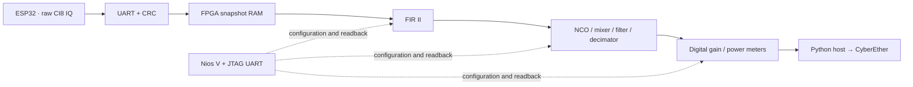

# ESP32 → Agilex 3 IQ Pipeline Lab

Five independently editable **Quartus Visual Designer Studio** checkpoints for the **Terasic Atum A3 Nano**, plus a focused notebook and browser demo for each step.



This example includes the **five checkpoints and IQ Pipeline Lab**. The earlier Wi-Fi packet/header receiver and XDNA demo are separate designs and are outside this branch.

The [FIR notebook](notebooks/03_fir_filter.ipynb) includes [15 reloadable filter examples](docs/FIR_FILTER_LIBRARY.md), response plots, Python controls and a browser coefficient editor. Try the 4 MHz notch on the clean FPGA two-tone input; the page verifies the applied taps and measured output.

**Modem Lab:** [notebook 08](notebooks/08_modem_lab.ipynb) and [run guide](docs/MODEM_LAB.md) demonstrate BPSK → QPSK → 16-QAM → 64-QAM, synchronization, soft decoding and BER. A separate [VDS modem checkpoint](fpga_hub/iq_bridge/vds_demo_06_modem/README.md) implements the FPGA symbol/FEC path. [Implementation status](docs/MODEM_IMPLEMENTATION_STATUS.md) distinguishes Python, RTL, hardware and the unresolved original-ESP32 IQ transmitter. [Full roadmap](docs/RF_MODEM_BPSK_TO_64QAM_PLAN.md).

**FPGA Preamble Lab:** [notebook 10](notebooks/10_fpga_preamble.ipynb) and [guide](docs/FPGA_PREAMBLE_LAB.md) add raw-IQ differential QPSK training detection. Clean/saved-IQ replay and passive RF checks use no transmitter commands. Checkpoint08 retains SPI and FIR in parallel with the detector.

**Original ESP32 TX bring-up:** [measured RF results and plots](docs/ESP32_TX_BRINGUP_RESULTS.md), [bounded diagnostic firmware](firmware/esp32_tx_probe/README.md), and repeatable CW/OOK checks. PMOD A sends; RFS2 receives; the FPGA transports captures. Arbitrary-IQ TX remains a separate investigation.

## Contents

| Checkpoint | Folder under `fpga_hub/iq_bridge/` | VDS blocks | Adds |
|---|---|---:|---|
| [1 · Raw IQ bridge](#checkpoint-1--raw-iq-bridge) | `vds_demo_01_raw` | 6 | Three radio UARTs, host UART, framing, CRC and capture RAM |
| [2 · Nios V monitor](#checkpoint-2--nios-v-monitor) | `vds_demo_02_nios` | 11 | Processor, RAM, JTAG UART, counters and status |
| [3 · FIR II](#checkpoint-3--fir-ii) | `vds_demo_03_fir` | 13 | Reloadable 16-tap filter and paired raw/filtered readback |
| [4 · DDC](#checkpoint-4--ddc) | `vds_demo_04_ddc` | 16 | Frequency translation, I/Q FIR filters and decimation |
| [5 · Gain and meters](#checkpoint-5--gain-and-meters) | `vds_demo_05_gain` | 17 | Saturating digital gain and integer power/peak/clip meters |
| [7 · SPI and FIR](docs/SPI_PIPELINE_LAB.md) | `vds_demo_07_spi_fir` | 13 | PMOD B SPI ingress and exact paired FIR checks |
| [8 · Preamble](docs/FPGA_PREAMBLE_LAB.md) | `vds_demo_08_preamble` | 14 | Raw-IQ training correlation, score trace and coarse alignment |

RTL, Nios firmware and the native VDS construction/connection Tcl definitions are included. The editable `.vds` diagrams and vendor IP parameter caches are regenerated from those definitions. Vendor HDL, synthesis databases, bitfiles, SDKs, Python environments, captures and credentials are generated/downloaded locally. The small CI8 files under `cyberether/samples/clean-ddc` are deterministic synthetic test fixtures, not RF recordings.

Learn the radio side in the [ESP32 SDR firmware notebook](notebooks/07_esp32_sdr_firmware.ipynb): offline controls, IQ simulation, packing and UART bandwidth.

The five notebook pages now include [visual feature checks](docs/NOTEBOOK_DEMOS.md): aligned before/after graphs, requested/applied evidence, FPGA test-input buttons where available, and clearly separate software previews.

## Demo night: RF Arcade

Open the [RF Arcade setup notebook](notebooks/06_rf_arcade.ipynb) for the guided build → program → launch workflow and the demo sequence.

[**RF Arcade**](docs/RF_ARCADE.md) adds a fullscreen presentation with a live waterfall, spectral peak memory, glowing IQ samples, a tone-rescue challenge and FPGA clipping/harmonic effects. One **Showreel** button runs the hardware scenes automatically. It uses checkpoint 5 without RTL or firmware changes.

```bash
.venv-notebooks/bin/python scripts/demo_night.py --host <host-LAN-IP>
```

## Run the notebooks locally

Start with [the notebook guide](notebooks/README.md). Each checkpoint has a Python model, plots, a PNG exported by the actual VDS GUI, an RTL simulation, an FPGA build/program step and its own focused CyberEther page.

The new [RF Link Lab](docs/RF_BPSK_WALKTHROUGH.md) adds a compact original-ESP32
framed BPSK/QPSK experiment to notebook08. Start its page with
`.venv-notebooks/bin/python scripts/start_rf_link_lab.py start` (port 8770).
**Clean reference** and **FEC challenge** use clearly labelled synthetic input;
**Capture RF** needs the explicitly installed v4/v5 probe (QPSK: v5) and runtime FPGA hub.
Actual framed RF, same-capture FPGA FIR and separate FPGA demapper/FEC replay
are hardware-tested; the [walkthrough](docs/RF_BPSK_WALKTHROUGH.md) records their
processing boundaries and measured error counts.

[BER qualification](docs/BER_QUALIFICATION.md) compares hard/soft FEC on identical synthetic samples and audits physical RF separately. [QPSK qualification](docs/QPSK_QUALIFICATION.md) documents the measured 12 µs operating point and shorter-period failures. The [SPI transport prototype](docs/SPI_TRANSPORT.md) has separate firmware/FPGA images; installing it is an explicit hardware step.

The separate [SPI IQ Pipeline Lab](docs/SPI_PIPELINE_LAB.md) runs on port8771. Opening it does not acquire RF; the installed SPI meter supports explicit test-pattern or passive-RF runs, and SPI-plus-FIR checkpoint07 has passed bounded hardware verification.

Use a **Linux x86-64 desktop where the FPGA tools are installed**. This can be your host or a desktop inside a container. Run the installer and Jupyter in that same environment; Docker is not required by the notebooks.

- Quartus Prime Pro **26.1.1 Build 130**, Agilex 3 device support, RiscFree RV32 tools, Nios V `elf2hex` and `juart-terminal`.
- Questa Altera FPGA **2025.3** for RTL/IP simulations.
- Python **3.12**, a C compiler, Graphviz and a Vulkan-capable display for CyberEther.
- A working desktop `DISPLAY` for native VDS generation. The tools and Jupyter need access to the board's UART and JTAG cable.

```bash
cd esp32_agilex3_iq
# Paths are optional when installed under /opt/altera or available on PATH:
export QUARTUS_ROOTDIR=/opt/altera/quartus
export QUESTA_ROOT=/opt/altera/questa_fse
export ATUM_ALTERA_ROOT=/opt/altera
bash scripts/install_local.sh --system  # Debian/Ubuntu prerequisites + venv + CyberEther
.venv-notebooks/bin/python scripts/check_tools.py
.venv-notebooks/bin/jupyter lab notebooks --no-browser
```

Choose the **Atum A3 IQ Demos** kernel in Jupyter or VS Code. Omit `--system` if system packages are already installed. The installer downloads the pinned CyberEther AppImage, extracts it locally and installs its Python dependencies into `.venv-notebooks`. Proprietary FPGA tools are not distributed here.

For a different RiscFree installation, set `ATUM_RISCV_GCC`, `ATUM_RISCV_SIZE` and `ATUM_ELF2HEX` to executable paths. The UART is detected from an Atum A3 Nano by-id link or its USB identity, including container device mappings without by-id links. Set `ATUM_UART` to override detection or select among multiple boards, and set `ATUM_JTAG_CABLE` for your board. The notebook configuration cell accepts the same environment settings. An invalid explicit UART path is reported rather than silently replaced.

Existing host-to-container scripts remain available as an optional compatibility mode: explicitly set `ATUM_TOOLS_MODE=docker`, `ATUM_CONTAINER` and, if mount discovery is unsuitable, `ATUM_CONTAINER_ROOT`. Prefer running Jupyter beside the tools for the complete notebook workflow.

## Official Nios V software IDE

Checkpoints 2–5 now have generated HAL BSPs, editable Hello World / IQ monitor applications and RiscFree run configurations. See [the Nios V IDE guide](software/README.md).

```bash
.venv-notebooks/bin/python scripts/nios_software.py 2 --open
```

This creates `software/checkpoint_02/{bsp,hello_world,iq_monitor}` and launches **Ashling RiscFree IDE for Altera FPGAs**. Import the BSP and app separately with **File → Import Nios V CMake project**. Each processor notebook has a `lesson.software()` cell.

## Build from source

Run from a terminal beside the installed tools, at this example's root:

```bash
# One checkpoint, or all five; all regenerations start from the native Tcl definitions.
.venv-notebooks/bin/python scripts/build.py 1
# Prepare the native diagram/IP without waiting for fitting:
.venv-notebooks/bin/python scripts/build.py 1 --generate-only
.venv-notebooks/bin/python scripts/build.py all --jobs 2
```

For each checkpoint the script rebuilds Nios firmware when present, recreates/connects the VDS system, regenerates vendor IP, then performs a full Quartus compilation. It writes an ignored `BUILD_RESULT.json` with fitted allocation, reported timing slack and bitfile SHA-256. These results establish a successful build, not new hardware qualification.

To run the same sequence manually, in a checkpoint directory:

```bash
export PATH=/opt/altera/quartus/bin:$PATH
bash scripts/build_firmware.sh       # checkpoints 2–5 only
quartus_sh -t scripts/create_vds.tcl
quartus_sh -t scripts/connect_vds.tcl
quartus_sh --flow compile iq_bridge_vds
```

### Linked, complete Quartus projects

Every `scripts/build.py` run prints a **Quartus project** path and a **Project ZIP** path. Notebook `lesson.generate()` and `lesson.build()` display clickable links for both, including cached builds. For already generated designs, refresh these exports with:

```bash
.venv-notebooks/bin/python scripts/quartus_project.py all
```

**Download the ZIP, extract it, open its `iq_bridge_vds.qpf`, then choose Processing → Start Compilation.** Keep the QPF with its sibling files; downloading the QPF alone is insufficient. Use Quartus Prime Pro 26.1.1 with Agilex 3 device support. No serial/JTAG access or FPGA programming is involved in compilation.

The prepared project explicitly includes **`iq_bridge_vds.sdc`**, board RTL/pins, the generated system **and every leaf-IP QIP**, vendor HDL/IP constraints, and Nios initialization HEX where present. `PROJECT_FILES.json` lists/hashes the packaged inputs. The GUI screenshot project's copy now includes the same files and SDC, too.

The ZIP is a generated-HDL snapshot, so it compiles directly in Quartus without the ESP32 SDK or Nios compiler. Native VDS diagrams and their Tcl definitions are included; follow `OPEN_IN_QUARTUS.md` inside the ZIP to view the diagram or regenerate edited Tcl definitions. These generated files are local exports and are not committed as vendor source.

| Lesson | Tracked timing constraints |
|---|---|
| 1 · Raw IQ | [SDC](fpga_hub/iq_bridge/vds_demo_01_raw/iq_bridge_vds.sdc) |
| 2 · Nios monitor | [SDC](fpga_hub/iq_bridge/vds_demo_02_nios/iq_bridge_vds.sdc) |
| 3 · FIR | [SDC](fpga_hub/iq_bridge/vds_demo_03_fir/iq_bridge_vds.sdc) |
| 4 · DDC | [SDC](fpga_hub/iq_bridge/vds_demo_04_ddc/iq_bridge_vds.sdc) |
| 5 · Gain | [SDC](fpga_hub/iq_bridge/vds_demo_05_gain/iq_bridge_vds.sdc) |

To check portability yourself, extract/compile the ZIPs in fresh directories:

```bash
.venv-notebooks/bin/python scripts/quartus_project.py all --verify --jobs 2
```

### Open in Visual Designer Studio

After generating the checkpoint, in your desktop terminal:

```bash
cd <path-to-this-example>/fpga_hub/iq_bridge/vds_demo_01_raw
/opt/altera/quartus/bin/quartus iq_bridge_vds.qpf
```

Choose **Tools → Visual Designer Studio**, then open:

```text
src/vds/iq_bridge_system/iq_bridge_system.vds
```

Use **Ctrl+Alt+W** to fit the diagram. The `.vds` is the editable design; `gen/` contains generated HDL. Follow the [connection-by-connection walkthrough](docs/VDS_WALKTHROUGH.md) to explain or extend each stage. Opening or compiling a project does not program the FPGA.

### Atum A3 Nano in the project wizard

Generate the tiny board starter ZIP from these sources:

```bash
python3 scripts/board.py
```

After preparing checkpoint 1, run the installer with write access to the Quartus installation (normally as root):

```bash
python3 scripts/board.py --install
```

Restart Quartus, then **File → New Project Wizard → Example Design → Find Options → Pre-installed → Family Agilex 3 → Development kit Terasic Atum A3 Nano**. Select **Atum A3 Nano IQ Bridge - VDS Education Starter**. Clear old family filters if necessary. Verify device **A3CZ135BB18AE7S** after importing. This installs a local example/template, not a universal board preset for every IP. It backs up the existing catalog and preserves unrelated entries.

## Checkpoint 1 · Raw IQ bridge

`vds_demo_01_raw`: ESP32 bursts enter as signed interleaved **CI8** (`I,Q` bytes). The FPGA validates capture framing/CRC, stores a frozen burst and sends CRC-protected **IQB1** frames to the host. Three sources are addressable; this is not synchronous RF sampling across three radios.

## Checkpoint 2 · Nios V monitor

`vds_demo_02_nios`: Nios V reads coherent transfer counters and reports through **JTAG UART**. This control/status path is separate from the FTDI sample-data UART. Firmware is bare-metal RV32I; the processor does not filter each sample.

## Checkpoint 3 · FIR II

`vds_demo_03_fir`: vendor **FIR II** supplies reloadable 16-tap boxcar/Hamming filters. Capture wrappers select raw/filtered output, implement rounding and saturation, and associate both outputs with one input CRC and capture identity.

## Checkpoint 4 · DDC

`vds_demo_04_ddc`: sample-driven phase accumulation and an NCO/mixer translate frequency; two **FIR II** instances filter I/Q before decimation by 1, 2 or 4. This processes frozen bursts in FPGA RAM. It is not a sustained 16–80 MS/s host stream. Synthetic single-tone/two-tone/impulse generators give clean teaching inputs without transmitting RF.

## Checkpoint 5 · Gain and meters

`vds_demo_05_gain`: Q8 digital gain, signed CI16 saturation, integer power sums, peaks and clipping counters. The final image supports all browser lessons through runtime controls; switching lesson tabs does not load another bitfile.

## Simulation and tests

```bash
.venv-notebooks/bin/python -m unittest discover -s cyberether/tests -v
.venv-notebooks/bin/python scripts/simulate.py
```

The short standalone Questa lesson checks **bypass, 0.5×, 2×, saturation and zero gain**, including exact output integers and power meters. It produces `simulation/gain.wlf` and `gain.vcd`; these are ignored by Git.

In your desktop terminal:

```bash
cd <path-to-this-example>/simulation
/opt/altera/questa_fse/bin/vsim -gui -view gain.wlf -do view.do
```

The included simulation tests the gain RTL directly, not Nios instruction execution or the complete vendor FIR system. The host tests check transport CRC/bounds, integer DSP references, browser control validation/authentication and deterministic fixtures. Fresh-build and test evidence is summarized in [VALIDATION.md](VALIDATION.md).

## Hardware and firmware

Target part **A3CZ135BB18AE7S**, clock **50 MHz**. The supplied QSF files contain the exact board pin assignments:

| Signal | FPGA pin |
|---|---|
| CLOCK1_50 | A8 |
| HOST_RX / HOST_TX | L1 / T6 |
| RFS2_TX / RFS2_RX | H13 / K13 |
| PMOD0_TX / PMOD0_RX | AB9 / P6 |
| PMOD1_TX / PMOD1_RX | AK1 / AJ6 |

Signal names are FPGA top-level port names; follow the board's connector documentation when wiring. Use 3.3 V logic and common ground. SDR/control UART is nominally **2 Mbaud**, while monitor mode uses **115200 baud**. The installed suite changes modes through software restarts; routine use needs no ESP32 reset buttons.

The original ESP32 firmware source is in `unified/`. Its **ESP-SDR-derived GPLv3 source and license** are retained. SDK/dependency revisions are pinned in `scripts/fetch.py`. A fresh firmware build is optional when the existing modules already run this suite:

```bash
python3 scripts/fetch.py firmware
bash scripts/build_firmware.sh
```

The [firmware/programming guide](docs/ESP32_FIRMWARE.md) covers both **RFS2 and Digilent Pmod** UART profiles, the flashing utility, and the temporary FPGA programming bridge. Build Pmod firmware with `bash scripts/build_firmware.sh pmod`; it uses GPIO17/16 during normal operation.

```bash
.venv-notebooks/bin/python scripts/flash_esp32.py --module pmod-a --port /dev/ttyUSB0 --dry-run
```

The first SDK installation may download its toolchain and Python environment. Use `IDF_TOOLS_PATH` to choose a separate tools cache. Initial flashing requires your UART/programming wiring and boot-mode handling; the build script does not flash or reset a module. ESP32-S3/S31 and other chip variants are intentionally outside this example.

## Run IQ Pipeline Lab

First stop any existing acquisition service using the board. The loader refuses to program while it detects a serial owner; it does not stop another checkout's demo.

```bash
# Terminal beside the tools, from this example root:
export ATUM_UART=/dev/serial/by-id/<your-Atum-serial-device>
export ATUM_JTAG_CABLE='Atum A3 Nano [your-cable-id]'
.venv-notebooks/bin/python scripts/run.py load
.venv-notebooks/bin/python scripts/run.py serve --host <host-LAN-IP>
```

The UART is auto-detected when `ATUM_UART` is unset; the default JTAG cable name retains the original rig's identifier. Set the cable for another board. `serve` uses the foreground terminal; **Ctrl+C** stops the lab cleanly. Native viewer port is **8687**, controls **8768**, TCP media **40100–40103**. For alternate ports set `ATUM_VIEWER_PORT`, `ATUM_CONTROL_PORT`, and `ATUM_MEDIA_RANGE` before starting. The service binds to the explicit host IP, not a wildcard. No router credentials are needed.

Open the private URL saved to **`cyberether/run/iq-bridge-lab/control-invite.json`**, using your normal host browser. The page contains ordinary HTML controls and embeds the native CyberEther video. Its title is **IQ Pipeline Lab**. Do not use port 8687 alone when you need the lesson controls. Tokens are created at runtime and never committed.

Optional, with the lab already running in another terminal:

```bash
.venv-notebooks/bin/python scripts/verify_hardware.py --host <host-LAN-IP>
```

This selects RFS2 on channel 2 for fresh Hamming captures, then switches to FPGA-generated two-tone input, decimation 4 and 2× digital gain. It verifies physical readback against independent integer references and saves its result under the ignored lab run directory.

Try **Raw IQ Bridge → Boxcar FIR → Hamming FIR**, then **Tune / Filter / Decimate → FPGA clean two-tone → Reject interferer / Show alias**. Compare **0.5× / 1× / 2×** gain; pin a comparison; then choose **Live ESP32 bursts** for RF.

The host performs transport, independent integer-reference checks, display FFT and plotting. **FIR/DDC/gain/meter arithmetic runs on Agilex 3 FPGA.** Scatter plots are IQ, not recovered Wi-Fi/QPSK symbols. ESP32 acquisition is sparse, relative-power data with a configured nominal sample rate, not calibrated RF metrology. FPGA receipt ticks do not establish RF sample synchronization. Resource bars show compiled allocation, not live DSP activity.

## Licensing and upstream dependencies

See [NOTICES.md](NOTICES.md). CyberEther, ESP-IDF, ESP-DSP, ESP-SDR and the proprietary FPGA IP retain their own licenses. The repository's root MIT license does not replace those notices. The bootstrap downloads the pinned CyberEther binary and compiles the small local GStreamer registration shim; neither binary is stored in Git.

## Project agent instructions

[AGENTS.md](AGENTS.md) points agents to the local [SKILL.md](SKILL.md), which describes the build, notebook, firmware, Nios, hardware and RF Arcade workflows. The skill stays with this example and does not change global agent settings.

Planned extension: [two-ESP32 Wi-Fi gateway through Agilex 3](docs/WIFI_GATEWAY_FPGA_PLAN.md), including packet forwarding and a separately gated raw-IQ PHY/MAC track.

Planned modem demo: [three-ESP32 modulation, demodulation and FEC](docs/SDR_MODEM_FEC_PLAN.md), with TX/RX/monitor roles, recovered constellations and measured BER comparisons.

### FPGA 64-QAM constellation and BER

[The FPGA 64-QAM BER guide](docs/FPGA_64QAM_BER.md) runs checkpoint06's actual
encoder/mapper → Nios noisy symbol replay → FPGA soft demapper/Viterbi. The
viewer puts the constellation and pre-/post-FEC counters together, with a
100,096-payload-bit sweep at each of 12, 16 and 20 dB. Build/program explicitly,
then run `python scripts/start_qam64_lab.py start` (port 8773). This needs no
ESP32 changes and transmits no RF. Notebook08 includes optional launch and
hardware sweep cells. Noise is explicitly labeled approximate Gaussian.

The same server offers a compact [TX/RX presentation layout](docs/FPGA_64QAM_BER.md#social--presentation-layout) at `/poster`: a 2×3 constellation grid with FPGA pipeline diagrams and pre-/post-FEC results. A measured example PNG is included for social posts. This view never starts hardware.
