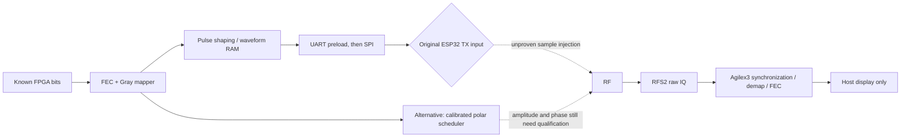

# Custom FPGA-generated QAM: execution plan

Target: installed original ESP32s and Atum A3 Nano / Agilex3. Preserve native
Wi-Fi64-QAM as a separate working demo. No replacement hardware is assumed.

## Architecture and gates



| Gate | Work and acceptance | Status |
|---|---|---|
| 0 Preserve | Private native-A full-flash backup, source/image hashes, current stage11 restore path | Fresh4MiB native backup verified; V1 flash/digest and stage11 restoration passed |
| 1 Source review | Find a concrete original-chip sample selector, packing, clocks, start/stop; no copied S3 register guesses | No sample input established |
| 2 Amplitude diagnostic | CONTROL and ATTEN120..127, requested3..50ms, two seconds quiet; independent raw RX, invariant/restore checks | V1 stable RF amplitude change measured; no fine amplitude law yet |
| 3 Polar calibration | Transfer curve, AM/PM, settling, phase directions and repeatability against unchanged-code controls | V2 stack failure recorded; V3 correction built, pending installation / RF test |
| 4 Backend decision | Direct IQ playback if demonstrated; otherwise calibrated polar TX, or explicit unresolved result | Pending evidence |
| 5 FPGA implementation | Known bits, framing/pilots, K7 FEC, BPSK→QPSK→16-QAM→64-QAM, calibrated waveform/polar schedule | Replay mapper/FEC already works; RF backend pending |
| 6 Complete RX | On-device acquisition/CFO/timing/equalization/soft demap/FEC/CRC, each module simulated and tested | Native Wi-Fi Nios receiver exists; custom waveform integration pending |
| 7 RF qualification | Same-capture64 states, EVM, failures, pre/post BER with denominators and >=100000 unique payload bits per point | Not yet measured |

## First hardware experiment

V1 stable-amplitude gate has now run on hardware. Repeated CONTROL RMS96–97ADC
units versus code120 RMS4.20–4.25, with later TX-off1.05–1.12 and no rail hits at
manual RX gain0. See [results and plot](ORIGINAL_IQ_AMPLITUDE_RESULTS.md).
The initial clipped AGC run and initialization-only run are excluded. All370
host tests pass. These observations do not establish phase continuity, a gain
law,9radii/52directions, arbitrary IQ or custom QAM.

The narrowest supported lead is tone attenuation, not guessed SRAM playback.
Install the separate `atum_original_iq_tx_probe` image on PMOD A only; RFS2 and
PMOD B remain unchanged. Startup does not initialize RF. Use manual BOOT/reset
workflow, MAC verification, full4MiB rollback, and esptool hash verification.
Restore the exact stage11 SOF and dedicated receiver ELF after programming.

Run one explicit CONTROL50 job first. Initialization consumes its budget and may
cancel it; this is not a failed amplitude result. After cooldown, run another
CONTROL, then ATTEN120, then one incremental candidate. Stop if canonical fields,
restoration, readbacks or independent receiver headroom fail. Do not run a blind
register sweep. Native TX firmware must be restored if the probe is rejected or
before resuming the native Wi-Fi demonstration.

Existing slow plateau jobs can establish relative amplitude at stable times.
They **cannot** establish phase continuity across transitions from independent
snapshots. A16380-sample40MS/s capture is only409.5us, shorter than the millisecond
plateaus. Add a separately tested, short repeated microsecond transition mode
or a hardware-timed capture only after stable-amplitude qualification. Never
splice captures and claim a chronological constellation.

Independent raw samples and register records are the experimental evidence.
Offline Python analysis may audit this engineering gate; it is not the final
display-only-host FPGA pipeline. Report RF gain/phase/settling separately from
host trigger latency, and never call a register-off readback measured RF-off.
The guard clears known tone enables repeatedly, but vendor PHY calls can block
or re-key: a requested50ms software limit is not proven physical RF cutoff.

## Why the polar gate matters

Square64-QAM needs nine radii and52 directions, about16.902dB radial dynamic
range. Previous phase-pulse QPSK is insufficient. Before coding a64-QAM scheduler,
measure amplitude transfer and phase continuity, then a slow16-QAM frame with
training and CRC. Advance only on measured error/settling limits.

## Executable preparation

Run locally beside the pinned SDK and Quartus tools:

```bash
bash scripts/build_original_iq_probe.sh
.venv-notebooks/bin/python -m unittest cyberether.tests.test_original_iq_probe cyberether.tests.test_esp32_flash -v
.venv-notebooks/bin/python scripts/analyze_original_polar_qam.py --self-test --output cyberether/run/custom-qam-requirements.json
# Prints a validated command; does not open the UART or flash:
.venv-notebooks/bin/python scripts/flash_esp32.py --module pmod-a --build-dir build-original-iq-tx-probe --port /dev/ttyUSB0 --dry-run
# After explicit installation, normal boot and restoration of stage11 only:
.venv-notebooks/bin/python scripts/original_iq_control.py --transmit --expect-mac 78:21:84:d4:4f:98 --milliseconds 50 --rx-gain 0 --output cyberether/run/new-original-iq-control.json
# Only after V2 installation: unchanged-code repeated-transition control first.
.venv-notebooks/bin/python scripts/original_iq_control.py --transmit --expect-mac 78:21:84:d4:4f:98 --level 0 --train-period-us 32 --milliseconds 30 --rx-gain 0 --output cyberether/run/new-original-iq-train-control.json
```

The one-job controller checks the image platform and target identity, requests a
single bounded job, saves a CRC-checked raw snapshot without DSP, matches job IDs,
and attempts STOP/idle/bridge/mirror cancellation and gain restoration in cleanup.
It assigns no plateau or transition label to the capture. It never programs,
automatically repeats, estimates BER, or declares QAM qualification.

Actual install requires two human reset presses because EN/reset is not wired
to the FPGA. The operator loads ROM bridge only once the firmware, rollback and
runtime restore are verified, then requests the first press. No user button
press, IQ path or RF success is inferred from compile/test success.

## Source review, October21

Rechecked primary repositories, including
[esp-sdr-zephyr](https://github.com/cyber-murmel/esp-sdr-zephyr), HEAD
`58db280a11c0c12760064af647794c25d81fa967`. Its README identifies S3 and C5/C6
paths, not a demonstrated original-ESP32 playback backend. Broader third-party
claims about "all ESP32" do not establish support for these installed chips.
[esp32-iq-tx](https://github.com/whstudio123/esp32-iq-tx) also identifies S3/S31.
Keep [the detailed research](ORIGINAL_IQ_TX_RESEARCH_20261021.md) and
[full custom-IQ plan](CUSTOM_IQ_64QAM_OTA_PLAN.md) as the evidence baseline.

Completion means a complete custom frame over RF decoded on-device with retained
measurements, not a pretty alphabet, native Wi-Fi packet or synthetic replay.
