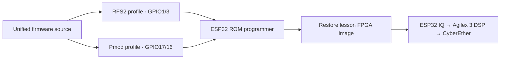

# ESP32 firmware and programmer

Start with the [offline firmware notebook](../notebooks/07_esp32_sdr_firmware.ipynb) for diagrams and editable control/signal simulations. It does not access hardware.

The complete original-ESP32 RF-suite source is included in [`unified/`](../unified/). One application supports **Wi-Fi monitoring**, **CSI on a known 2.4 GHz network**, and **ESP-SDR IQ capture**. The five FPGA lessons and RF Arcade use its SDR burst mode. It is ESP-SDR-derived GPLv3 code; the license and upstream revision pins are included.



## Build the two profiles

Run beside the SDK/tools, on your host or inside your desktop container:

```bash
bash scripts/build_firmware.sh rfs2
bash scripts/build_firmware.sh pmod
```

`pmod-a` and `pmod-b` are aliases for the same Pmod build. The script fetches the pinned SDK/upstream dependencies if needed, installs missing SDK tools, and builds the application, bootloader and partition table. SDK setup is serialized; healthy environments are reused. An existing checkout of the **same pinned ESP-IDF revision** can be selected with `ATUM_ESP_IDF`; `IDF_TOOLS_PATH` selects the tools cache.

| Module | Build folder | Application TX / RX | ROM TX / RX |
|---|---|---|---|
| RFS2 ESP32 | `build-esp32` | GPIO1 / GPIO3 | GPIO1 / GPIO3 |
| PMOD A ESP32 | `build-esp32-pmod` | GPIO17 / GPIO16 | J2.1 GPIO1 / J2.2 GPIO3 |
| PMOD B ESP32 | `build-esp32-pmod` | GPIO17 / GPIO16 | J2.1 GPIO1 / J2.2 GPIO3 |

Each folder has IDF's `flasher_args.json` plus `FIRMWARE_BUILD.json` with the Python interpreter, SDK commit and SHA-256 hashes. Builds use separate SDK config files, so Pmod UART settings cannot leak into the RFS2 profile. Keep these generated folders out of Git. Changing defaults in an existing configured build may require `idf.py menuconfig` or a fresh build directory.

## Direct USB-to-UART adapter

Use a 3.3 V logic adapter and common ground. On a Pmod, adapter TX goes to **J2.2 RX**, adapter RX to **J2.1 TX**, and GND to **J2.3**. **J2.4 is GPIO0, not a power input.** Use one intended power supply. Hold GPIO0 low while resetting to enter the ROM loader. Release it and reset again for normal application boot.

```bash
# Inspect the exact command and pin profile first; no serial port is opened:
.venv-notebooks/bin/python scripts/flash_esp32.py \
  --module pmod-a --port /dev/ttyUSB1 --dry-run

# Read the selected target's identity without writing flash:
.venv-notebooks/bin/python scripts/flash_esp32.py \
  --module pmod-a --port /dev/ttyUSB1 --action info

# Flash only that target; optionally require the MAC printed by info:
.venv-notebooks/bin/python scripts/flash_esp32.py \
  --module pmod-a --port /dev/ttyUSB1 --expect-mac aa:bb:cc:dd:ee:ff
```

Use your actual port and MAC. The default is manual reset, 115200 baud and no DTR/RTS reset sequence. `--reset auto` is for an adapter with the appropriate EN/GPIO0 reset circuit. The utility uses the esptool Python recorded by the build; override it with `--esptool-python /path/to/python` if needed. [Espressif reset behavior](https://docs.espressif.com/projects/esptool/en/latest/esp32/esptool/advanced-options.html).

The utility checks module/pin profile, build hashes and image bounds before writing. It refuses a busy serial port. `--action verify` compares the images with flash. Esptool also verifies writes during normal flashing. It writes the bootloader at **0x1000**, partition table at **0x8000** and app at **0x10000**, using IDF's actual manifest. It does not erase the whole flash/NVS or configure Wi-Fi credentials.

## Existing Atum USB UART and FPGA bridge

The running lesson's IQB1 protocol is **not** a transparent ROM programmer. This repository includes a separate, clockless bridge at [`fpga_hub/esp32_programmer`](../fpga_hub/esp32_programmer/esp32_programmer.sv). Its pin assignments match the existing RFS2 JP1 → Pmod J2 wiring:

| RFS2 JP1 | FPGA pin | Pmod connection |
|---|---|---|
| 1 | F27 | A J2.2 RX |
| 2 | B14 | A J2.1 TX |
| 3 | H27 | A J2.4 GPIO0 |
| 5 | Ground | A J2.3 GND |
| 7 | B19 | B J2.2 RX |
| 8 | F21 | B J2.1 TX |
| 9 | A14 | B J2.4 GPIO0 |
| 11 | Ground | B J2.3 GND |

The main Pmod J1 connector supplies power and carries normal application UART. Leave JP1 pins 4/10 and 3.3 V pins 6/12 unused for these extra wires. Use pin-1 markings, not assumed viewing orientation. Do not add J1-to-J2 UART jumpers to this wiring. Interface switches stay in UART mode; BOOT must be released for normal boot. Change physical wiring with power off.

For **one selected module**, from the example root. Set `ATUM_UART` to the Atum USB UART (for example, `export ATUM_UART=/dev/ttyUSB0` inside the existing container); the bridge loader uses it to check for other readers:

```bash
# Compile only (does not interrupt the current FPGA):
.venv-notebooks/bin/python scripts/esp32_bridge.py pmod-a --mode rom

# Explicitly load that temporary bridge, stopping this checkout's viewer:
.venv-notebooks/bin/python scripts/esp32_bridge.py pmod-a --mode rom --load
# Press/release BTN1 on A now: the bridge holds A GPIO0 low.

.venv-notebooks/bin/python scripts/flash_esp32.py \
  --module pmod-a --port /dev/ttyUSB0 --action info
.venv-notebooks/bin/python scripts/flash_esp32.py \
  --module pmod-a --port /dev/ttyUSB0 --expect-mac <A-MAC>

# Release GPIO0 and route A's application UART:
.venv-notebooks/bin/python scripts/esp32_bridge.py pmod-a --mode runtime --load
# Press/release A BTN1 again for normal boot.
```

Repeat with `pmod-b` for B. A ROM bridge only drives its selected GPIO0 **low**; inactive GPIO0 is high-Z. A runtime bridge releases both. UARTs for inactive modules remain idle-high. The bridge does not drive either ESP32 reset input: the button steps are real manual actions.

For `rfs2`, the bridge routes the normal RFS2 GPIO1/3 UART. Use the RFS2 board's boot/download jumper procedure and reset; this bridge does not control its GPIO0. Select `--module rfs2` for flashing.

## Return to a lesson

A programming bridge contains no Nios, capture RAM or DSP. After the selected ESP32 is in normal boot, restore your lesson:

```bash
.venv-notebooks/bin/python scripts/run.py load --checkpoint 5
# Then start its notebook live cell, or:
.venv-notebooks/bin/python scripts/demo_night.py --host <host-LAN-IP>
```

A fresh radio defaults to MONITOR at 115200 baud. `MODE SDR` selects SDR and restarts the ESP32 at nominal 2 Mbaud; the IQ Pipeline Lab acquisition handles this mode transition. `MODE?` reports the current mode. Existing NVS may preserve a previously selected mode across flashing. The utility itself does not issue mode commands through the ROM connection.

Validation for this addition: both firmware profiles compile; ROM/runtime routing is simulated across all targets, including GPIO0 pull-ups; representative bridges are compiled. No connected ESP32 was reflashed or reset for this packaging task. A bridge build/simulation is not a new physical flash test.
