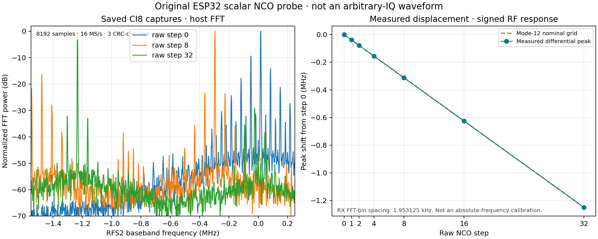

# Original ESP32 NCO RF results

An original ESP32 on PMOD-A v2 (`TX_PROBE` revision 300) transmitted its vendor
scalar tone while the RFS2 `ESP32SDR 6` receiver supplied independent IQ
captures. In 12-bit frequency mode, raw steps from 0 through 32 moved the
received spectral peak in the predicted direction and on the nominal code
grid. This validates a bounded frequency control path for a single tone; it
does not validate arbitrary-IQ playback or BPSK/QAM RF transmission.

## Measurements

The sweep used raw steps `0, 1, 2, 4, 8, 16, 32`, with three captures per
step. The receiver was host-configured for channel 8 (2.447 GHz center) and
16 MS/s. Each CI8 capture contained 8192 I/Q samples (16384 bytes); the FFT
bin spacing was therefore **1.953125 kHz**. Peak frequencies below are signed
host-FFT baseband bins. Differential shift is relative to the step-0 peak,
which was +17.578 kHz.

| Raw NCO step | Measured peak (kHz) | Differential shift (kHz) | Nominal mode-12 shift (kHz) |
|---:|---:|---:|---:|
| 0 | +17.578 | 0.000 | 0.000 |
| 1 | −21.484 | −39.063 | −39.063 |
| 2 | −60.547 | −78.125 | −78.125 |
| 4 | −138.672 | −156.250 | −156.250 |
| 8 | −294.922 | −312.500 | −312.500 |
| 16 | −607.422 | −625.000 | −625.000 |
| 32 | −1232.422 | −1250.000 | −1250.000 |

The nominal mode-12 grid is 39.0625 kHz per raw step. The observed
differential positions land exactly on that grid at the receiver's FFT-bin
resolution. This establishes relative displacement for these settings; it does
not calibrate absolute RF frequency, receiver clock error, or RF power. The
spectral power in the plot is normalized, not an absolute dBm measurement.

The transmitter identified as original-chip `TX_PROBE` revision 300. Each
bounded request used channel 8, `backoff_qdb=96` and a 3000 ms limit. Tone 1
remained enabled; tone 2 remained disabled. The enable, attenuation and
mode-12 settings were preserved, and the exact original register baseline was
restored after every job.

A v3 regression repeated all seven settings with manual RX gain 0: **21/21**
frames passed, with the same peak-bin positions and zero grid error at this FFT
resolution. All seven stop events were observed and `text_drops` stayed at its
existing value of 11 after reducing unnecessary firmware chatter. The original
v2 run's dropped telemetry remains recorded below; it was not silently replaced.

All **21/21** receiver frames passed payload CRC. Host command, radio framing
and capture error counters stayed at zero, and every capture reported 0% CI8
rail samples. The hub's `text_drops` counter increased from 15 to 27, by two per
job. The `TX_OFF` response and STOP event were not observed in the dropped text
stream. Instead, follow-up `INFO` reported `busy=0` and `STATE` readback showed
both tone sources disabled. The idle/readback evidence and restoration passed,
but the missing stop text remains a telemetry limitation.

## Scope and evidence

This is an RF measurement of one original-ESP32 scalar tone, received through
the RFS2 path and captured in physical FPGA capture RAM. The 16 MS/s rate and
2.447 GHz center were host-configured; the frequency extraction was a host FFT.
It does not show that the ESP32 accepts arbitrary I/Q samples, that the two
tone controls form orthogonal I/Q axes, or that it can send BPSK, QPSK, 16-QAM
or 64-QAM. It also does not characterize a phase-update path, EVM, symbol
timing, modulation bandwidth, calibrated power, or regulatory compliance.

The focused graph was generated from the saved CI8 captures and the
machine-readable proof at `cyberether/run/nco-test-002/proof.json`. That runtime
evidence contains the per-capture CRCs, hashes, transport metadata, register
snapshots and telemetry; it is local run data rather than part of this document.
See the [probe ABI and firmware evidence](ESP32_NCO_PROBE_EVIDENCE.md) for the
vendor call signature and register interpretation. A separate
[phase/pulse experiment](ESP32_PHASE_RF_RESULTS.md) now establishes persistent
phase changes on the installed original chip. Framed modulation and an
arbitrary-IQ/amplitude-linear waveform path remain unqualified.
