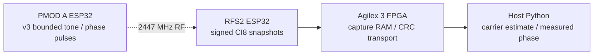
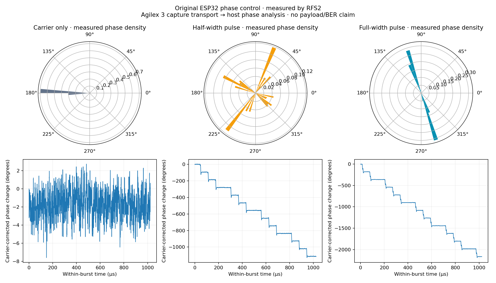

# Original ESP32: measured phase control

The installed original ESP32 on PMOD A produces persistent, approximately
180° phase changes by briefly changing its scalar tone frequency and returning
to zero. RFS2 measured the resulting RF independently. This opens a practical
phase-keying experiment on the existing hardware; it does not yet provide
framed BPSK, arbitrary-IQ playback, RF FEC or QAM transmission.





The plot uses the first capture of each control in `phase-test-005`. The polar
plots show actual plateau phase density; the traces retain measured phase ramps
and noise. A carrier near −180° is one angular state even though a Cartesian
histogram would split it across the ±180° boundary. Absolute phase differs
between captures because the radios have independent oscillators.

## Hardware measurements — 2026-10-21

Receiver: RFS2 `ESP32SDR 6`, channel 8 / 2447 MHz, nominal 16 MS/s, manual gain
code 0. Each capture contains **16,380 signed CI8 samples**, about 1.024 ms.
Transmitter: original ESP32-D0WD-V3 revision 300, PMOD A, `TX_PROBE v3`, 160 MHz
CPU. Each phase job is bounded to 500 ms and explicitly stopped after capture.
The source/readback, payload CRC/hash and firmware timing counters are saved.

The final analyzer was applied to **all 30 captures**, including controls:

| Run | Pattern / symbol period | Full / half requested cycles | Captures per control | Full-width two-state captures | Median full-width phase change |
|---|---|---|---:|---:|---:|
| 001 | `A5` / 64 µs | 2048 / 1024 | 1 | 1/1 | −182.24° |
| 002 | `A5` / 64 µs | 2048 / 1024 | 3 | 3/3 | −180.94° |
| 003 | `A5` / 128 µs | 2048 / 1024 | 2 | 2/2 | −182.22° |
| 004 | `3C` / 64 µs | 2048 / 1024 | 2 | 2/2 | −183.23° |
| 005 | `A5` / 64 µs | 2024 / 1012 | 2 | 2/2 | −177.76° |

All **10 carrier-only** captures have zero detected events and reject the
two-state criterion. All **10 half-width** captures reject it too, with median
phase changes approximately −90° to −95° per run. All **10 full-width** captures
meet the measured antipodal-plateau/event criterion. Changing the symbol period
and pattern changes the observed event spacing: the nominal `A5` bursts contain
about 12 events at 64 µs versus 6 at 128 µs; `3C` produces 3–4 events per burst.
Capture boundaries can cut an event.

All 30 frames passed transport checks. Host-command, radio-framing and capture
error counters remained zero. No exact CI8 rail hits occurred, and the revised
capture-quality checks found useful component-code headroom. This is not a
calibrated receiver-linearity or power measurement. Run 001 used vendor backoff
96; later runs used 120, both in quarter-dB command units.

## Measurement fixes and limits

The first detector split ringing around a phase pulse into multiple events;
one full-width capture consequently failed its event criterion despite clear
antipodal density. The revised detector requires 6 µs of quiet to separate
events, independent of requested pulse width or known pattern. All saved data
was reanalyzed, including negative controls. Original capture proofs were
retained. Synthetic tests cover split/ringing events, carrier ambiguity, CW,
OOK, four-state phase, reset-at-pulse-end and noise.

Timing is still **software scheduled**. For 2048 requested cycles, minimum
reported pulse widths were around 2072 cycles, with occasional longer delays.
Subtracting 24 requested cycles in run 005 did not create an exact calibration:
reported minima were 2055 cycles and maxima reached 5157 cycles. Its two
full-width captures had second circular moments 0.996 and 0.896, with per-burst
median phase changes −181.74° and −173.93°. The error is fairly consistent within
each burst, so isolated interrupt delays alone do not explain it. Peripheral
timing, receiver phase distortion and carrier-estimation uncertainty remain
possible contributors. The counters time CPU operations, not the exact RF edges.

The earlier gain-20 CW data had concentrated extreme codes despite no exact
rail hits. These phase tests reacquired at gain 0. Exact rail counts alone are
insufficient evidence of analog headroom.

**No payload bits, BER, framing, RF symbol synchronization or FPGA demodulation
are claimed.** The FPGA currently transports these captures; phase analysis is
host Python. Next steps are tighter pulse scheduling, independent timing/phase
recovery, a protected frame/header, and then actual received bits through the
existing FPGA soft-demapper/FEC engine. Amplitude-linear QAM needs a separately
qualified waveform path.

## Reproduce

After explicitly installing v3 and restoring the runtime hub, with no other
UART/JTAG acquisition owner:

```bash
.venv-notebooks/bin/python scripts/check_esp32_phase.py \
  --output cyberether/run/phase-new --rx-gain 0 --backoff-qdb 120
# Repeat with --symbol-us 128 or --pattern 60 (0x3C).
.venv-notebooks/bin/python scripts/plot_esp32_phase_controls.py \
  cyberether/run/phase-new --output cyberether/run/phase-new/controls.png
```

Local evidence: `cyberether/run/phase-test-001` through `phase-test-005` and
`cyberether/run/phase-analysis-validation`. Captures remain ignored; the
reproduction sources and saved result PNG are committed.

Firmware application SHA-256:
`9ba48ecbba51984375e055cb1c781c82239bd5fa8ce21fdbfa2eb3ebe874d170`.
The flashed images passed hash verification; the runtime checkpoint-3 SOF was
restored before normal boot. See [phase analysis theory](ESP32_PHASE_PROBE.md),
[firmware protocol](../firmware/esp32_tx_probe/README.md) and
[earlier scalar-frequency measurements](ESP32_NCO_RF_RESULTS.md).
