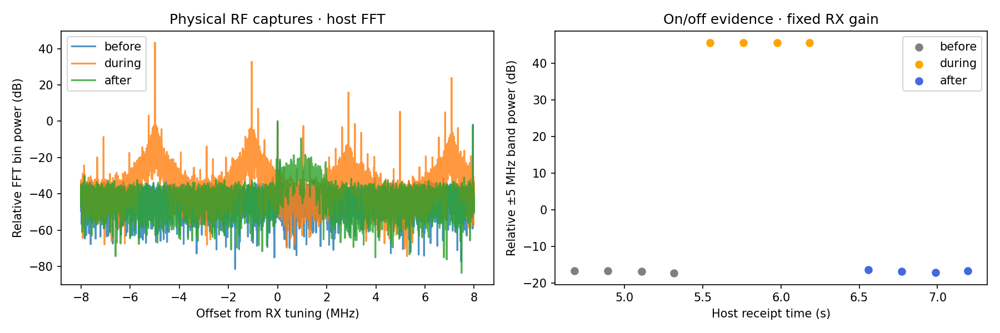
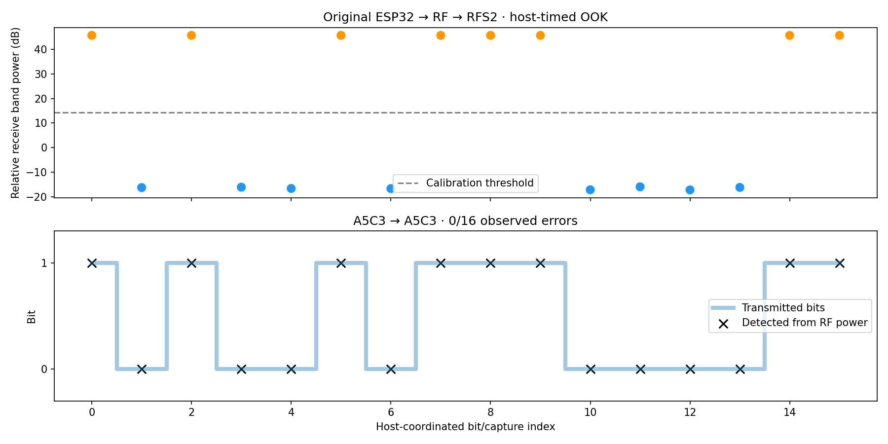

# Original ESP32 TX bring-up — 2026-10-21

**PMOD A transmits a carrier and on/off-keyed data; RFS2 receives it over RF.**
The original-chip arbitrary-IQ source path remains unverified. This result is a
useful first hardware gate, not a completed BPSK/QAM/FEC link.

```text
PMOD A ESP32                 RFS2 ESP32         Agilex 3 FPGA          Host
bounded CW on/off ── RF ──→ raw IQ capture ──→ buffered IQB1 UART ──→ power / bits / plots

Host commands coordinate the TX jobs and RX capture slots.
No independent symbol timing acquisition or FPGA demodulation is claimed here.
```

| Check | Measured outcome |
|---|---|
| Channel 3 carrier, RFS2 tuned 5 MHz below | Median band-power rise 39.77 dB; fall 61.41 dB |
| Channel 8 carrier, RFS2 tuned 5 MHz below | Rise 62.33 dB; fall 62.32 dB |
| Commanded STOP | TX-off acknowledgement and independent RF power drop |
| Automatic 500 ms deadline | Off at 500,803 µs, `reason=deadline`; subsequent INFO idle |
| Automatic 750 ms deadline, independent RX check | Off at 754,928 µs; measured RF power fell 62.12 dB |
| Busy / invalid command handling | Rejected second concurrent job, zero duration and excessive requested power |
| 16-bit host-timed OOK | `A5C3` recovered as `A5C3`, 0/16 observed errors |
| 64-bit host-timed OOK | `A55A0123456789FF` recovered exactly, 0/64 observed errors |

All 24 tone-test captures passed the FPGA transport checks; no ADC rail hits
were observed. Power is relative to ADC counts, not calibrated dBm. Snapshot
receipt timing does not establish coherent RF timestamps. OOK decisions use a
threshold trained on separate known-off/known-on captures; expected payload
bits are used only for counting errors. Small successful samples are not a BER
characterization or evidence of phase-coherent transmission.





## Reproduce

Build/flash/reset directions: [TX probe README](../firmware/esp32_tx_probe/README.md).
PMOD A currently has the diagnostic image; RFS2 and PMOD B retain their receiver
firmware. The normal checkpoint-3 FPGA hub is restored. The probe starts with RF
off; it transmits only explicit bounded jobs.

Stop the running viewer from the checkout that owns it before opening another
UART/JTAG client. Run these from the example directory beside installed tools:

```bash
.venv-notebooks/bin/python scripts/check_esp32_tone.py \
  --port /dev/ttyUSB0 --channel 8 --output cyberether/run/tone-new

# Repeat using the firmware deadline rather than STOP:
.venv-notebooks/bin/python scripts/check_esp32_tone.py \
  --port /dev/ttyUSB0 --channel 8 --automatic-stop \
  --output cyberether/run/tone-deadline-new

.venv-notebooks/bin/python scripts/check_esp32_ook.py \
  --port /dev/ttyUSB0 --payload-hex a55a0123456789ff \
  --output cyberether/run/ook-new
```

Each output directory must be new. Both scripts stop TX and restore receiver
gain after the job. Neither programs hardware. Transport errors fail the run;
raw captures, provenance and plots remain under ignored `cyberether/run/`.
The power/FFT/detection examples run in host Python. Future FPGA detector work
must be identified separately from this bridge-only experiment.

## Firmware and next gate

The separate project is `firmware/esp32_tx_probe/`, using the repository-pinned
original-chip ESP-IDF revision `25fe69f946311abdaf9ad56591f25fedbc20ac98`.
Application UART is GPIO17/16 at 2 Mbaud; the existing J2 programming route uses
GPIO1/3. The application SHA-256 for the tested image is
`191dbff1bbcfcdb2ace58aca1256fa3ced18bda0555833c481ffbddc0f1849ad`.
The exact build record is local `build-esp32-tx-probe/FIRMWARE_BUILD.json`.
A private backup of the original supported 2 MiB flash layout was retained
before any write; do not export it because NVS may contain credentials.

The remaining TX gate is a demonstrated sample-source/trigger/clock/ownership
sequence that injects arbitrary IQ into the original chip's RF DAC path.
Carrier keying cannot substitute for phase-controlled BPSK/QPSK or amplitude/phase
controlled QAM. [SDK/ROM evidence](ESP32_TX_INVESTIGATION.md) records this work.
