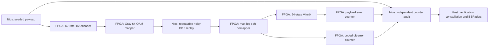
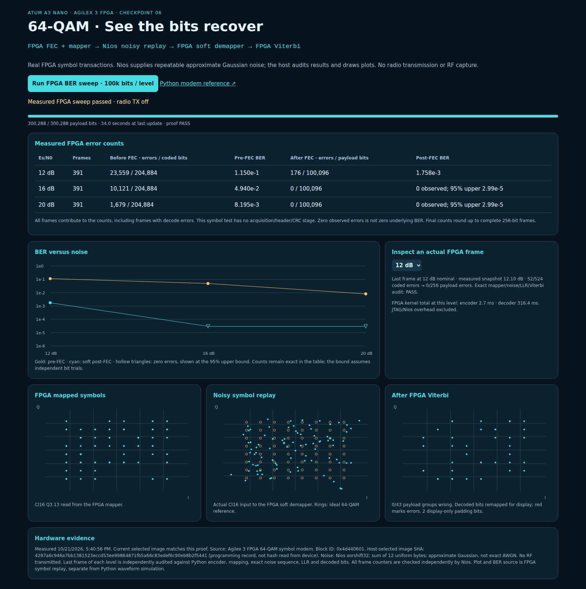
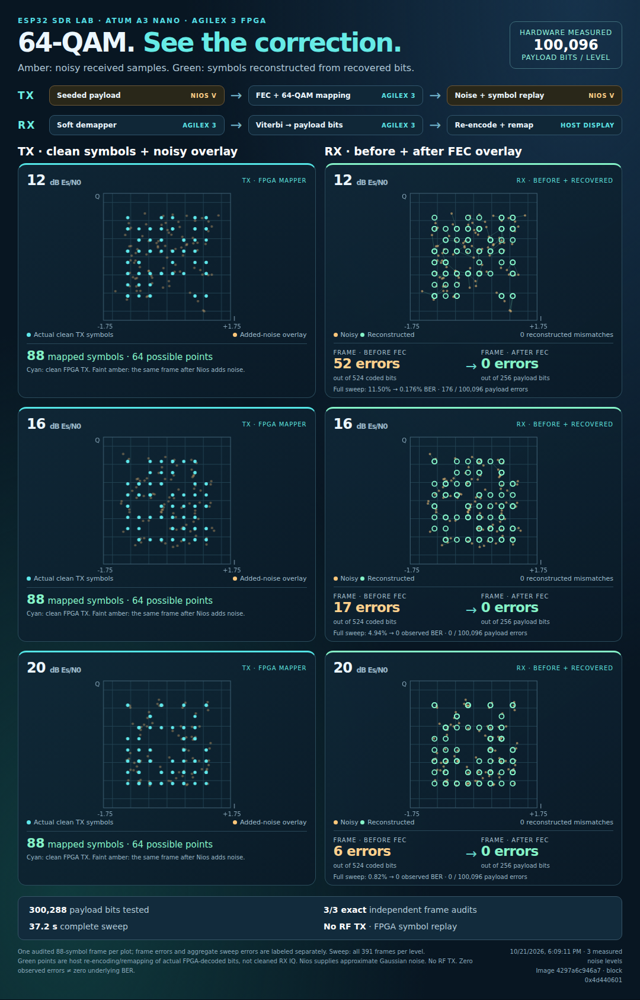

# FPGA 64-QAM constellation and BER sweep



Each frame contains 256 payload bits, six zero tail bits, 524 coded bits and
88 64-QAM symbols. Four zero padding bits complete the last mapped symbol;
padding is excluded from coded BER. The payload BER denominator excludes tail
bits. Failed decoded frames remain in the error counts. There is no waveform
acquisition, header or CRC in this symbol-level test.

The encoder, mapper, soft distance metrics, Viterbi decoder and error counters
run in actual FPGA RTL. Nios V transports data through the existing Avalon
register interface and supplies the payload/noise; it does not decode symbols.
The host independently checks the last frame of each noise level against the
encoder, mapper, exact noise PRNG sequence, fixed-point LLRs and Viterbi output.
Nios independently checks every frame's FPGA error counters by reading the
actual encoded bits, LLR signs, original payload and decoded bits.

The noise is an **approximate Gaussian**, the sum of twelve independent uniform
PRNG bytes, centered at 1530 and normalized by 256. Its tails are bounded; this
is not exact AWGN or an RF BER measurement. I and Q use separate PRNG draws.
The repeatable xorshift32 state is recorded for every chunk. Nominal Es/N0 uses
unit average constellation energy and per-axis sigma in Q3.13:

`round(8192 / sqrt(2 * 10**(EsN0_dB / 10)))`.

Actual signal/noise energy from the displayed 88-symbol frame is also reported;
it naturally differs from nominal energy over this short random frame.

## Build and run

From the example root, beside installed Quartus/Questa tools:

```bash
.venv-notebooks/bin/python scripts/modem_fpga.py simulate
.venv-notebooks/bin/python scripts/modem_fpga.py build
.venv-notebooks/bin/python scripts/modem_fpga.py program
.venv-notebooks/bin/python scripts/start_qam64_lab.py start
```

Programming explicitly replaces the current FPGA image. The new Nios monitor
contains `MSVERSION`, `MSRUN` and `MSGET`. Earlier checkpoint06 images retain
the modem RTL but do not support the on-board sweep command. No ESP32 firmware
change, switch change, reset press, UART acquisition or RF transmission is
needed. Other SPI/preamble lessons need their corresponding image reloaded.
The web page never programs the board automatically.

For the official IDE projects, run `python scripts/nios_software.py 6 --open`.
Use `--refresh-sources` when intentionally replacing older editable monitor
copies with this version. BSP/Hello World/IQ monitor builds are independent of
programming the SOF; the HAL monitor does not need a separate download here.

Open the printed host-IP URL on port 8773 and press **Run FPGA BER sweep**.
The default sweep tests **100,096 payload bits at each of 12, 16 and 20 dB**,
rounding the requested 100,000 up to 391 complete frames. Progress is based on
completed FPGA frames. The CLI can run smaller checks or longer sweeps:

```bash
# Short hardware qualification before the full sweep:
.venv-notebooks/bin/python scripts/check_qam64_sweep.py \
  --output cyberether/run/qam64-short --levels 16 --payload-bits 256 --chunk-frames 1

# Default full sweep; choose a new directory for every run:
.venv-notebooks/bin/python scripts/check_qam64_sweep.py \
  --output cyberether/run/qam64-full --levels 12 16 20 --payload-bits 100000
```

All actions share the acquisition/JTAG leases. One command processes at most
32 frames; the default is 16, allowing frequent progress updates. No background
acquisition begins when the viewer starts. Reopening the page preserves the
latest proof. If the selected image changes, Run is disabled and saved results
remain historical measurements.

## Read the plots

- **FPGA mapped symbols:** actual Q3.13 IQ from the RTL mapper.
- **Noisy symbol replay:** actual samples supplied to the RTL demapper, with
  ideal reference points overlaid.
- **After FPGA Viterbi:** actual decoded payload bits remapped for display.
  Red crosses/lines show incorrect groups against the original payload. This
  is not newly measured received IQ; even a wrong group lies on a grid point.
- **BER curve:** coded errors before FEC and payload errors after soft Viterbi.
  Hollow triangles show the one-sided 95% upper bound for zero-error
  observations; the table keeps the observed error count and denominator.
  This bound treats bit trials as independent; convolutional decoder errors
  can occur in bursts, so it is an educational bound, not a field guarantee.

No hard-decision Viterbi hardware is present in this test. The separate Python
Modem Lab compares hard/soft algorithms; the FPGA page reports the implemented
soft decoder only. Build databases, SOFs, captured NPZ files and raw proofs are
local outputs. Authored source, tests and representative screenshots are kept
in Git.

## Hardware results

The physical Agilex 3 browser sweep completed in **36.23 seconds**:

| Nominal Es/N0 | Coded errors / bits | Pre-FEC BER | Payload errors / bits | Post-FEC BER |
|---|---:|---:|---:|---:|
| 12 dB | 23,559 / 204,884 | 0.114987 | 176 / 100,096 | 0.00175831 |
| 16 dB | 10,121 / 204,884 | 0.0493987 | 0 / 100,096 | No errors observed |
| 20 dB | 1,679 / 204,884 | 0.00819488 | 0 / 100,096 | No errors observed |

The independent-bit 95% upper bound for each zero-error observation is about
2.99e-5. Each row includes 391 frames. Every frame's hardware counters passed
Nios audits; the last frame of each level passed exact host checks of payload,
coded bits, mapped IQ, noisy IQ, LLRs and decoded bits. The displayed frame can
be error-free even when the aggregate row contains payload errors.

SOF `4297a6c946a7bb1381523eccd53ee99864871fb5a66c83edef6c90eb8b2f5441`
was fully rebuilt and programmed. Source fingerprint:
`791fe8cb6fecc0d967d78960f6960e92009f6d3d6e5fdf4db69b2ae772006d68`.
The design uses 28,058/45,800 ALMs, 146/353 M20Ks and 32/368 reported DSP units.
50-MHz setup slack is +1.194 ns; hold slack is +0.026 ns.

The browser tested Run and all three frame selections without JavaScript
errors. All 237 host tests passed, as did the actual modem RTL simulation and
notebook08 offline execution. The official Nios BSP/Hello World/monitor apps
were rebuilt; no ELF was downloaded separately. TX readback before and after
confirmed `busy=0`, both tone amplitude fields zero, and extension control zero.
Serial and JTAG are released after the checker exits.

Proofs are local under `cyberether/run/qam64-gui-1792626056550406835/`, with
`qam64-browser-hardware.json` and `qam64-tx-idle-{before,after}.json` alongside.
The failed initial short check (`qam64-hw-short-001`) exposed a host parser
assuming decimal for `next_bits`; the parser and its regression test were
corrected. `qam64-hw-short-002` and the full browser sweep passed on the same
unchanged FPGA image. The portable Quartus project ZIP was checked for CRC
integrity and includes the new monitor header; its extracted contents were
not separately recompiled in this run.



Build, reference and physical-board verification are also recorded in
[VALIDATION.md](../VALIDATION.md).

## Social / presentation layout

Open `/poster` on the same port (for example `http://HOST_IP:8773/poster`).
The read-only layout has three rows (12, 16 and 20 dB) and two columns:
actual clean TX symbols with a faint noisy overlay on the left, and the matching RX before/after-FEC
overlay on the right. Separate TX/RX diagrams identify Nios replay,
the FPGA encoder/mapper/demapper/Viterbi, and the host display reconstruction.
Each lower panel shows frame error counts alongside the full-sweep result. All six plots use the same scale and equal
I/Q aspect ratio. The page uses actual audited FPGA snapshots, never a
new acquisition or TX command.

The **Download measured example PNG** link serves the committed screenshot,
not a freshly rendered image of a later sweep. The page itself updates when
a new completed proof becomes available. For a new export, capture the
`#poster` element with a browser screenshot; its timestamp identifies the
measurement. The supplied PNG is 1080 pixels wide and can be used directly
in a social post.



### What the before/after overlay means

Amber dots are the actual noisy symbols presented to the FPGA receiver.
Green rings reconstruct the **same 88 coded-symbol positions** by re-encoding
and remapping the actual FPGA-decoded payload bits. This display-only step
runs on the host; the FPGA still performs the real soft demapping and Viterbi.
Faint paths pair corresponding positions. They are a comparison aid, not a
claim that FEC moves or denoises the received IQ samples. Toggle **Correction
paths** to hide them.

Red crosses in the RX overlay mark reconstructed symbols that still differ from
the known TX sequence. Incorrect decoded bits remain incorrect; this view
does not simply snap every sample to a convenient ideal point. A regression
test flips a decoded payload bit and verifies that red mismatches remain.

The displayed frames contain 52, 17 and 6 coded errors respectively, with
zero payload errors after FPGA decoding. These are single-frame counts
(524 coded bits and 256 payload bits). The 100k-bit sweep still includes
176 payload errors at 12 dB. Old saved proofs are enriched from their NPZ
snapshots after repeating the exact reference audit; completed results are
cached. Opening the overlay never starts a hardware action.

The centered poster is capped at 1080 pixels with wider page margins. On the TX side, faint amber dots show the same recorded frame after Nios adds noise; cyan dots remain the actual clean FPGA mapper output. The overlay is explanatory and does not imply noise was transmitted by the mapper.
