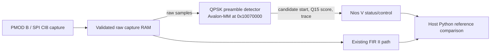

# FPGA QPSK preamble detector lab

Checkpoint08 adds a coarse differential-QPSK preamble detector beside the
existing SPI capture RAM and FIR II pipeline. It consumes the raw capture branch
in parallel with the FIR. It identifies a likely 32-symbol training start and
reports a normalized score; it is not a complete synchronizer or modem. The
current checkpoint08 image passes the synthetic, saved-IQ and passive RF browser
actions with exact score-trace agreement. The passive snapshot falls below the
detection threshold; it is a transport/reference pass, not a preamble detection.
The image preserves the tested FIR datapath and includes a monitor boot-memory
fix for the existing FIR commands. All lab actions remain receive/replay only.

## What it computes

The input is signed CI8 I/Q at 16 MS/s. For each candidate start, the detector
forms 16-sample averages at 32 symbol positions, giving 31 adjacent complex
differential products. It rotates those products according to the known
quarter-turn transitions of the QPSK training sequence, sums them, and reports
the normalized squared correlation in unsigned Q15. A common phase rotation
cancels in the differential products; modest carrier offset is tolerated over
the short training span. An energy floor rejects weak inputs.

The datapath uses signed 13-bit averaging accumulators, signed 9-bit averaged
I/Q values, signed 18-bit differential products, signed 32-bit correlation
accumulators and unsigned 64-bit energy/divider state. The restoring divider is
sequential; correlation and normalization are performed in RTL. The best score
is clamped to the unsigned Q15 range 0–32768. The score threshold and energy
threshold are programmable within their documented input widths/ranges.

The detector does not estimate and remove carrier offset for the payload, refine
symbol timing, demap data, check CRC, or perform FEC. Host acquisition and the
existing modem decoder remain responsible for those stages. It does not run on
FIR-filtered samples: the detector receives the raw samples through a dedicated
`preamble_capture` observer conduit in parallel with the existing FIR route.
The conduit also carries capture commit metadata. A prior VDS attempt to fan
one capture output into both destinations disconnected FIR and was rejected by
strict validation; the current point-to-point observer keeps both paths
connected.



The offline model is `cyberether/preamble_reference.py`. The synthetic example
uses `rf_qpsk.synthesize()` and the same integer `scan()` reference; it does not
load hardware or capture RF. The checker supports synthetic checks and replay
of an existing saved CI8 file, neither of which transmits RF.

## Avalon-MM register map

The slave base address is `0x10070000`. Every entry is a 32-bit word at
`base + 4 × index`. Avalon accesses require all four byte enables. The RTL is
the source of truth for bit widths and signedness. Registers 0–28 and 31 are
implemented; 29–30 and other addresses are reserved.

| Index | Access | Meaning |
|---:|:---:|---|
| 0 | R | Identity (`0x50520801`) |
| 1 | R/W command | State readback: busy bit 0, ready bit 1, done bit 2, armed bit 3, any-error bit 4, detected bit 5. Writes `1` clear, `2` begin host load, `3` finish host load, `4` run host buffer, `5` arm physical source, or `6` cancel. |
| 2 | R/W | Complex sample count (1–16384) |
| 3 | R/W | Samples per symbol (SPS, 128–240) |
| 4 | R/W | Candidate scan step (1–16); host command defaults to 4 samples |
| 5 | R/W | Detection threshold, unsigned Q15 (0–32768) |
| 6 | R/W | Minimum differential-energy threshold; default 7936 |
| 7 | R/W | CI8 word write index, auto-advances as input words are written |
| 8 | R/W | Host-load CI8 data word; low 16 bits carry one signed I/Q sample pair |
| 9 | R | Detector cycle count |
| 10 | R | Best candidate start sample |
| 11 | R | Best normalized score, unsigned Q15 |
| 12 | R/W | Candidate trace read index |
| 13 | R | Candidate trace score at index 12 |
| 14 | R | Candidate count |
| 15 | R | Error/status detail |
| 16 | R | Raw-input CRC |
| 17 | R | Capture job identifier |
| 18 | R | Capture source identifier |
| 19 | R | Sample rate |
| 20 | R | RF frequency metadata |
| 21 | R | Averaging window (16 samples) |
| 22 | R | Algorithm identifier (1) |
| 23 | R | Low word of differential energy |
| 24 | R | Differential correlation real accumulator |
| 25 | R | Differential correlation imaginary accumulator |
| 26 | R | High word of differential energy |
| 27 | R | Number of CI8 samples written to host buffer |
| 28 | R | CRC32 of the completed host-loaded buffer |
| 31 | W | Source filter for physical arming; firmware accepts source 0–2 |

The monitor commands are `PSTATUS`, `PCONFIG samples sps threshold`, `PCLEAR`,
`PBEGIN`, `PLOAD index hexbytes`, `PFINISH`, `PRUN`, `PARM source`, and
`PTRACES index count`. `PLOAD` accepts at most 16 samples (64 hex characters)
per command, in sequential sample-index chunks. Each four-hex-character item
encodes one signed I/Q byte pair in I-then-Q order. `PCONFIG` validates sample
count, SPS and threshold, and sets the candidate
step to 4 and energy threshold to 7936. `PBEGIN` starts a host-buffer load;
`PFINISH` seals it and records the CRC; `PRUN` scans that buffer. `PARM` arms a
physical capture source after the existing capture path has supplied data.
`PTRACES` returns 1–32 consecutive Q15 trace values within the candidate count.
`PCLEAR` resets detector state. The existing IQB1 capture and SPI/FIR contracts
remain in force.

## Run the lesson

Use the repository's `Atum A3 IQ Demos` notebook kernel beside the installed
Quartus/Questa tools. The canonical lesson is
[notebooks/10_fpga_preamble.ipynb](../notebooks/10_fpga_preamble.ipynb). Run All
executes only a deterministic Python simulation and plots a score trace. All
optional tool and hardware switches default off.

The standalone checker is also usable from the repository root:

```bash
.venv-notebooks/bin/python scripts/check_preamble.py \
  --synthetic --symbol-us 10 --output cyberether/run/preamble-synthetic

.venv-notebooks/bin/python scripts/check_preamble.py \
  --input cyberether/run/<saved-ci8-file> --symbol-us 10 \
  --output cyberether/run/preamble-replay
```

The second command replays a saved file and performs no RF capture. Use a fresh
output directory for each run. A passing synthetic result checks reference
behavior, not FPGA implementation or radio performance.

Notebook optional actions call `scripts/preamble_pipeline.py` for `generate`,
`simulate`, `build`, or `program`. Generation opens the real VDS system; the
14-block native GUI export is `notebooks/diagrams/10_vds_gui.png`. The generated
QPF and full project package should be reviewed before opening the QPF in
Quartus. Compilation does not qualify hardware. Programming replaces the active
FPGA image and must remain an explicit action after verifying the selected
design and acquisition owner.

For the Questa GUI, run `python scripts/preamble_pipeline.py simulate`, then
open `simulation/preamble/` and execute `vsim -gui -do run.do`. The script
`simulation/preamble/run.do` is the canonical testbench entry point. To inspect
the saved waveform without rerunning the bench, open its generated WLF with
`vsim -view <waveform>.wlf -do view.do`. The CPU is not instruction-simulated;
these tests exercise the detector RTL and its bus interface.

## Qualification status

The currently loaded checkpoint08 image is `cf2eea090cd7825d23087b2e0dbacc2e5b08c3aa898e98aff5b43ef64205145d`, source fingerprint `dd6bf7276d85b1a1f73619a69e9aaab6a786184e86ade61af66b6ab414b1f439`. The hardware block identity reads `0x50520801`; the SOF hash is local programming-manifest provenance, not a device-read image hash. The monitor-only source fix reserves the existing `PAIR` and `PRESET` commands, restoring FIR control. The corrected Nios boot memory was installed using the documented Quartus MIF-update/assembler flow; no RTL, routing or DSP implementation changed, and this was not a new full place-and-route build. The prior fit reported 29,472/45,800 ALMs (64%), 152/353 M20Ks (43%) and 24/368 DSPs (7%); at 50 MHz, worst setup slack is +6.591 ns and minimum hold slack is +0.019 ns. These are the routed implementation's measurements. The official checkpoint08 BSP, Hello World and IQ monitor were refreshed and rebuilt successfully; none of those software applications was downloaded to hardware.

A regression on the original `8ae98339…` image showed its preamble command parser intercepted `PAIR` / `PRESET`, breaking the established FIR control path (`preamble-fir-regression-001`). The command reservation fix passed native-C regression and the current `cf2eea09…` image then passed the hardware FIR regression: 16,380 complex samples, exact Hamming integer reference (maximum error 0), valid CRC, pair disabled, coefficients restored, and host UART returned to 2 Mbaud (`preamble-fir-regression-fixed-001`).

Nine RTL fixtures passed, including exact full-trace comparisons and corner
cases using generated and saved-RF vectors. Seven Python model tests passed.
Their model-only input-separation check accepted 90 CRC-positive saved-RF files
and kept them separate from 137 generated negative cases; this is offline data
validation, not new RF operation.

Historical detector proofs on original image `8ae98339…` remain in
`cyberether/run/preamble-hw-clean-001/proof.json`,
`preamble-hw-saved-001/proof.json`, and `preamble-hw-zero-001/proof.json`.
They recorded the same clean synthetic pass (10,000 samples; 1,257 exact scores;
best start 60, score 32,739; 2,091,649 cycles), an RFS2 saved-capture replay
(16,380 samples; 2,852 exact scores; best start 924, score 32,696; 4,745,729
cycles), and an all-zero energy-floor negative input (5,120 samples; 285 zero
scores; no detection; 456,001 cycles). These proofs predate the monitor fix and
are retained as historical evidence for that image.

## Current-image GUI qualification

The refreshed current image passed all three browser actions. Each proof records
`status: PASS`, `completed: true`, `tx_started: false`, exact comparison of every
FPGA Q15 trace value with the independent reference, verified input CRC, and
successful detector-clear readback. The browser reported no JavaScript errors.

| Action | Input and provenance | FPGA/reference result | Wall time |
|---|---|---|---:|
| Replay clean IQ | 10,000 synthetic CI8 samples; no radio transmission | 1,257 scores exact; best start 60, score 32,739; detected above 24,576 threshold; 2,091,649 cycles (41.83298 ms) | 50.436 s, including 40.209 s upload |
| Replay saved RF | Original RFS2 CI8 capture 000 from `rf-v6-qpsk-10us-001`; source 0/job 7 in original metadata. Upload only; no new RF observation | 2,852 scores exact; best start 924, score 32,696; detected; 4,745,729 cycles (94.91458 ms) | 85.244 s, including 64.601 s upload |
| Passive RF snapshot | New PMOD B SPI capture, source 2/job 5, 16,380 complex samples at configured 16 MS/s / 2447 MHz | 2,852 scores exact; best start 6,040, score 4,141, below 24,576 threshold; correctly no detection; 4,610,049 cycles (92.20098 ms) | 21.013 s |

The passive capture's SPI commit, sequence, bank, length and CRC checks passed;
FIR mode restoration and detector-clear readbacks passed. The saved RF capture
was previously associated with a CRC-valid host-decoded QPSK frame, but replaying
it through the preamble detector does not add a radio observation or prove
payload decoding by FPGA. The passive low score is not a false pass: the FPGA
trace matches the host reference, while the detection threshold correctly
remains unmet. IQ sample ticks are FPGA ingress/receipt timing, not RF phase or
synchronized sample time.

The final browser proofs are `preamble-gui-1792624384083485799`,
`preamble-gui-1792624436846072184` and `preamble-gui-1792624460027918522`; the
combined GUI record is `cyberether/run/preamble-browser-hardware.json`. The
completed repository host suite passed 228 tests. Synthetic input, saved-data
replay and passive RF remain distinct evidence types. A preamble score does not
prove BER, continuous delivery or a complete QPSK receiver. No action in this
qualification sends a transmit command; each proof records `tx_started: false`,
PMOD A TX was also checked idle after the tests in
`cyberether/run/preamble-tx-idle-after.json`: v6 reports `busy=0`, raw tone1
register `0x20000000`, tone2 `0`, extension tone `0`, and zero amplitude fields
for both tones (both disabled); the RFS2 host UART is back at 2 Mbaud.
