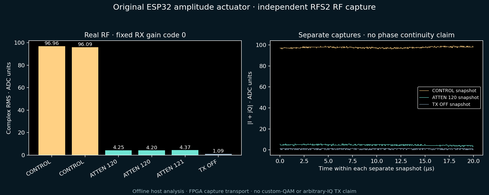

# Original ESP32 amplitude gate: measured RF



PMOD A original ESP32-D0WD-V3 rev300, MAC78:21:84:d4:4f:98, ran diagnosticV1
SHA `e5f5e28787d5990505712573eff7b2a7fc59b5f06055ec808cb64d4f2bac49ad`.
Independent RFS2 source0 captured16380 CI8 samples at nominal40MS/s and2447MHz.
FPGA stage11 supplied capture RAM / transport. Analysis below is **offline host
NumPy engineering analysis**, not on-device DSP or a completed custom-QAM demo.

| Case | Complex RMS, ADC units | Exact rail hits |
|---|---:|---:|
| CONTROL, manual RX gain0, repeat1 |96.9639|0|
| CONTROL, manual RX gain0, repeat2 |96.0927|0|
| ATTEN120, same gain, repeat1 |4.2458|0|
| ATTEN120, same gain, repeat2 |4.2010|0|
| ATTEN121, same gain, one observation |4.3695|0|
| TX OFF, three later passive captures |1.0479 /1.1183 /1.0908|0|

All five manual-gain active captures peak at the same17.094kHz FFT bin within
the ±100kHz baseband search. CONTROL versus code120 median total ADC power
difference is27.1799dB. This is **not calibrated radiated attenuation**, EVM,
linearity or proof of fine amplitude resolution. Code121 is not demonstrably
separated from120 across repeatable controlled measurements yet.

The first CONTROL spent127120us in setup and opened no tone-register window;
its gain-restored flag was0, so it is excluded. The next hardware-AGC CONTROL
clipped11.09% of sample pairs and is excluded. Manual RX gain0 fixed headroom
for the reported comparison; settings were restored after each job.

Each active manual-gain job requested50ms, then returned gain_restored1,
fields_ok1, rf_off1, STOP and busy0. Observed software tone-register windows were
about50.5–50.6ms; the software guard has about1ms scheduling granularity.
Register-off is not an independently proven hard50ms RF cutoff. Later passive
captures show the carrier has dropped toward the measured noise floor, but do
not time its exact off edge. Host receipt/trigger delay is not an RF sample clock.

Records show BASELINE tone1=`20040000`, trial120=`20062000`, return=`20040000`,
and OFF=`20000000`; tone2/ext remain0. These validate the intended bitfield
operation and restoration. No phase-continuity inference follows from separately
captured millisecond plateaus. No arbitrary IQ input has been found.

## Reproduce the offline audit

Private proof/data files remain ignored in `cyberether/run/`:

```bash
.venv-notebooks/bin/python scripts/analyze_original_iq_amplitude.py \
 --proof cyberether/run/original-iq-control-003.json \
 --proof cyberether/run/original-iq-control-004.json \
 --proof cyberether/run/original-iq-atten120-001.json \
 --proof cyberether/run/original-iq-atten120-002.json \
 --proof cyberether/run/original-iq-atten121-001.json \
 --off cyberether/run/original-iq-passive-001.json \
 --output cyberether/run/new-amplitude-audit
```

The audit verifies archive SHA/CRC, sample profile and gain, and refuses clipped
captures. It never opens serial/JTAG or transmits. Raw archives and flash backups
are private; only this aggregate plot and source are committed.

## Recovery and next gate

A fresh full4MiB native-TX backup was read, checksum-verified, and its application
bytes matched the known native-TX build before V1 installation. Backup SHA:
`88a517b537a9dad4f79e714bd2d2ed6ca38327e6bca043ebe8bc52eed031f629`.
Flash and independent digest verification passed; stage11 SOF and Nios app were
restored, and V1 normal boot reported RF uninitialized before any experiment.

V2 app SHA `9c2330dbf20e6abc778ffc230a001daccd23a4d5516fc8b4135dfc4b7d036220`
was installed and booted correctly, but its CONTROL and subsequent TRAIN0
attempt failed during PHY initialization with a worker stack overflow. Neither
run qualifies RF transitions. Crash/reboot lines remain in the private proofs;
cleanup reports STOP, busy0 and RF-uninitialized. V1's measurements remain
separate evidence.

The added16-record automatic trace enlarged the worker compiler frame to896bytes
inside a4096-byte task stack. V3 moves it to static RAM, reduces that frame to
384bytes, allocates8192bytes to the worker, and exports runtime minimum stack
margin. The build now checks compiler stack evidence: static worker frame <=512
bytes. This is a local-frame check, not a proof of vendor call-tree stack depth.
The controller detects panic/reboot lines immediately during jobs and permits
cleanup after a fault. V3 SHA
`b112c38a155d66dceaa5a860ab850051280714a0e764c53fc2f7d43750de62a0`
is built, not hardware-tested.

Next after installing the fix: initialization-only CONTROL, inspect its result
before advancing, unchanged-code TRAIN0 control, then TRAIN120, followed by one
conservative intermediate LEVEL candidate only if headroom/readbacks pass.
Measure phase disturbance and settling **within each single capture** before
building a polar-QAM calibration or claiming64 states.
