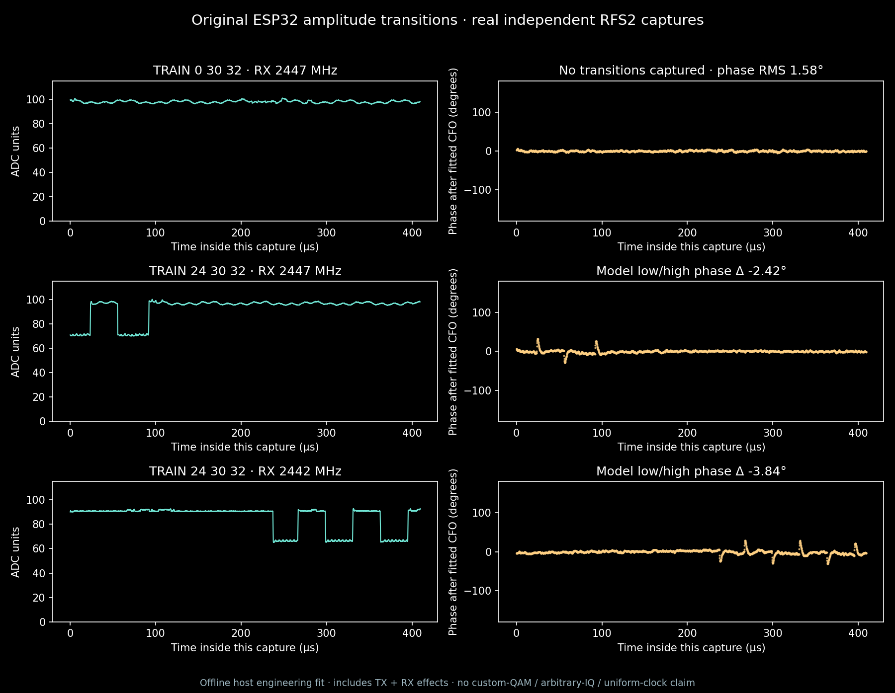

# Original ESP32 V3: same-capture RF transitions



V3 app `b112c38a155d66dceaa5a860ab850051280714a0e764c53fc2f7d43750de62a0`
was used on PMOD A rev300/MAC78:21:84:d4:4f:98 for these saved tests. It passed flash/digest,
normal boot, initialization and short amplitude-transition tests. Minimum free
worker stack remains4000bytes; guard stack2664bytes. No V3 panic/reboot was
observed. Initialization took177191us and opened no tone-register window because
it consumed the requested50ms budget; that job is not a transmission success.

RFS2 captured nominal40MS/s,16380 CI8 samples, manual RX gain0. Stage11
SOF0d164d03… / Nios app a720cb72… provide capture RAM and transport. These fits
are **offline host NumPy engineering analysis**, not FPGA receiver DSP.

| Case | RX centre | Received transitions | Measurements |
|---|---|---:|---|
| TRAIN0 /32us |2447MHz|0|Unchanged-code control; amplitude97.81ADC, phase RMS1.58° |
| TRAIN120 /32us |2447MHz|11|Model phase offset−20.39°; large14.24ADC model residual |
| LEVEL24 |2447MHz|stable snapshot|RMS71.90ADC; zero exact rail hits |
| TRAIN24 /32us |2447MHz|3|Amplitudes96.72/71.25ADC; model phase offset−2.42° |
| TRAIN24 /64us |2447MHz|3|Amplitudes96.46/70.89ADC; model phase offset−5.24° |
| TRAIN0 /32us |2442MHz|0|Offset control:90.36ADC, phase RMS1.51° |
| First TRAIN24 offset attempt |2442MHz|0|Only one level captured; retained, not transition qualification |
| Second TRAIN24 offset attempt |2442MHz|6|Amplitudes90.74/66.25ADC; model phase offset−3.84° |

TX stays at nominal2447MHz during the5MHz RX-offset test. Fitted carrier is near
−4.9836MHz, consistent with prior IQ-orientation observations. Moving away from
receiver DC did not remove phase disturbance. This rejects a simple DC-only
explanation but does not isolate TX: RX filtering, imbalance, compression and
fitting effects remain. Model phase offsets have no uncertainty bounds and are
not a calibrated phase LUT. Code120 is weak and fits a constant-phase model
poorly; its model phase is not reliable TX-only AM/PM calibration.

All reported captures have zero exact rail hits; this does not establish analog
linearity. Received step spacings span29.15–36.525us across32us tests and
60.025–63.825us in the64us capture. Intentional approximately1ms firmware yields
every32 updates remain. This is not a uniform or FPGA-driven symbol clock.

Envelope timing uses17-sample smoothing (0.425us). Approximately0.2us median
agreement after a received50% threshold crossing includes RX filtering and
smoothing; it is not physical TX settling time. Phase spikes remain visible
in the full±180° plot. Each accepted job reports gain/field restoration,
registers-off, STOP and busy0. TRAIN requested30ms and observed approximately
29.5ms register windows. Later passive captures show return toward the noise
floor, but do not establish an independent hard RF cutoff.

## Evidence and reproduction

Private proof names under `cyberether/run/`:

```text
original-iq-v3-init-001.json
original-iq-v3-train0-001.json
original-iq-v3-train120-001.json
original-iq-v3-level24-001.json
original-iq-v3-train24-001.json
original-iq-v3-train24-64us-001.json
original-iq-v3-offset-train0-001.json
original-iq-v3-offset-train24-{001,002}.json
original-iq-v3-passive-{001,002}.json
```

With saved private captures available:

```bash
.venv-notebooks/bin/python scripts/analyze_original_iq_transitions.py \
 --proof cyberether/run/original-iq-v3-train0-001.json \
 --proof cyberether/run/original-iq-v3-train24-001.json \
 --proof cyberether/run/original-iq-v3-offset-train24-002.json \
 --output cyberether/run/new-transition-audit
```

The fitter checks raw SHA/CRC/profile/gain and rejects clipping. Synthetic tests
verify known phase shifts, amplitude-only changes, DC, negative IQ orientation
and unchanged-code rejection. Those fixtures are software tests, not RF evidence.

## Next gate and current radio roles

Amplitude stepping is measured; **custom64-QAM and arbitrary-IQ TX remain
unproven**. No payload modulation, FEC or BER is qualified here.

Next firmware batch should combine a lower configurable baseline, calibrated
amplitude/phase controls, preload/CRC and timing diagnostics. Establish repeatable
transfer with sufficient headroom, then test all9radii/52directions. FPGA can
subsequently preload a finite polar schedule. Keep this polar backend separate
from an unproven SRAM-to-DAC IQ backend. Framing, on-device synchronization,
demap/FEC and >=100000-bit RF BER remain later gates.

A now runs the [combined TX lab image](TX_LAB_FIRMWARE.md), containing the V3
amplitude engine, native Wi-Fi TX and phase research. Select modes in software;
no per-experiment flashing is required. RFS2 is the raw receiver and B is a
passive native Wi-Fi monitor. The viewer retains the earlier saved proofs. `/tx-research` on
port8774 is a read-only presentation of these engineering results and never
starts RF.
