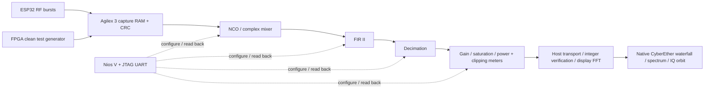

# RF Arcade — demo night

**ESP32 SDR × Agilex 3 FPGA × CyberEther**

```text
              LIVE AIRWAVES           RESCUE THE TONE         POWER RUSH
Input         ESP32 RF               FPGA two-tone           FPGA single-tone
Try           Radio / channel        Fold → Shift → Reject   Clean → Boost → Clip
Watch         Waterfall + IQ         Interferer disappears   Circle → square + harmonics
```

## Start

For guided setup, open [RF Arcade setup notebook](../notebooks/06_rf_arcade.ipynb). It covers installation, project/diagram links, build, programming, launch and cleanup. Stop at the Launch cell while presenting.

Use the local environment containing Quartus, the installed venv and the board's UART/JTAG access:

```bash
cd esp32_agilex3_iq
# Current container only; the host normally has the default stable by-id link:
export ATUM_UART=/dev/ttyUSB0
.venv-notebooks/bin/python scripts/demo_night.py --host <reachable-LAN-IP>
```

The script verifies/reuses or builds checkpoint 5, stops the previous notebook-owned demo, programs the board and starts the native CyberEther graph plus its control page. It prints the private browser link. It needs no ESP32 reset buttons or Wi-Fi password with the compatible firmware already installed. Stop unrelated acquisition services first.

First installation: follow [the local notebook setup](../notebooks/README.md). The same checkout runs on a Linux host or a container desktop alongside the tools. Ports remain 8768 (controls), 8687 (native viewer), TCP 40100–40103 (media).

## A two-minute presentation

1. Open the printed link. Press **⛶** for fullscreen.
2. Start with **Airwaves**: “This is received 2.4 GHz RF. The ESP32 captures short IQ bursts; Agilex filters them; CyberEther draws the result.” Select a radio or Wi-Fi channel if desired.
3. Select **Rescue the tone → Fold**. Two clean FPGA-generated tones appear; the interferer aliases during decimation.
4. Press **Shift to DC**, then **Reject interferer**. The wanted tone moves to the center, then the FPGA FIR removes the interferer. The waterfall marks each scene change.
5. Select **Power rush**. Try **1×**, **2×**, then **16×**: the IQ circle expands, hits the rails and becomes square; extra spectral lines appear. Point to the FPGA clipping meter and **0 LSB** reference match.
6. Press **Showreel** to repeat all seven scenes automatically. It waits for a matching, verified hardware result before starting each scene's dwell. Manual scene/radio/channel changes stop the showreel.

**Freeze** holds acquisition; **Resume** continues it. **Stop showreel** leaves the current scene selected. The frame holds the last verified plot while settings change and labels it accordingly. The native CyberEther link is available in the header.

## What runs where



This addition uses the existing **checkpoint-5 SOF**. It introduces no RTL, firmware or pin changes. The HTML buttons apply real register/coefficient settings through the existing Nios path. Live Airwaves uses the 16-tap Hamming FIR; the tone-rescue path uses the I/Q 127-tap FIR II filters and decimation by four. Gain scenes use real FPGA integer meters.

The display FFT, waterfall coloring, peak history and IQ graphics run on the host inside CyberEther's Python frame source. Flow dots are a schematic animation, not a measured FPGA clock/utilization indicator. **Hardware / integer match** compares FPGA output with the independent host reference.

## Read the display correctly

- **LIVE RF** means an actual ESP32 acquisition. **FPGA TEST SIGNAL** means a deterministic FPGA pattern, with no RF transmission.
- One waterfall row is one distinct verified result; rows are capture-index history, not a continuous-time or gap-free RF recording. History is bounded to 180 rows and resets on radio, center frequency, input-pattern or output-rate changes.
- Gold spectral peak memory holds maxima from the last three seconds. RF power is relative, not calibrated dBm. Fixture rejection is a digital test measurement, not an RF sensitivity claim.
- The IQ orbit displays samples. It is not a recovered Wi-Fi/QPSK constellation. Its fixed scale in the power scenes makes saturation visible.
- Radio selection acquires one module at a time. The modules are not phase-coherent or simultaneous RF receivers.
- Waveforms, headers, payloads and waterfall rows are not invented during a hardware timeout. The view holds the last result and shows the acquisition error.

To return to a notebook, run its programming/live cells normally. They stop RF Arcade and restore that notebook's standard page. For a manual stop:

```bash
.venv-notebooks/bin/python -c 'import sys; sys.path.insert(0,"scripts"); from lessons import stop_demo; stop_demo()'
```
