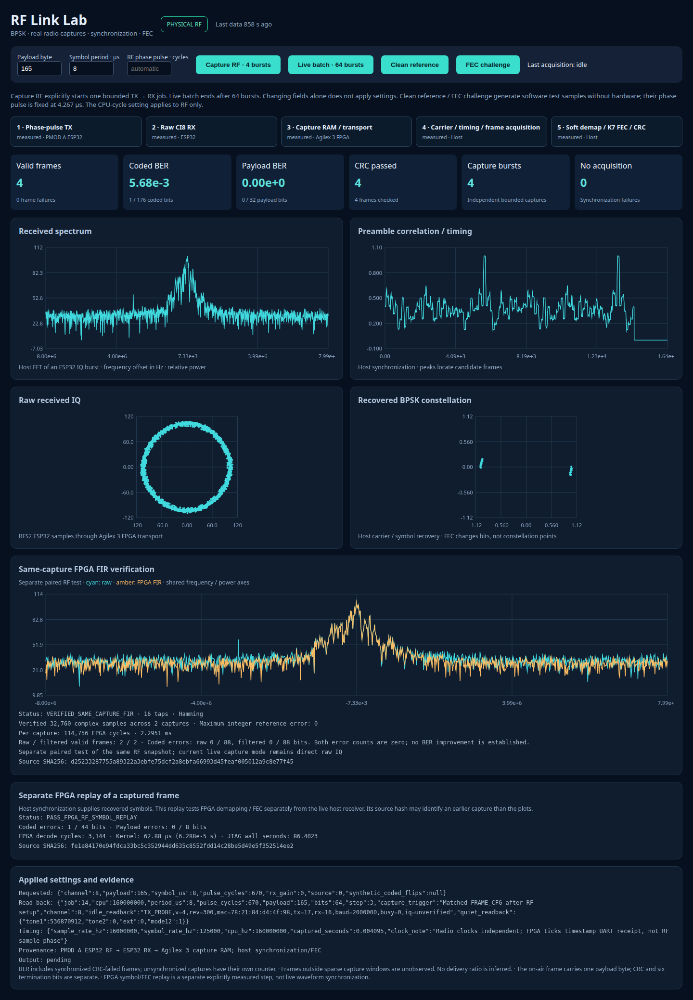

# RF BPSK walkthrough: from phase control to decoded payload

The v4 transmitter and host receiver share a defined 64-symbol framed BPSK contract. The original ESP32 has transmitted frames recovered by an independent receiver; a captured frame has also been replayed through the physical Agilex 3 symbol/FEC block, and a separate same-capture FIR test verifies the existing FPGA filter. Raw-IQ synchronization and the full receiver still run on the host.

## One frame, end to end

```text
  16-symbol marker                44 coded symbols                   4 guards
┌────────────────────────┬──────────────────────────────────────┬────────────┐
│ 0x0651, MSB first      │ K=7, rate 1/2, (171,133) octal       │ zero bits  │
└────────────────────────┴──────────────────────────────────────┴────────────┘
         16 symbols       22 input bits × 2 = 44 symbols            4 symbols
         └────────────────────── 64 symbols total ────────────────────────────┘
```

The 22 encoder input bits are one payload byte, its CRC-8, and six zero termination bits. CRC-8 uses polynomial `0x07`, initial value `0x00`. The K=7 convolutional encoder starts in state zero and emits the 44 coded bits; four additional zero symbols guard the end of the repeated frame. Bits and marker are sent most-significant-bit first. BPSK states map 0 to positive and 1 to negative. The original ESP32 creates transitions with brief frequency-increment pulses; it does not play arbitrary IQ samples.

At the default 8 µs symbol period, a frame occupies 512 µs. The receiver captures 16,380 complex CI8 samples at nominal 16 MS/s, a 1.02375 ms window. That is nominally about two frame periods, but it does not guarantee a complete frame: TX scheduling jitter or missed symbol slots can delay or restart a frame. The firmware restarts at the marker after a missed slot rather than compressing symbols.

```mermaid
flowchart LR
    P[Payload byte] --> TX[ESP32 v4<br/>frame, K7, phase pulses]
    TX -. 2.4 GHz RF .-> RX[Independent ESP32 IQ capture]
    RX --> FPGA[Agilex 3<br/>capture RAM + transport]
    FPGA --> HOST[Host Python<br/>carrier, timing, marker search]
    HOST --> HD[Host<br/>soft decisions + K7 FEC + CRC]
    HOST -. measured 44 recovered symbols .-> RTL[FPGA checkpoint 06<br/>soft demap + K7 Viterbi]
    HD --> OUT[Payload / BER / frame evidence]
    RTL --> OUT
```

Capture transport runs through the FPGA. In the normal checker, carrier estimation, timing search, marker acquisition, demapping, Viterbi decoding and CRC validation run on the host. The separate FPGA replay tool takes the host's measured 44 payload-region symbols and sends those into checkpoint 06 for FPGA soft demapping and terminated K=7 decoding. The FPGA tool does not perform raw-IQ synchronization, transmit RF, or program the FPGA image.

## Implemented contract and offline evidence

Firmware `FRAME` accepts channel, bounded duration, backoff, payload byte, symbol period and pulse width. `FRAMEBITS` returns the encoded 64-bit sequence for a payload so host code can verify cross-language agreement before capture. Default symbol timing is 8 µs; configured values are 8–15 µs in the current checker. `FASTPHASE` exposes the configurable extension step 1–3 for phase-pulse experiments. These controls define a software/firmware contract; they do not establish a measured RF error rate.

The v4 application compiled with the SDK, native plus cross-language protocol checks passed for all 256 payload values, and the corrected firmware passed its normal `READY` startup. Physical measurements then confirmed the calibrated pulse profile and independent frame recovery.

The pulse calibration used the original ESP32 at 160 MHz. With extension step 3, the calibrated 670-cycle pulse measured a median −180.22° phase change with second circular moment 0.992. The half-width control measured −90.01°; carrier-only CW produced zero phase events. The nominal 682-cycle full pulse measured −183.11° with moment 0.656 and failed the strict concentration criterion, so the checker defaults to 670 cycles on this CPU. This is relative phase evidence, not calibrated transmit power or a guarantee for other clocks/settings.

| RF run | Captures | Payload | CRC-valid frames | Pre-FEC coded errors | Decoded payload errors |
|---|---:|---:|---:|---:|---:|
| `rf-bpsk-001` | 4 | `0xA5` | 4 | 1 / 176 | 0 / 32 |
| `rf-bpsk-002` | 16 | `0x3C` | 16 | 19 / 704 | 0 / 128 |
| `rf-bpsk-003` | 4 | `0x00` | 4 | 0 / 176 | 0 / 32 |
| `rf-bpsk-004` | 4 | `0xFF` | 4 | 0 / 176 | 0 / 32 |
| **Direct RF total** | **28** | — | **28** | **20 / 1232** | **0 / 224** |
| Live browser 64-burst batch | 64 | — | 65 | 55 / 2860 | 0 / 520 |
| **Combined PMOD A observations** | **92** | — | **93** | **75 / 4092** | **0 / 744** |

All direct captures and the 64-burst batch yielded the stated CRC-valid frames with no acquisition or CRC failures. The batch completed in 50.68 seconds. An independent review redecoded the original 28 direct captures without an expected-payload input and verified the raw CI8 hashes. The known payload was used only after blind carrier/timing/frame recovery for BER comparison. Each coded BER denominator contains 44 coded bits per recovered frame; each payload denominator contains eight payload bits per frame. These are observed samples, not a claim that the true BER is zero. The windows are sparse and do not measure delivery between captures.

A separate PMOD B receiver observation recovered four CRC-valid frames from four captures: 4/176 coded errors and 0/32 payload errors. It is an independent receiver observation and may contain the same transmitted packets; keep it separate from the PMOD A combined totals rather than treating it as additional unique RF delivery.



## Separate same-capture FPGA FIR test

The existing checkpoint 03 FIR II was enabled for a paired capture of the same RF burst. This checks the established filter IP and does not add FIR to checkpoint 06 or create a new bitfile:

```text
                         ┌→ Raw CI8 snapshot ────────┐
Same ESP32 RF snapshot ──┤                            ├→ Host sync / BPSK / K7 FEC / CRC
                         └→ FPGA FIR II, 16 taps ────┘
                              Hamming Q15 · nearest
```

Two paired captures covered 32,760 complex samples. The 16-tap Hamming Q15 filter with nearest rounding matched the independent integer reference exactly (maximum error 0). It used 114,756 FPGA cycles per 16,380-sample burst, or 2.29512 ms at 50 MHz. Raw and filtered paths each recovered two CRC-valid frames with 0/88 coded errors. This is a separate FIR verification; those frames are not part of the 28 direct-capture totals, and equal error counts do not establish a BER improvement.

Reproduce with the installed v4 transmitter and checkpoint 03-compatible image:

```bash
.venv-notebooks/bin/python scripts/check_rf_bpsk_fir.py \
  --output cyberether/run/rf-bpsk-fir-new --captures 2 --payload 165
```

The checker restores the prior FIR configuration and pairing state. It does not program hardware or upload host-generated IQ.

The BPSK host receiver acquires from received samples using the configured symbol period and marker only. A known payload may be supplied for error counting after decisions; it is not supplied to synchronization, decoding, or CRC validation. CRC failures and sync failures remain separately counted. Captures contain sparse windows, so frames between windows are unobserved and cannot be treated as errors or successful delivery.

## BER and failure counts

| Measure | Counted bits or events | Denominator |
|---|---|---|
| Pre-FEC coded BER | Incorrect decisions among the 44 coded bits | Coded bits in sync-acquired frames compared with the known frame, whether CRC passes or fails |
| Decoded payload BER | Incorrect payload decisions | 8 payload bits per acquired frame compared with the known byte, including CRC-failed frames |
| CRC/frame failures | Acquired frames with an invalid received CRC | Acquired frames with a complete CRC check |
| Sync failures | Captures with no accepted marker/frame | Capture attempts; no payload-bit denominator exists for these captures |

The 16 information bits include payload plus CRC, and the six trellis tail bits are encoder overhead; neither changes the eight-bit payload BER denominator. Report zero as “0 errors in N tested bits.” A replay of one saved capture does not add independent RF coverage. A short capture window also means the checker cannot infer how many frames were transmitted between captures.

## Run the host RF checker and viewer

The checker requires the explicitly installed v4 TX probe and the normal IQB1 FPGA runtime hub. It does not flash the ESP32 or FPGA. With the correct transmitter and receiver roles connected, run:

```bash
.venv-notebooks/bin/python scripts/check_rf_bpsk.py \
  --output cyberether/run/rf-bpsk-new --captures 4 --payload 165
```

By default this requests four bounded captures with payload `0xA5`, channel 8, 8 µs symbols, RX gain 0 and 120 quarter-dB backoff. On a 160 MHz transmitter it selects the measured 670-cycle step-3 pulse profile; another CPU clock requires an explicit `--pulse-cycles` calibration. The default was chosen from the measured 670-cycle result, not the nominal 682-cycle estimate. `--synthetic` runs a separately labeled software fixture with no hardware. See `--help` for capture, channel, source, timing, pulse, gain and backoff options. The checker verifies the transmitter identity, firmware-generated frame bits, applied TX settings, receiver gain and TX idle/restoration state. It saves raw CI8 captures and a proof record; host analysis supplies synchronization, demapping, FEC and BER counts.

Start the RF Link Lab viewer to inspect the latest proof and explicitly request a new bounded capture:

```bash
.venv-notebooks/bin/python scripts/start_rf_link_lab.py
```

The page shows spectrum, marker correlation/timing, raw received IQ, recovered BPSK symbols, applied/read-back settings, coded and payload error counts, CRC/frame failures and synchronization failures. Editing controls alone does not transmit; the **Capture RF** button starts the job. The viewer owns no serial or JTAG device itself. Its acquisition worker is guarded against concurrent RF Link Lab capture jobs.

## Replay recovered symbols through checkpoint 06

After a physical capture proof contains at least one sync-acquired frame, the separate checker can replay its measured payload-region symbols through the FPGA modem block. The first replay of frame 0 from `rf-bpsk-001` passed with block ID `0x4d440601`: the FPGA reported 1/44 coded errors, 0/8 decoded payload errors, and a valid CRC. The measured decode took 3,144 cycles, or 62.88 µs at 50 MHz; the JTAG transaction took 86.402 seconds. This time difference separates FPGA kernel work from slow host/JTAG data movement.

```bash
.venv-notebooks/bin/python scripts/check_rf_bpsk_fpga.py \
  --input cyberether/run/rf-bpsk-new/proof.json \
  --output cyberether/run/rf-bpsk-new/fpga-replay.json
```

This command requires checkpoint 06 already loaded. It never autoprograms. It selects frames by synchronization even when their CRC failed, checks FPGA soft metrics, decoded bits and counters against independent integer/Python references, and records FPGA cycles separately from JTAG transaction wall time. It reports symbol/FEC processing of host-recovered RF symbols; synchronization and timing remain host work. Synthetic proofs are rejected.

The 3,144-cycle result is the FPGA demapper/FEC path only; the FIR result is a separate use of existing FIR II IP. Carrier estimation, timing search, marker acquisition and symbol extraction remain host Python; the FPGA does not yet receive and synchronize the raw RF waveform. Future work is to move the full raw-waveform receiver into FPGA, evaluate higher-throughput SPI transport, and extend beyond BPSK. The measured bursts do not establish continuous real-time reception or performance across other hardware settings.

For the earlier measured scalar phase-control work and its limits, see [phase RF results](ESP32_PHASE_RF_RESULTS.md). For the wider modulation roadmap, see [BPSK to 64-QAM plan](RF_MODEM_BPSK_TO_64QAM_PLAN.md).
