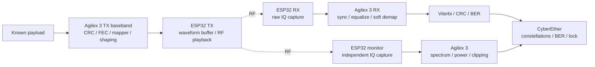

# Next major RF demo: BPSK to 64-QAM modem lab

Status: implementation roadmap; new modem functions and ESP32 raw-IQ TX are not hardware-qualified in this checkout.

## Outcome

Show a real transmitted waveform becoming recovered symbols and bits, then demonstrate how synchronization, equalization and FEC affect reliability. Progress through **BPSK → QPSK → 16-QAM → 64-QAM** on the Atum A3 Nano / Agilex 3, with one ESP32 TX, one RX and one independent monitor.

This is the next major RF education demo. It expands the [three-radio modem/FEC foundation](SDR_MODEM_FEC_PLAN.md); that document retains detailed frame sizing, transport and BER accounting. The [Wi-Fi gateway](WIFI_GATEWAY_FPGA_PLAN.md) is a separate application. The modem uses a custom fixed-frequency waveform; it does not implement Wi-Fi networking.



## Hardware decision before implementation

| Role | Initial candidate | Gate |
|---|---|---|
| TX | ESP32-S3 supported by the inspected IQ-TX project | Prove arbitrary-IQ playback, packing, rate, capacity and linearity on the exact board |
| RX | Existing original ESP32 or supported S3 | Verify complete-frame raw IQ capture and gain/rate behavior |
| Monitor | Existing original ESP32 or supported replacement | Independently observe RF activity and spectrum without receiver overload |

Start at a verified **2.4 GHz** setting, permitting reuse of existing receivers. An original ESP32 or ESP32-C5 must not be assumed to provide arbitrary-IQ TX. If only the installed original modules are available, qualify that path or obtain a supported TX module before the real-RF milestone. Continue simulation/FPGA loopback while this is unresolved.

Use USB board power/programming and explicitly mapped PMOD transport with shared ground. Preserve current wiring and working images until a reviewed hardware integration step. No shared RF clock is required for this single-link modem; RX must recover oscillator and timing errors. The monitor is not a coherent extra antenna.

## Modulation ladder

| Milestone | Points | Coded bits/symbol | Information bits/symbol at rate-1/2 FEC* | New lesson |
|---|---:|---:|---:|---:|---|
| BPSK | 2 | 1 | 0.5 | Find a frame, acquire timing/phase and recover bits |
| QPSK | 4 | 2 | 1 | Quadrant ambiguity and two soft bits per symbol |
| 16-QAM | 16 | 4 | 2 | Amplitude accuracy, equalization and four soft bits |
| 64-QAM | 64 | 6 | 3 | Tighter error budget, RF linearity and six soft bits |

*Before preamble, pilots, header, CRC, padding and encoder-termination overhead. Hold symbol rate and pulse shape fixed for the first comparison. Compare modes at a documented average symbol energy; use code-rate-aware Eb/N0 for coding-gain plots. Do not infer faster UART throughput from more bits per RF symbol.

## One reusable TX chain

```text
Payload / reproducible PRBS
  → CRC → scrambler → convolutional FEC → optional interleaver
  → Gray-coded BPSK / QPSK / 16-QAM / 64-QAM mapper
  → frame assembly: known acquisition/training, protected header and pilots
  → RRC pulse shaping / interpolation → amplitude scaling / quantization
  → FPGA waveform RAM → upload to ESP32 → preloaded RF playback
```

Keep a robust BPSK preamble/header when payload modulation changes. Header fields identify waveform version, frame ID, payload length, modulation and FEC/interleaver configuration. Define header protection separately from payload protection. Known training must cover both amplitude and phase estimation.

Freeze all conventions in a versioned waveform specification and golden vectors: bit ordering, Gray map, normalized energy, CRC, PRBS, scrambling, encoder polynomials/state/tail, interleaving, pilots, filter delays, quantization and ESP32 packing. For square 64-QAM, use eight amplitude levels on each axis; explicitly define the normalization and bit-to-axis mapping.

Start with the foundation plan's 1 Msymbol/s and 40 MS/s S3 TX proposal, subject to real qualification. The generator calculates the full waveform length including guards/filter tails and enforces measured SRAM capacity/alignment. Choose payload length per mode so a complete repeated frame is capturable at arbitrary RX start phase. Do not silently truncate frames.

## One reusable RX chain

```text
IQ ingress / CRC / source-tagged capture RAM
  → DC removal / clipping checks / level normalization
  → coarse preamble detection and frequency-offset estimate
  → NCO / complex frequency correction
  → RRC matched filtering / decimation
  → fractional symbol timing recovery
  → training-based channel estimate / complex FIR equalizer
  → pilot-assisted carrier phase and amplitude tracking
  → resolve rotational ambiguity / identify frame and payload
  → hard bits + signed soft metrics
  → deinterleaver → Viterbi → descrambler → CRC → BER / frame statistics
```

Ordering and feedback placement may change with the chosen acquisition method; document group delays and metadata at each boundary. Timing recovery needs an oversampled/interpolatable signal before final symbol decisions. Define and test QAM-specific decision-directed phase detectors; a QPSK Costas detector cannot simply be reused without checking its behavior on amplitude-varying QAM.

Use training to initialize gain, phase and equalizer taps, then track within each burst. Adaptation must have reset/freeze controls. Avoid fast gain changes that follow individual QAM symbol amplitudes. Use regularized estimates and limits so weak signals cannot cause uncontrolled gain.

Implement an explicit acquisition state machine:

```text
SEARCH → COARSE SYNC → TRAIN → HEADER CHECK → TRACK / DECODE → CRC / COUNT
   ↑         timeout / bad header / lost lock / end of burst          │
   └──────────────────────────── reacquire ────────────────────────────┘
```

Keep header failures, loss of lock, payload errors and capture failures distinct. Never infer lock solely from a visually plausible constellation or use the known payload to overwrite received decisions.

## FPGA blocks and interfaces

| Block | Candidate implementation | Standalone verification |
|---|---|---|
| FEC encoder / scrambler / CRC | RTL, common to all modes | Known vectors, reset/tail/bit-order cases |
| Mapper / soft demapper | LUT/threshold-distance RTL; 1/2/4/6 metrics per symbol | Exhaust every ideal point, boundaries and metric signs |
| RRC / matched filter | FIR II or validated FIR RTL with appropriate lengths | Quantized impulse/frequency response, stalls and saturation |
| Carrier correction | Phase accumulator, complex mixer, CORDIC or equivalent | Known phase/frequency ramps and phase wrapping |
| Timing recovery | Error detector + fractional-delay/polyphase interpolation | Fractional offsets and sample-clock drift sweeps |
| Complex equalizer | Training-based FIR; adaptive extension | Known multipath channels and convergence/freeze tests |
| Viterbi | Validated hard/soft RTL; vendor IP only if installed/licensed and suitable | Trellis vectors, traceback latency and error injection |
| Capture / monitor FFT | RAM/FIFOs, FFT IP/RTL, power/clip accumulators | Frame provenance, overflow, FFT vectors and scaling |
| Configuration / evidence | Nios V + registers/JTAG UART | Atomic configuration, readback, counter snapshots |

Use a new independently buildable native VDS checkpoint. Define sample and soft-bit stream formats, valid/ready, frame boundaries, sample rate, fixed-point scaling and latency. Budget intermediate widths from simulation, not from the 8/10-bit radio sample width. Measure post-fit ALM/DSP/RAM use and timing; do not commit to a utilization percentage before compilation. Pin the exact vendor IP configuration and include complete SDC/project exports.

Final operational DSP target is FPGA TX/RX/FEC/BER plus monitor FFT. ESP32s control RF and move samples; Nios controls jobs; host Python configures, validates and displays FPGA outputs. Early Python processing is a labeled reference/prototype, not evidence that the corresponding FPGA block exists.

## Development stages and exit criteria

| Stage | Deliverable | Exit criterion |
|---|---|---|
| 0 · Contract and hardware | Radio inventory, sample protocol, waveform spec | Exact TX path verified or hardware gate explicitly recorded; vectors fit buffers |
| 1 · Python modem | All four modes, AWGN/CFO/timing/multipath model, hard/soft FEC | Noiseless exact decode; repeatable BER curves over multiple seeds |
| 2 · FPGA BPSK | Encoder/shaper, burst sync and demod/decoder in loopback | Bit-exact vectors; lock/reacquisition and counter checks pass |
| 3 · Real RF QPSK | TX/RX/monitor integrated | Four recovered symbol clusters, valid frames and measured before/after errors |
| 4 · 16-QAM | Gain/phase/equalizer training and four-metric demapping | 16-point mapping verified; useful real-RF BER and clipping/EVM evidence |
| 5 · 64-QAM | Eight-level axes, six-metric demapping and improved tracking | All 64 points verified; real-RF frame/BER measurements meet an agreed target |
| 6 · Presentation | CyberEther, notebooks, complete VDS exports and reports | Reproducible demo with visible applied settings and mode provenance |

Run module simulation and internal FPGA loopback for each mode before real RF. The 64-QAM gate is empirical: measure the exact ESP32 link's EVM, phase drift, distortion, image leakage and quantization limits. If real RF cannot support useful 64-QAM BER, retain the validated FPGA 64-QAM loopback demonstration, identify its mode clearly, and document the RF limitation. Do not present synthetic results as RF success.

## Error and lock evidence

Display pre-FEC coded BER, post-FEC payload BER, uncoded payload BER, CRC/frame errors and acquisition statistics with explicit denominators. Include errors from CRC-failing decoded frames. Known reference bits are used by the measurement block only, not to assist decoding beyond the declared training/header.

Compare hard versus soft decoding on the same received symbols. Compare coded versus uncoded payload BER separately using controlled energy/rate assumptions. Interleaving is an explicit optional experiment, with matched TX/RX settings. At low SNR, loss of synchronization or decoding failure may dominate; FEC is not guaranteed to improve every point.

For each initial operating point, collect at least 100,000 payload bits and continue as needed for meaningful error counts. Report zero errors as an observation with the tested bit count, not zero true BER. Save waveform IDs, unique RX capture IDs, seeds, settings and failures. Reprocessing one saved capture does not add independent RF evidence.

EVM uses a declared RMS reference normalization and known transmitted symbols after acquisition/alignment, with any removed gain/phase/equalizer effects stated. Show both pre/post-equalization results where useful. An EVM improvement is not automatically a measured BER improvement, and FEC does not physically tighten received constellation clusters.

## CyberEther: make each correction visible

```text
┌──────────────────────────────────────────────────────────────────┐
│ BPSK → QPSK → 16-QAM → 64-QAM · Source: preview / FPGA / RF       │
│ Applied settings · frame ID · capture age · SEARCH/TRACK/ERROR     │
├─────────────────────┬─────────────────────┬──────────────────────┤
│ Raw IQ scatter      │ Recovered symbols   │ After equalization   │
│ no symbol claim     │ ideal-point overlay │ EVM + phase error    │
├─────────────────────┼─────────────────────┼──────────────────────┤
│ Eye / timing error  │ BER vs impairment   │ Monitor spectrum     │
│ CFO + lock metrics  │ uncoded/hard/soft   │ power / clip / age   │
├─────────────────────┴─────────────────────┴──────────────────────┤
│ TX encode → map → RF → sync → demap → FEC → CRC / BER             │
│ Error/bit counts · frame failures · useful throughput · resources │
└──────────────────────────────────────────────────────────────────┘
```

Keep controls focused: modulation, coded/uncoded waveform, hard/soft decoding, impairment level, run/pause/capture and reset statistics. Advanced controls expose equalizer bypass, pilots and gain/backoff. A mode change is APPLYING until TX waveform/readback and a fresh matching RX result agree. Never mix BER windows across settings.

Teaching scenes: **Find the signal → Stop the rotation → Open the eye → Correct the channel → Rescue the bits → Pack more bits**. The same captured burst can illustrate stage-by-stage processing, but only new captures advance acquisition statistics. Monitor observations are independent and timestamped; they do not prove coherent synchronization with RX.

## Practical boundaries and deliverables

UART remains burst transport: 2 Mbaud/8N1 gives at most 200 kB/s before overhead, versus 80 MB/s for CI8 at 40 MS/s. Upload finite TX waveforms, replay locally, acquire buffered RX/monitor snapshots and report coverage gaps. This is not a gap-free real-time modem link. Faster transport is a later measured upgrade, not a prerequisite for buffered FPGA DSP demonstrations.

Add the new lesson(s) through scripts/make_notebooks.py without renumbering existing notebooks. Include theory/graphics, editable Python simulation, actual VDS PNG export, module/top simulation with Questa GUI directions, full QPF/QSF/SDC/source links, SOF build/program, focused live page, progress feedback and saved example screenshots. Extend the local installer for actual new dependencies and pin sources/licenses.

Deliver firmware profiles, waveform spec/golden fixtures, native VDS construction scripts, RTL/IP and constraints, Nios BSP/app generator, notebook(s), CyberEther views, and a results report covering BER, EVM, acquisition, throughput, resources and limitations. Use one acquisition owner and release serial/JTAG on stop. No implementation, programming or flashing is performed by creating this plan.

## References

- [Three-radio modem/FEC foundation](SDR_MODEM_FEC_PLAN.md)
- [ESP32 IQ TX: S3/S31 SRAM playback](https://github.com/whstudio123/esp32-iq-tx)
- [ESP-SDR receiver support and capture limits](https://github.com/ESPARGOS/esp-sdr)
- [HDL QAM transmitter and receiver architecture](https://www.mathworks.com/help/comm/ug/hdl-optimized-qam-transmitter-and-receiver.html)
- [GNU Radio packet receiver architecture](https://wiki.gnuradio.org/index.php?title=Gr4-packet-modem_receiver)
- [GNU Radio constellation soft decoder](https://wiki.gnuradio.org/index.php/Constellation_Soft_Decoder)
