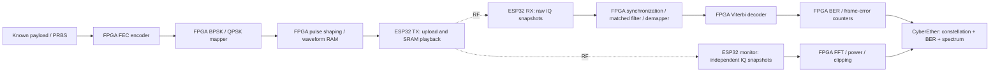

# Three-ESP32 SDR modem: modulation, demodulation and FEC

Status: proposed implementation, not a completed modem or hardware result.

This foundation is expanded by the [next major RF demo roadmap: BPSK to 64-QAM](RF_MODEM_BPSK_TO_64QAM_PLAN.md).

## Demonstration goal

Transmit known data as a clean BPSK/QPSK constellation from one ESP32. Capture it on a second ESP32, recover symbols and bits in Agilex 3, and demonstrate forward error correction (FEC) reducing the measured bit error rate (BER). A third ESP32 independently monitors the transmitted spectrum and activity.

This is a small custom radio modem on a fixed frequency, not a Wi-Fi packet gateway. It does not require Wi-Fi association, encryption, acknowledgments or coherent clocks between receivers. Receiver frequency/phase/timing recovery is part of the lesson.



## Radio roles and feasibility gate

| Radio | Initial hardware choice | Responsibility |
|---|---|---|
| TX | ESP32-S3 board supported by the inspected IQ-TX project | Load a waveform, tune, start/stop preloaded playback; report applied settings |
| RX | Original ESP32 from our installed suite, or another supported ESP32-S3 | Capture raw IQ bursts; report rate, frequency, sequence, length and CRC |
| Monitor | Another installed original ESP32, or supported replacement | Independently capture IQ for spectrum, activity, receive power and clipping |

Use 2.4 GHz first so the existing receivers can be reused. The S3 choice is based on documented upstream SRAM IQ playback, not a test on our boards. ESP32-C5/original-ESP32 arbitrary-IQ TX must not be assumed to work. If only the three currently connected original ESP32 modules are available, raw-IQ TX qualification or a replacement TX module is a prerequisite.

The inspected TX implementation exposes S3 playback at 40/80 MS/s and a finite waveform buffer. It is not a continuous waveform stream from PMOD. Before building the receiver around it, verify the exact board, firmware revision, sample packing, waveform capacity, RF center frequency, amplitude and reproducible start/stop behavior. Retain upstream licensing/provenance.

Use USB for board power/programming and PMOD UART plus common ground for initial FPGA control/data. Keep PMOD power disconnected in the USB-powered arrangement. Document actual pins per board; no assumed common pinout. Begin RF qualification with a controlled low-level link, preferably a properly attenuated conducted path where antenna connectors permit it, or a shielded setup. Avoid receiver overload.

## First waveform and frame contract

Start with BPSK acquisition, then Gray-coded QPSK for the four-point constellation demo. Use single-carrier modulation; OFDM/16QAM are later extensions.

| Parameter | Initial proposal |
|---|---|
| Center frequency | One verified 2.4 GHz setting shared by TX/RX/monitor |
| TX sample rate | 40 MS/s on the qualified S3 path |
| Symbol rate | 1 Msymbol/s; 40 TX samples/symbol |
| Pulse shaping | Root-raised-cosine (RRC), roll-off 0.35; matched filter on RX |
| RX rate | Start at 40 MS/s, then qualify lower supported rates with correct resampling |
| Payload | Known 128-bit test payload initially; several payload patterns/seeds |
| FEC | Rate-1/2 convolutional code, constraint length 7; hard and soft Viterbi comparison |
| Frame | Guard → acquisition preamble → training/sync/header → coded payload/CRC/tail → guard |

Create a versioned machine-readable waveform/frame specification before RTL: exact preamble, header fields and protection, PRBS polynomial/seed, bit order, QPSK mapping, pulse/filter normalization, CRC convention, convolutional polynomials (171/133 octal), shift-register orientation, output order, initial/terminal states, padding and sample packing. Commit golden vectors to remove convention ambiguities.

Suggested payload protection: append CRC-16, then six encoder termination bits, and encode the resulting block. A 128-bit payload plus 16 CRC bits and six tail bits produces 300 coded bits, or 150 QPSK symbols. Budget acquisition/header/guards/filter transients around this. The waveform generator must calculate the full sample count, satisfy playback alignment, and reject overflow against the verified TX capacity. Do not truncate a frame to make it fit.

At 40 MS/s, 16,128 samples span about 403 microseconds; a 150-symbol coded payload occupies 150 microseconds at the proposed rate. Final framing must fit the remaining budget, or reduce payload size/change the rate. A capture must contain a complete frame; use frame-length/guard choices that permit at least one full frame within the qualified RX buffer despite arbitrary capture start phase.

## FPGA receive stages

```text
IQ ingress / CRC / RAM
   → DC correction and level/clip measurement
   → coarse frame detection and carrier-frequency-offset estimate
   → NCO frequency correction
   → matched filter / decimation
   → symbol timing recovery and fine carrier/phase recovery
   → training-based phase ambiguity resolution / gain normalization
   → symbol-spaced constellation taps
   → hard bits AND signed soft metrics
   → Viterbi decoder → CRC check → BER counters
```

The implementation may reorder detection/filtering to suit the acquisition method, but every delay and sample-rate change must remain explicit. Account for filter transients, fractional timing offsets, independent oscillator drift and dropped captures. Known training resolves QPSK's quadrant ambiguity. Do not use known payload bits to correct received payload decisions.

The display must distinguish raw IQ scatter from recovered symbol-spaced constellation points. Only the latter is the modem constellation. FEC corrects bit estimates; it does not make the received constellation dots physically tighter.

## BER experiment: measure the improvement honestly

Feed the same captured soft-symbol data into hard-decision and soft-decision decoder paths for a directly comparable experiment.

| Metric | Numerator / denominator |
|---|---|
| Pre-FEC coded BER | Wrong hard-demapped coded payload bits / compared transmitted coded payload bits |
| Post-FEC payload BER | Wrong decoded information bits / compared original payload bits |
| Uncoded payload BER | Wrong uncoded information bits / compared original uncoded payload bits |
| Acquired-frame error rate | Payload CRC failures / acquired frames with valid headers |
| Acquisition loss | Missed/invalid frames in a controlled counted transmission experiment; otherwise report capture/frame acquisition statistics without inventing a transmitted-frame denominator |

Pre/post-FEC BER use different bit populations; label them explicitly. The stronger coding-gain result is a separate coded-versus-uncoded payload BER sweep versus Eb/N0 with code rate, energy per information bit, bandwidth and overhead accounted for. Do not equate equal transmit amplitude with equal Eb/N0. Report effective information throughput too: rate-1/2 coding consumes extra symbols.

1. First run reproducible Python AWGN, frequency-offset and timing-offset simulations across several seeds. Produce uncoded, hard-Viterbi and soft-Viterbi BER curves.
2. Exercise the exact captured RX data with optional seeded FPGA-added noise before demodulation. Clearly label this as digital impairment added after RF capture; retain an unmodified RF mode.
3. Sweep physical attenuation/gain separately. Use received SNR estimates only with a stated estimator; EVM is not automatically calibrated Eb/N0.
4. Count errors on CRC-failing payloads too. Reject bad headers separately so success-only filtering cannot hide errors. Report all acquisition failures alongside BER.
5. Accumulate at least 100,000 payload bits per initial point and continue where practical until enough errors support a comparison. Show raw counts; zero observed errors is not proof of zero BER. Save capture IDs, seeds, settings and repetitions.
6. Repeated playback is acceptable for bring-up; do not count a replay of the same stored RX capture as a new independent RF observation. Identify waveform version and capture sequence separately.

Success: at a measured operating point, valid-frame acquisition is stable and post-FEC payload BER is lower than the measured uncoded baseline under a documented comparison. Demonstrate the failure region too: below the usable SNR, synchronization or decoding can fail and FEC is not guaranteed to improve results.

## Implementation checkpoints and tests

| Step | Addition | Required evidence |
|---|---|---|
| 0 | Exact TX/RX/monitor inventory and firmware qualification | Known waveform reaches RX and monitor without clipping; packing/rates confirmed |
| 1 | Python model and waveform specification | Noiseless recovery; reproducible BER curves; golden payload/coded/symbol/IQ vectors |
| 2 | FPGA encoder, mapper and pulse shaper | Module simulation matches vectors; playback image length/alignment verified |
| 3 | FPGA capture, synchronization and demodulation | Timing/CFO sweeps, phase ambiguity tests, symbol lock and bit alignment |
| 4 | FPGA hard/soft Viterbi and BER counters | Noiseless exact recovery, directed error tests and noisy statistical comparisons |
| 5 | Real RF integration | Independent RX/monitor captures; real symbol constellation and before/after error counts |
| 6 | Live education page and notebook | Applied-setting evidence, fresh captures, mode labels and saved results |

Use a separately buildable VDS checkpoint. Connect RTL/IP through explicit sample-stream valid/ready and frame-boundary interfaces, with FIFO clock crossings and a register map. Reuse Nios V for configuration, waveform upload commands and counter snapshots; keep demodulation/FEC out of the operational Nios software path. Candidate building blocks are FIR II, RAM/FIFOs, NCO/complex-mixer RTL, CORDIC or equivalent phase RTL, correlators and Viterbi RTL. Check actual installed vendor-IP support/licensing before selecting a vendor decoder. Record post-fit resources and timing rather than assigning speculative utilization targets.

Run Questa module tests before full integration; inject stalls, saturation, frame loss and resets. Validate coefficient/metric widths, soft-metric signs, traceback latency and counter windows against independent references. Generate native VDS diagrams and complete QPF/QSF/SDC/source project exports.

## CyberEther presentation

```text
┌──────────────────────────┬──────────────────────────┐
│ Recovered QPSK symbols   │ BER: uncoded / hard / soft│
│ Ideal points + EVM       │ Error counts + bit counts│
├──────────────────────────┼──────────────────────────┤
│ RX eye / timing / CFO    │ Monitor spectrum / history│
│ Lock and frame status   │ Power / clipping / age   │
├──────────────────────────┴──────────────────────────┤
│ TX → RF → RX → sync → demap → Viterbi → CRC         │
│ Applied settings · capture IDs · FPGA proof/status │
└────────────────────────────────────────────────────┘
```

Keep controls small: BPSK/QPSK, uncoded/coded waveform, impairment level, hard/soft decode, capture/run/pause and reset statistics. Start with an offline synthetic input button, then an internal FPGA loopback, then actual RF. Each mode must be visibly distinct. A decoder toggle cannot make an uncoded transmitted frame become FEC-coded: frame mode and applied TX waveform must agree.

Monitor data is independent supporting evidence, not a coherent extra receive antenna or a second BER measurement unless a separate decoder is explicitly implemented. Its sparse captures need not coincide with the main RX; show source timestamps/uncertainty and do not label host arrival times as RF synchronization.

## Transport and runtime boundaries

At 2 Mbaud/8N1, one UART carries at most 200 kB/s before overhead. A CI8 stream at 40 MS/s requires 80 MB/s, so the first modem is **preloaded TX plus buffered RX/monitor bursts**, with gaps. Upload a waveform once and reuse it; collect independent received snapshots for statistics. Measure duty cycle, turnaround and missed-frame opportunities. No Wi-Fi real-time MAC deadlines are required by this custom repeated-frame experiment.

Final operational target: FPGA generates TX baseband, recovers RX symbols, performs FEC and accumulates BER; ESP32s perform RF control/capture/playback/transport. Host Python runs control, reference validation and visualization. Move monitor FFT to FPGA for the final all-DSP-in-FPGA milestone; label host-rendered spectra during intermediate development. Use one acquisition owner for all radios, source-tag frames and release UART/JTAG on stop.

## Deliverables

- Versioned modem specification, golden vectors and clean waveform fixtures.
- Board-specific TX/RX/monitor firmware builds and programming instructions.
- Native VDS checkpoint, RTL/IP parameters, timing constraints, Nios BSP/app generator and full project links.
- Notebook covering theory, Python plots, real RTL/IP simulation/Questa GUI, FPGA build/program, live CyberEther and example screenshots; include progress feedback.
- BER/capture reports with exact settings, denominators, failures and hardware/software mode provenance.

This plan does not authorize an unattended radio/FPGA reflash merely to produce documentation. Implement and qualify hardware changes in a subsequent execution task; preserve the current demos and wiring until then.

## Sources and related plans

- [ESP32 IQ TX](https://github.com/whstudio123/esp32-iq-tx): supported S3/S31 SRAM waveform playback; confirm exact release limits during qualification.
- [ESP-SDR](https://github.com/ESPARGOS/esp-sdr): receiver support, sample formats and sparse capture limitations.
- [Existing FIR example library](FIR_FILTER_LIBRARY.md): reload/readback and independent integer-reference workflow.
- [Separate Wi-Fi gateway plan](WIFI_GATEWAY_FPGA_PLAN.md): different application requiring a substantially larger PHY/MAC implementation for raw-IQ operation.
