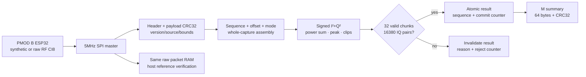

# FPGA processing directly from SPI IQ

**Status: source, simulation and build qualification only. SPI hardware
qualification is pending PMOD B’s reset; no SPI flash or capture is claimed here.**

A separate **SPIQ0002** image implements a processing stage in FPGA RTL after the SPI
bridge. The ESP32 firmware is unchanged. Reprogramming the FPGA switches between
SPIQ0001 transport and SPIQ0002 meter without another ESP32 reset or flash.



This is an FPGA integer power detector and transport integrity demonstration.
It does not perform synchronization, demodulation, FEC or SSID decoding.

## Arithmetic and validity

CI8 bytes are signed I followed by signed Q. For every complex sample:

```
power = I*I + Q*Q
sum_power += power              # 64-bit result
peak_power = max(peak_power, power)
clip_sample += I or Q equals -128 or +127
clip_component += each component equal to -128 or +127
```

Power is in uncalibrated CI8 code² units, not dBm or the ESP32 Wi-Fi RSSI.
Clipping means an integer component reached a numeric rail; it does not establish
analog-front-end saturation or a calibrated RF power level.

The FPGA checks physical transaction length1056, magic/version, source2,
header size32, supported flags, total32760 bytes, aligned ordered offsets,
valid payload length, final flag, zero padding, header CRC32 and payload CRC32.
Candidate measurements accumulate only across matching source/sequence/mode.
No candidate values are published until all32 chunks complete. Only one packet
is stored in FPGA RAM; whole-capture validation tracks metadata and candidate
accumulators, rather than keeping all32760 raw bytes on the FPGA. Any rejected
packet clears the public valid bit and increments the reject counter. Old
committed numbers remain readable **with valid=false**, never as a new result.
The commit counter advances only on a newly validated complete capture.

New captures must advance sequence using a signed modulo32 window, which accepts
`0xffffffff → 0` and rejects replay/backwards values, including `A → B → A`.
An **ESP32 reset starts a new sequence session**: reprogram/reset the FPGA before
accepting the restarted ESP32 sequence. The receiver does not silently accept a
backwards reset as fresh RF data. JTAG reprogramming the separate image supplies
that new session; the prototype has no unauthenticated UART counter-reset command.

Ingress cycles sum each physical SPI packet's start-to-end clock interval,
including byte stalls and the one-cycle end detector. They exclude READY wait
and host UART transfer gaps. Divide by the nominal50MHz FPGA clock to get active
ingress time. This is distinct from CLI elapsed time and end-to-end UART rate.

## Interfaces

`I` returns `SPIQ0002`; `T`, `R` and `C` preserve the original packet transport
behavior. `M` reads the current64-byte little-endian FPGA summary and never
starts SPI/RF acquisition.

|Bytes|Field|
|---|---|
|0..3|`SPM1`|
|4|Version1|
|5|Bit0 valid, bit1 synthetic|
|6|Last error:0 none,1 length/padding,2 header CRC,3 format,4 payload CRC,5 order/replay/mode|
|7|Reserved0|
|8..11|Committed capture sequence|
|12..15|Whole-capture commit counter|
|16..19|Rejected packet/incomplete capture counter|
|20..23|Complex sample count|
|24..31|64-bit power sum|
|32..35|Peak power|
|36..39|Complex samples with a rail component|
|40..43|Individual rail components|
|44..51|64-bit active SPI ingress cycles|
|52..55|Capture payload bytes|
|56..59|Validated chunk count|
|60..63|IEEE CRC32 over first60 summary bytes|

## Build and demonstrate

```bash
python scripts/simulate_spi_meter.py
python -m unittest discover -s cyberether/tests -p 'test_spi*.py' -v
cd fpga_hub/iq_bridge/spi_meter
quartus_sh --flow compile iq_spi_meter
```

Open [the Quartus project](../fpga_hub/iq_bridge/spi_meter/iq_spi_meter.qpf), then
use the existing board cable/programmer workflow to load
`output_files/iq_spi_meter.sof`. This replaces the FPGA hub temporarily; it does
not flash an ESP32. Keep PMOD B's SPI selector ON and BOOT selector OFF, using the
already-qualified combined SPI ESP32 image.

```bash
python scripts/check_spi_meter.py --confirm-spi-image \
  --output cyberether/run/spi-meter-synthetic-001
python scripts/check_spi_meter.py --confirm-spi-image --rf \
  --output cyberether/run/spi-meter-rf-001
```

The utility takes the shared acquisition lock, requires exact SPIQ0002 identity,
reads baseline `M`, captures raw CI8, then reads final `M` through the same serial
session. It requires matching sequence/mode, a new commit, valid state, lengths
and exact independent integer agreement for every FPGA meter. It reports active
FPGA ingress rate separately from total UART export rate. RF mode first forces
a synthetic boundary, then requests RF, ensuring the accepted RF capture is new.
Raw data and observed summary remain saved if integer verification fails.

In Questa GUI, after the script compiles the tests, open `simulation/spi_meter`,
run `vsim -gui work.tb_iq_spi_capture_meter` or
`vsim -gui work.tb_iq_spi_meter_top`, then `add wave -r /*` and `run -all`.
The standalone test exercises CRC/header/source/version, order/drop/mode/replay,
truncation/overflow/no-end, signed extremes/zero/clips, sequence wrap and recovery.
The complete board test moves32 valid SPI packets through RAM/UART, verifies
atomic meter values and independently timed ingress cycles, then corrupts another
packet and checks that `M` invalidates the view without advancing its commit.

The basic SPIQ0001 project and firmware remain separate. This meter is not yet
integrated into Nios V, VDS checkpoints or the running RF Link Lab. Host Python
transports bytes and verifies a reference; power/peak/clip arithmetic and capture
validity are implemented in FPGA RTL. Their hardware qualification remains pending.

## Build qualification snapshot, 2026-10-21

|Check|Result; hardware remains pending|
|---|---|
|Host/native C|12 SPI test groups passed|
|Questa standalone|CRC/format/source/version/order/drop/mode/replay/truncation/no-end, signed rails, sequence wrap and recovery passed|
|Questa board path|32 valid packets, atomic meters, independently timed cycles, summary CRC and next-packet invalidation passed|
|Quartus26.1.1|Full compile and no-edit consistency rebuild passed|
|Allocation|1,237 ALMs,1,940 registers,1 RAM,1 fixed-point DSP reported|
|Setup slack|50MHz system +12.698ns;5MHz SPI +88.334ns|
|Hold slack|System +0.088ns;SPI +18.626ns|
|Unconstrained|0 clocks, input ports or output ports|
|Fitted pins|All8 report3.3-V LVCMOS on the verified balls|

Five tool warnings remain, as in the standalone transport profile: early Reset
Release instance-count checking (the fitted generated SDM reset endpoint drives
the POR counter), inferred RAM pass-through, output drive/slew defaults, and
asynchronous/forwarded-clock data-output-delay labels. These are not a claim of
board waveform timing margin or hardware qualification. Local generated build
records are in `cyberether/run/spi-meter-build-qualification.json`.
