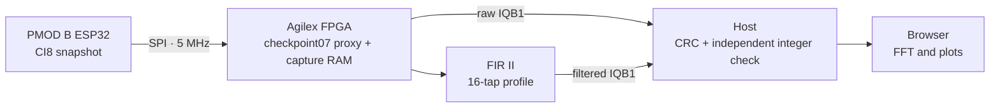

# SPI IQ Pipeline Lab

The SPI IQ Pipeline Lab gives PMOD B its own capture and processing page on
port8771. The page is idle when opened: it does not acquire RF, flash either
device, or program the FPGA. Use **Verify test pattern** or **Capture real RF**
to start one explicit bounded run.



In FPGA, CRC/order checks and integer power, peak and clipping measurements run
with the capture controller. Checkpoint07 stages each SPI capture through raw
RAM and FIR II. The host verifies both IQB1 frames, capture identity, CRCs and
FIR output against an independent integer reference, then calculates the
display FFT. The plot is an analysis view of normalized CI8 samples, not a
calibrated power measurement. Final checkpoint07 SOF
`91a0b547a3c5b0ae8b780c89c31a19940dbf20e660f2ceea5ad602845e9e7881` passed a
fresh-boot capture. All 16 default taps read back as 2048; an exact Hamming
profile run matched the integer reference for 16,380 complex samples, and
settings restoration passed. The boot-fixed proof is
`cyberether/run/spi-fir-boot-fixed-synthetic-001`.

Checkpoint07 control guards were physically tested: 40 MHz / 2417 MHz returns
error128; a 1024-sample request returns error32 without arming. A valid SPI raw
capture and four passive RFS2 UART0 captures then passed on that earlier image,
recorded in `spi-profile-rejection-recovery-001`. The current image adds a
four-line whole-line status FIFO. It passed hardware `TX_ON` acknowledgement
with zero text drops (`tx-status-fifo-hardware-001`). Resource use is 27,988 /
45,800 ALMs (61%), 120 M20Ks and 16 reported DSP units; added ALMs are queue and
control logic, not RF processing. Current v6 has bounded RF captures; watchdog
recovery remains unqualified.

## Start the page

Run beside the installed FPGA tools, either on the Linux host or in its desktop
container:

```bash
.venv-notebooks/bin/python scripts/start_spi_pipeline_lab.py start
```

Open the URL printed by the launcher (port8771) in a browser that can reach that
host. It binds to `0.0.0.0` by default and reports a reachable address; there is
no fixed host or IP to configure. The existing [RF Link Lab](RF_BPSK_WALKTHROUGH.md)
is a separate page on port8770. Both pages use the same acquisition lock, so
they cannot capture simultaneously. The viewer enables SPI controls only when
the selected image manifest identifies checkpoint07. The checker independently
requires the shared acquisition lock and rejects a run if another owner holds
it. Release the other capture owner before retrying. To inspect or stop the page:

```bash
.venv-notebooks/bin/python scripts/start_spi_pipeline_lab.py status
.venv-notebooks/bin/python scripts/start_spi_pipeline_lab.py stop
```

## Run a bounded capture

Use the known PMOD B setup: combined SPI receiver firmware installed, SPI
selector ON, BOOT selector OFF, and the intended FPGA image already loaded. The
qualified meter image identifies as `SPIQ0002` and captures PMOD B only.
Checkpoint07 is the integrated SPI/FIR image. RFS2 UART0 passed four passive
captures on it. PMOD A UART INFO works, but transmitter RF remains unqualified
after a PHY setup watchdog hang before frame configuration.

In the page, select **SPI power meter** for the installed SPIQ0002 image or
**SPI + FIR pipeline** for integrated checkpoint07. Selecting an image in the
page only selects the requested test: it never loads that image. For the meter,
choose **Verify test pattern** to capture the deterministic CI8 pattern, or
**Capture real RF** for passive PMOD B RF on channel8 (2447 MHz, nominal16 MS/s).
The page labels synthetic and real RF separately and shows requested settings
alongside image, sequence, mode and verification readbacks. RF data is passive;
it does not start a transmitter.

The [SPI IQ and FIR notebook](../notebooks/09_spi_iq_fir.ipynb) walks through
the packet contract, FPGA processing and page. All 23 cells were executed in the
`atum-a3-iq` kernel; all 11 code cells completed without errors, with optional
generation, build, program, capture and viewer actions left at offline defaults.
The executed copy is saved under ignored `cyberether/run/`. It performs no board
capture. The notebook's explicit FPGA build/program and capture actions remain
separate hardware steps.

Checkpoint07 offers two reloadable 16-tap FIR profiles: **1, Boxcar average**,
and **2, Hamming low-pass**. The default is Hamming low-pass. Neither is a
bypass. Choose the requested **Host UART** rate, 2 Mbaud or 4 Mbaud; this controls
FPGA-to-host transport, not the fixed 5 MHz SPI clock. Meter mode stays at
2 Mbaud. The checker restores the host UART to 2 Mbaud after each run and
restores the prior FIR configuration; displayed readbacks describe the saved
capture.

The checkpoint07 **Live test · 12 captures** button runs six alternating pairs
of deterministic synthetic and passive RF snapshots, starting with synthetic.
It shows progress as each pair is checked. They are bounded snapshots, not
continuous sampling, and gaps between them have no inferred RF drop/delivery
rate. Single-capture buttons remain available for one requested source. The
checker verifies that raw and filtered representations belong to the same
capture, validates CRCs and applied coefficients, and compares the result to an
independent integer reference. The previous checkpoint07 SOF `19ff94b02e3670587ada244a3ce6eb41aed2dbd0f21970a0db17c9dc8a06fa2b` passed fresh-boot coefficient readback and exact FIR comparison. The current SOF `91a0b547a3c5b0ae8b780c89c31a19940dbf20e660f2ceea5ad602845e9e7881` adds the status FIFO and passes the exact same-capture checks below. The viewer's selected profile is only a requested setting; use the coefficient readback and independent integer result as proof.
An earlier GUI attempt (`spi-gui-1792618348955853001`) verified one synthetic
pair, then failed PMOD A INFO liveness; retain this historical failure. After v6
normal boot, a 19ff-image 12-capture run passed all steps, UART checks, cleanup
and exact raw/FIR comparison over 196,560 complex samples. The current 91a0 image
also passed its 12-capture GUI regression: six synthetic and six RF snapshots,
exact Hamming integer-reference checks, settings and host 2-Mbaud restoration,
both UART liveness checks, and no JavaScript errors. Proofs:
`cyberether/run/spi-gui-1792621578444678407/proof.json` and
`cyberether/run/spi-fir-browser-fifo-final.json`; screenshot shows the 12-row
view. These are bounded snapshots, not continuous coverage or modem BER.

Separately, a v6 A→B BPSK SPI/FIR attempt acquired one frame but failed CRC in
both raw and filtered data (10/44 coded errors, 0/8 payload errors); the FIR
reported 725 clipped samples. TX stopped at 90 ms after 119 completed frames and
64 misses; the radio then idled quietly. Thus the exact transport/FIR result above does not
imply a valid modem frame. v6 RFS2 batches have separate BPSK/QPSK results; the
9 µs QPSK group has seven CRC failures, while the 8 µs group has no TX frames so
BER is undefined. The 100,000-bit target and watchdog recovery remain open; see
[QPSK qualification](QPSK_QUALIFICATION.md).

The saved view is


The separate RF Link Lab 10 µs QPSK browser run completed four captures and
acquired five frames: three CRC passed, two failed, with 35/220 coded errors →
6/40 soft payload errors and no acquisition failures. Combined with the 32-run
CLI batch, these 36 captures had 35 acquisitions, 33 CRC passes, two CRC
failures, two no-acquisition captures and 35/1540 coded → 6/280 soft payload
errors. The independent saved-raw audit passed integrity and blind re-decode
for all 172 unique v6 captures. This small grouped result does not replace the
100,000-bit qualification.
Proofs: `cyberether/run/rf-link-browser-v6-final.json` and
`cyberether/run/rf-link-20261021-222650-1792621610926103009/proof.json`.

The integrated checker requires explicit acknowledgement that the correct
checkpoint07 image is already loaded, saves proof/raw results to a new run
directory, and can also save the Lab's snapshot JSON:

```bash
.venv-notebooks/bin/python scripts/check_spi_fir.py \
  --confirm-spi-image --output cyberether/run/spi-fir-boxcar-001 \
  --snapshot cyberether/run/spi-fir-boxcar-001/snapshot.json --profile 1
.venv-notebooks/bin/python scripts/check_spi_fir.py \
  --confirm-spi-image --output cyberether/run/spi-fir-hamming-rf-001 \
  --snapshot cyberether/run/spi-fir-hamming-rf-001/snapshot.json --profile 2 --rf
```

Use a new, unused `--output` directory for every run. `--rf` selects passive
channel8 capture; without it the source is the synthetic pattern. `--profile 1`
selects the 16-tap boxcar average; `--profile 2` selects the Hamming low-pass.
Neither is bypass. The checker does not program the FPGA or flash an ESP32.
Matched profile-2 RF runs over 16,380 complex samples measured 79,164 useful
input B/s at 2 Mbaud and 126,048 B/s at 4 Mbaud. These rates exclude Nios setup
and host verification; CS-active SPI ingress remains about 591,134 B/s.

The final-image one-shot 4-Mbaud RF browser proof passed raw/FIR bit equality
with no JavaScript errors. Its proof is separate from the earlier matched-rate
measurements and does not establish a continuous rate or soak result.


The image is a saved view of the actual meter Lab from a completed capture. It
is historical evidence, not a live capture from the current FPGA image. A page
render or screenshot does not itself prove that a capture was acquired; use the
run proof and readbacks for measurement evidence.
