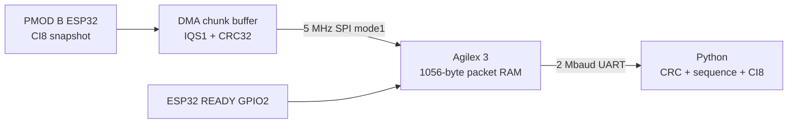

# SPI capture transport qualification

**Source and simulation prototype, not a live installed transport.** The running
RF Link Lab still uses UART. These separate images preserve that working baseline.



## Verified connector references

Digilent's [Pmod ESP32 schematic](https://digilent.com/reference/_media/pmod/pmodesp32/pmodesp32_sch.pdf)
shows the switch routes primary J1 pins between UART and SPI. The Atum System CD
`Demonstrations/Default_Code/golden_top.qsf` maps `TMD1_D[0..4]` to the FPGA balls
below; its manual/schematic establishes primary pins1/2/3/4 and secondary pin7.
The existing runtime QSF independently agrees on MOSI/UART RX AJ6 and MISO/UART TX AK1.

| PMOD B J1 | SPI function | ESP32 GPIO | Atum PMOD1 ball |
|---|---|---|---|
|1|CS active low|5|AR2|
|2|MOSI, FPGA output|23|AJ6|
|3|MISO, FPGA input|19|AK1|
|4|SCK, FPGA output|18|AR1|
|7|READY, FPGA input|2|AL12|
|5/11|Ground|GND|Ground|
|6/12|Power|3.3V|3.3V|

**Physical gate:** confirm connector/cable orientation and board revision before
loading this separate image. PMOD B's SPI selector must select SPI, and its BOOT
selector must remain normal. Present UART mode routes GPIO17/16 to J1.3/2;
changing the selector disconnects that application UART. J2 still exposes ROM
UART0 GPIO1/3 and GPIO0 via the installed programming wires. This prototype does
not route J2 commands; the raw-RX profile deliberately uses a fixed channel/rate.
No firmware flash, switch change, reset or SPI hardware test is claimed here.

## Wire protocol

One READY-high means one queued **1056-byte** read, MSB first, mode1, initially
5 MHz. MOSI byte0 is `T` to request a synthetic capture, `R` to request real RF,
or zero for a read without changing mode. All remaining MOSI bytes must be
zero; other commands or malformed/short transactions cannot change mode. Wait for READY before asserting CS; hold CS low across all
1056 bytes. SPI clocks can pause between bytes. Wait until CS is high before the
next queued packet. READY falls in the slave transaction completion callback.
A mode request applies after the current SPI transaction. The ESP32 abandons
that incomplete old-mode capture, then publishes a new capture at offset0 with
the matching flag. The host drains/counts old-mode chunks, and accepts data only
after flag+offset0 confirm the request. An RF qualification first requests
`T`, then `R`, ensuring it starts a new RF snapshot rather than accepting a
previously armed capture. The master should synchronize READY; MISO is sampled directly on the qualified
opposite clock edge, not through a latency-changing asynchronous synchronizer.

|Byte offset|Field|
|---|---|
|0..3|ASCII `IQS1`|
|4|Version1|
|5|Source0/1/2|
|6|Flags: bit0 final chunk, bit1 synthetic fixture; other bits zero|
|7|Header bytes32|
|8..11|Capture sequence, little endian uint32|
|12..15|Byte offset within capture|
|16..19|Total capture bytes, even, 1..32760|
|20..23|Valid payload bytes, even, up to1024|
|24..27|IEEE CRC32 over valid payload, zlib convention|
|28..31|IEEE CRC32 over first28 header bytes|
|32..1055|Payload CI8 signed I,Q interleaved; final padding zero|

Offsets advance1024. The synthetic/RF flag must match the requested qualification. A source/sequence/total/kind change, missing/repeated offset,
CRC error, unsupported version or inconsistent final flag rejects the capture.
Sequence wraps at uint32. Fixed transactions satisfy original ESP32 SPI DMA
word alignment. There is one DMA packet queued at a time; the producer cannot
overwrite it after a timeout. The CLI can drain a stale packet and counts any
incomplete captures instead of silently concatenating their data.

`iq_spi_master.sv` holds received bytes stable until `rx_ready`, stops its clock
between bytes, and automatically terminates/error-flags transactions that exceed
`MAX_BYTES`. All four SPI modes are tested; the board profile uses mode1 for the
original ESP32 DMA timing documented by [Espressif](https://docs.espressif.com/projects/esp-idf/en/stable/esp32/api-reference/peripherals/spi_slave.html).
The minimal FPGA image exposes ASCII `I` at2 Mbaud for identity `SPIQ0001`,
and `C`/`T`/`R` for one packet read (with MOSI byte0 zero/`T`/`R`). It waits
up to1s for READY, reads one SPI packet into RAM, then sends exactly1056 bytes. Missing READY
returns an invalid all-zero packet, which the host rejects. Concurrent commands
while busy are ignored. This is a transport test image, not IQB1 or a Nios hub.

## Build and test

Run beside the installed tools, host or container:

```bash
.venv-notebooks/bin/python -m unittest discover -s cyberether/tests -p test_spi_ci8.py -v
.venv-notebooks/bin/python scripts/simulate_spi.py
bash scripts/build_spi_probe.sh synthetic
bash scripts/build_spi_probe.sh rf
cd fpga_hub/iq_bridge/spi_transport
quartus_sh --flow compile iq_spi_qualification
```

Both builds record SHA-checked manifests accepted only for `--module pmod-b`
by `scripts/flash_esp32.py`; it retains ROM MAC verification and layout checks.
The build helper uses the repository-pinned SDR SDK via `ATUM_ESP_IDF` and the
normal `IDF_TOOLS_PATH`. `synthetic` builds `build-esp32-spi-probe`: an explicitly
artificial ramp `(byte_index*37+11)&255`, with **no RF**. `rf` builds
`build-esp32-spi-rx`: the existing unified receiver backend with a separate opt-in
`IQ_SPI_RX_PROFILE`. This combined image starts synthetic; `R` requests passive
channel8 (2447 MHz), nominal16 MS/s and16380 complex samples, packetized through
the same SPI hook. `T` returns to the pattern without flashing or resetting.
The passive RF frontend initializes at boot; actual RF snapshot acquisition runs
only after the explicit `R` request. Its capture remains buffered until
its chunks drain; bounded5s transaction timeouts are reported over console.
The default unified UART profile is unchanged. The standalone `synthetic` build
is an optional transport-only alternative; it cannot acquire RF. No arbitrary-IQ TX is added.

For Questa GUI, open the generated `simulation/spi` directory after the script,
run `vsim -gui work.tb_iq_spi_qualification`, then enter
`add wave -r /*` and `run -all` in the Transcript panel. The core test covers all
modes, MSB-first, receive backpressure, CS boundaries, maximum length, mid-byte
reset. The board test also checks identity and both bounded T/R MOSI commands. The board-top test covers READY gating, full1056-byte SPI read, RAM and
exact UART output. The Python tests cross-check the portable C packet encoder against Python,
and cover full32760-byte reconstruction,
CRC corruption, truncation/padding, sequence loss/replay and bounds.

After explicitly installing `build-esp32-spi-rx` and the separate FPGA image,
and changing B's SPI selector ON (BOOT remains OFF), qualify both modes with
one firmware flash and one reset pair:

```bash
.venv-notebooks/bin/python scripts/check_spi_transport.py \
  --confirm-spi-image --output cyberether/run/spi-synthetic-001
# The same combined image applies R and confirms RF mode; no extra reset:
.venv-notebooks/bin/python scripts/check_spi_transport.py \
  --confirm-spi-image --rf --output cyberether/run/spi-rf-001
```

The utility first requires FPGA identity `SPIQ0001` from ASCII `I`, verifies
source2/32760-byte captures and the synthetic/RF firmware flag, and never
programs/flashes anything. It refuses to run without the
explicit image acknowledgement. The utility takes the same acquisition-owner lock used by RF Link Lab;
stop its captures before using the serial device. Restore the
runtime FPGA image, B's UART selector and qualified firmware to return to the demo.
Keep saved working images privately before replacement and use the existing
verified programmer/reset procedure. Generated SOFs and firmware stay ignored.

## Bandwidth and remaining integration

At5 MHz the raw SPI ceiling is625 kB/s versus200 kB/s for2 Mbaud8N1 UART;
32 packets carry32760 bytes with96.95% payload efficiency. This qualification
image **still exports via UART**, so its end-to-end throughput is UART-limited
and includes sequential SPI/UART overhead. It may be slower end to end than the
current direct UART path. Its purpose is to verify faster ESP32→FPGA ingress,
then feed FIR/DDC/FEC directly from packet RAM rather than moving raw IQ to host.

The FPGA currently buffers bytes; CRC/sequence checking is in Python. Next FPGA
integration requires an IQS1 header/CRC checker, capture FIFO descriptors and
connection to the existing CI8/FIR pipeline, command/readback control, measured
SCK/CS/MISO margin, measured throughput/drop counters, and continuous recovery
qualification. Do not call this a live hub speed improvement until those gates
pass. Timing assumptions are explicit in the separate SDC; verify fitted timing
and board waveforms at5 MHz before raising to10 or20 MHz.

## Source/build qualification, 2026-10-21

|Check|Result|
|---|---|
|Python/native C/flash profile|8 SPI test groups passed; 9 combined flash tests passed|
|Questa master|Modes0–3, MSB-first, backpressure, CS, length bound and reset passed|
|Questa complete board path|Identity, READY, T/R MOSI commands, two1056-byte packets, RAM/UART exact passed|
|ESP-IDF|Combined synthetic/RF image and optional synthetic-only image built; SHA manifests recorded; flash dry runs passed|
|UART regression|Default Pmod unified firmware compiled with SPI profile off|
|Quartus26.1.1|Full compile passed;323ALMs,405registers,1RAM,0DSP|
|Fitted pins|All8 actual pins reported3.3-V LVCMOS, correct PMOD1 balls|
|Setup slack|50MHz system +13.699ns;5MHz SPI +88.747ns|
|Hold slack|System +0.084ns; SPI +18.415ns|
|Unconstrained paths|0 clocks, inputs or outputs|

The build has five warnings, including an early Reset Release instance-count
warning. The fitted design contains the generated SDM configuration-reset
endpoint driving the eight POR counter flops, following the existing checkpoint
wrapper. Signoff also labels asynchronous HOST_TX and forwarded-clock SPI_SCK
as missing data-output delays; their asynchronous/clock constraints are explicit.
Other warnings describe RAM read/write pass-through and unspecified output
drive/slew defaults. Positive timing uses the stated external assumptions; these
results do not establish board waveform margin or SPI hardware qualification.
The local generated evidence is `cyberether/run/spi-build-qualification.json`.
