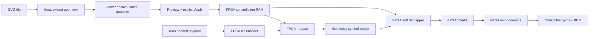
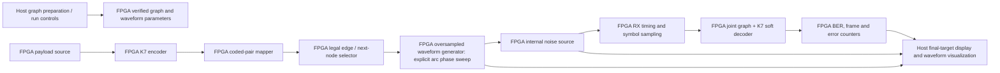
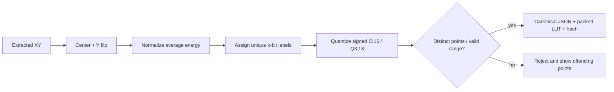

# SVG constellation loader for the FPGA Modem Lab

Status: the fixed pentagram example now has a tested Python reference, viewer,
notebook11 and complete standalone RTL with exact Questa and physical-board
checks. The fitted design passes 50 MHz timing and three 100,096-bit hardware
noise sweeps. Target: Atum A3 Nano / Agilex 3.
The standalone derivative preserves the existing checkpoint06 modem and
checkpoint11 RF image. General SVG import/upload remains the broader extension
specified below; the first decoder uses the supplied five-node graph and known
endpoint timing. See [implemented example and evidence](SVG_EDGE_FEC_PLAN.md).

## Goal and interpretation

Use SVG geometry as actual FPGA I/Q symbols and, in graph mode, as legal
transitions. The primary pentagram demonstration is an FPGA internal noisy
waveform modem: FPGA encoding, graph mapping, waveform generation, noise,
receive timing, joint decoding and counters. The host prepares the graph and
displays final FPGA results. The existing memoryless mapper/demapper remains a
separate constellation baseline.

**Primary requirement: the modulation constellation must match the SVG points.**
Each selected SVG marker becomes an actual symbol position in the FPGA mapper
and demapper. A star-shaped point set produces a star-shaped constellation;
a logo-shaped point set produces that logo-shaped constellation. Do not snap,
redistribute or reshape the points onto a standard square QAM grid.

The SVG defines the **symbol alphabet**, not the payload. Payload bits select
those actual positions. Importing an already discrete point set preserves its
point count and relative geometry. Outline sampling is a separate, explicit
preparation option for SVGs that contain curves rather than discrete markers;
it must never replace or resample an existing point set automatically.



This flow describes only the existing memoryless symbol-rate constellation
baseline. It is not the target pentagram oversampled-waveform architecture
shown below.

Keep three representations distinct: (1) a symbol is a discrete I/Q point at a
symbol instant, (2) an oversampled waveform is the timed sequence between
symbols, and (3) an SVG edge is a permitted graph transition. Endpoint symbols
alone do not trace the SVG edge. A straight edge needs a defined interpolation
or pulse shape; a circle arc specifically requires an explicit constant-radius
phase sweep with programmed phase increment and sample timing. RX timing selects
the symbol decision instants from the noisy oversampled stream; oversamples are
not independent graph symbols.

This is an internal FPGA experiment and needs no RF transmission. RF is a later
qualification gate for hardware with a supported arbitrary-IQ waveform playback
path. This work does not unlock arbitrary-IQ TX on the installed original ESP32s.



The host may parse SVG, validate labels, prepare tables and set run parameters.
The demo's measured transmit path, noisy receive samples, timing decisions,
decoded target path and counters must come from FPGA buffers/readback. Host Python
may provide an independent reference for comparison, clearly marked as such;
it cannot fill in an unimplemented FPGA stage.

## SVG edges: requested coding extension

The requested example is a pentagram inside a circle, with all five star tips
exactly on that circle. The edges are **actual allowed transitions**, not just
correction arrows. See the [SVG edge/FEC plan](SVG_EDGE_FEC_PLAN.md) and
[editable example](../examples/svg_constellations/pentagram_circle.svg).

This introduces a separate graph-coded mode: SVG nodes are I/Q positions, edge
labels carry coded bits, and a joint graph/encoder Viterbi enforces legal paths.
The five-node example needs a proposed320-state decoder when combined with the
existing K7 encoder. The memoryless point-label mapper below remains a separate
baseline; its power-of-two symbol-count restriction does not apply to graph mode.
The star and circle alone form K5 without self-loops and do not guarantee FEC;
the new code needs distance and BER qualification.

## 1. SVG import contract

Default to **use the SVG's existing points** and detect their count. Do not
force64 points or automatically resample a supplied constellation. Offer outline
sampling only when the user explicitly selects it:

| Mode | Input | Result |
|---|---|---|
| Point constellation | Circle/ellipse centers inside a selected constellation group | Each marker becomes one symbol |
| Outline sampling | Selected path/polyline/polygon geometry | Resample by arc length to the requested symbol count |

Initial supported alphabet sizes: **2, 4, 16 and 64**, matching the current
1/2/4/6 bits-per-symbol datapath. Arbitrary non-power-of-two alphabets, 8/32/256
symbols and probabilistic shaping are later work. An unsupported point count
must produce an explanation; never silently add/remove points or change the
geometry to fit a supported modulation order.

Import rules:

- Apply SVG viewBox coordinates and supported nested affine transforms.
- Flip SVG Y so positive Q points upward; show orientation in the preview.
- Preserve relative point positions and aspect ratio. Centering and normalization
  use translation plus one common scale factor for I and Q, never independent
  axis scaling. Default rotation is zero; any rotation is an explicit choice.
- Overlay the original transformed SVG points, quantized coordinates and actual
  FPGA readback so the user can verify that the constellation matches the art.
- For outline mode, sample the selected centerlines, not filled interiors or
  pixels. Show separate subpaths and the point allocation before accepting them.
- Treat labels, backgrounds and decoration separately from selected geometry.
  Do not accidentally interpret text or decorative circles as symbols.
- State supported SVG features. Reject unsupported filters, clipping, text outlines
  or transforms when they affect selected geometry; give an actionable message.
- Bound file size, element count and path complexity. Disable scripts, external
  references, entities and remote resources. Render a sanitized geometry preview;
  do not embed executable uploaded SVG directly into the page.

Provide starter SVGs: standard QPSK/16-QAM/64-QAM dots, a circle, a star and a simple
logo outline. A photograph embedded in SVG is not constellation geometry.

## 2. Coordinates, labels and reproducibility



Default to unit average symbol energy with uniform symbol probabilities. Record
actual energy after quantization. If the shape exceeds the CI16 coordinate range,
reject it or offer an explicit peak-fit scale with its changed energy displayed;
never silently clip it. For transformed source points `(x, y)`, use
`I = s * (x - cx)` and `Q = -s * (y - cy)` before optional explicit rotation and
fixed-point rounding. Apply the same `s` to both axes. Only representational
rounding may move a point; show the maximum quantization error and reject
collisions rather than relocating points. Reject zero-energy sets, duplicate points, and points
that collide after quantization. Warn about small minimum separation.

Every symbol needs a unique bit label. Default to deterministic coordinate order
with binary labels; offer manual reassignment and a label overlay. Labelling
changes which bits select a point; it must not move the point. Do not promise
Gray coding for arbitrary artwork: geometric neighbors need not admit a global
Gray labelling. A later optimizer may reduce neighbor Hamming distances, with the
measured labeling quality shown.

Canonical profile fields:

| Group | Fields |
|---|---|
| Source | SVG SHA256, selected elements, import mode, sampling settings |
| Geometry | Center, axis convention, rotation, requested scale, normalization |
| Digital table | M, k, label bit order, label-indexed signed integer I/Q pairs |
| Metrics | Actual quantized average energy, peak, minimum distance, PAPR |
| Identity | Schema version, packed-table CRC32/SHA256, labeling policy |

The packed table uses the existing CI16 convention: I in the low16 bits, Q in
the high16 bits of each32-bit word. Define byte order and CRC coverage exactly.
The JSON profile is portable; it must reproduce the same quantized table.

## 3. FPGA implementation

The current `iq_modem.sv` uses the combinational `mapped()` function in both
mapping and exhaustive max-log demapping. Replace its custom-mode source with
a shared **label-indexed, maximum64-point RAM table**. Preserve built-in modes.

| Change | Implementation |
|---|---|
| Custom mapper | Group coded bits into a label and read its I/Q point |
| Custom soft demapper | Scan all M actual table entries; maintain minimum squared distance for each bit=0/1 partition |
| Soft metric | Preserve positive-for-bit0 convention, signed saturation and documented scaling |
| Upload | Separate staging and active tables; validate count/labels/CRC before commit |
| Frame consistency | Latch table generation at encode; retain it through replay and decode |
| Readback | Export every active coordinate, identity, size, scale and generation |
| Recovery | Abort incomplete upload; retain the prior active table; reset defaults to a known built-in constellation |

Account for synchronous RAM read latency with explicit request/use states in
both mapper and demapper. Confirm RAM inference in Quartus; do not implement a
large register-based copy/mux bank just to increase utilization. Report ALMs,
M20Ks, DSPs, cycles per frame and setup/hold timing after fitting.

The existing16-word Avalon map is full: words14/15 already expose capabilities.
Propose a versioned extension to a32-word window, retaining words0–15. Add
LUT index/data/count, expected/read CRC, staging/commit/abort, active mode,
generation and LLR scaling in the new window. Update VDS address width/span,
Nios bounds and host helpers together; keep the current base address where valid.
Do not silently repurpose existing registers.

**Commit must be frame-safe, not merely `busy == 0`.** The core is idle between
encode and noisy replay/decode. Track the outstanding frame, reject a commit
until decode/abort completes, and reject a generation mismatch. Also hold the
existing acquisition/JTAG lease across the operation.

Change neither the K7 rate-1/2 code nor its termination/padding policy. Existing
256-bit frames contain524 coded bits; symbol count is `ceil(524/k)`. Exclude
padding and tail bits from their appropriate error denominators.

## 4. Nios and host controls

Extend the existing modem monitor and helpers with version/capability discovery
and conceptual commands:

```text
CONST BEGIN <M> <profile_crc>
CONST WRITE <label> <I_q13> <Q_q13>
CONST VERIFY
CONST COMMIT
CONST READ <label>
CONST STATUS
CONST ABORT
CONST BUILTIN <mode>
```

The existing `MSRUN`/`MSGET` sweep and host snapshot reader assume64-QAM and
88-symbol frames. Version these interfaces to report M, k, actual symbol count,
profile identity and snapshot lengths. Resize/bound Nios buffers for the smallest
supported alphabet (up to524 BPSK symbols), and make host transfers derive their
sizes from verified device metadata rather than the current fixed88-entry layout.

These are proposed commands, not currently available interfaces. Nios bridges
the upload and verifies readback; actual mapping/distance/FEC/counters stay in
FPGA RTL. SVG parsing and coefficient preparation happen on the host before a
run. Keep the existing explicitly labelled Nios approximate-Gaussian noise
backend for the first implementation.

Noise controls must use **actual quantized constellation energy**, not assume
that every imported shape has precisely8192 RMS after scaling. Display nominal
Es/N0, measured replay energy and Eb/N0 conversion separately, accounting for
bits per symbol, FEC rate and finite-frame overhead. Record noise seed, sigma,
LLR scaling and table identity with every result.

No host-side mapper/demapper may silently substitute for a missing FPGA feature.
Python provides an independent reference and optional audit, labelled as such.

## 5. CyberEther workflow and presentation

```text
Choose SVG → choose dot/outline mode → select M
    → inspect geometry, labels and quantization
    → Apply to FPGA → verify full-table readback
    → Run clean round-trip → Run noise sweep
```

Uploading or changing a preview does not modify FPGA state. Show **Preview**,
**Applied and verified**, or **Mismatch** with the active profile hash and M.
Disable Run on a mismatch, changed board image, incomplete upload or active job.
Never build/program an FPGA or start a sweep merely by opening a page.

Use the existing poster style with a large2×3 display:

| Left | Right |
|---|---|
| Original SVG / selected geometry | Actual FPGA LUT readback and bit labels |
| Actual FPGA TX symbols | Actual noisy symbols delivered to FPGA |
| Post-FEC reconstructed symbols | Pre/post-FEC BER curves and counters |

Overlay the read-back ideal points on RX and show error vectors for the same
symbol positions. Use common axes and scale across panels. Keep controls simple:
SVG, M, rotation/normalization, labels toggle, Apply, clean test and noise level.
Provide a few presets and visible upload/build/sweep progress.

Post-FEC points must be labelled **decoded → re-encoded symbols**, not cleaned
RX IQ. Re-encode and remap the actual FPGA decoded payload using the same table
and original termination/padding, preserving frame positions. Keep wrong symbols
visible. Retain the original payload/reference buffers and original BER counts.
For the final FPGA-only processing demo, export this reconstruction from FPGA;
any interim display-only host reconstruction must be explicitly identified.

## 6. Implementation milestones and acceptance

Acceptance is staged so a working reference or GUI cannot be mistaken for an
FPGA modem. The generic checkpoint06 QAM/K7 pipeline remains intact. The fixed
pentagram derivative now passes Python tests, complete RTL assertions, routed
timing, physical capture and independent checks of1173 sweep frames. Notebook11
and its viewer use those measured outputs. These results do not complete the
broader arbitrary-SVG loader, runtime graph upload or unknown-clock acquisition
features described elsewhere in this plan.

| Step | Deliverable | Acceptance |
|---|---|---|
| A: Python reference and GUI (fixed fixture accepted) | SVG graph validation, exact symbol/edge model, oversampled waveform model, joint-decoder reference, visible waveform and result view | Geometry and legal transitions match fixture; noiseless encode/decode round trips pass; arc waveform is produced only by explicit phase sweep; noisy reference is reproducible and labeled Python; GUI plots supplied samples and retains errors |
| B: RTL simulation (fixed graph, known timing accepted) | FPGA graph table, encoder/mapper, edge selector, explicit waveform generator, internal noise, RX timing, joint decoder and counters | Questa tests compare each stage against independent vectors; test all edge classes, arc phase/sample timing, noise seeds, termination, traceback and counter denominators; failures are retained. Unknown timing offsets require the later synchronization stage |
| C: FPGA fit and board evidence (fixed graph accepted) | Fitted checkpoint image, versioned controls, table/parameter readback and buffer export | Quartus resource/timing report accepted; fixed graph endpoint/ROM buffers and waveform settings read back exactly (runtime graph upload is future work); clean and seeded noisy runs match independent reference bit-for-bit at stage boundaries; measured FPGA buffers feed display |
| D: Noise qualification (software and internal hardware sweeps accepted) | Repeatable baseline and graph-code sweeps | At least100,000 payload bits per accepted point; coded and payload errors, frame failures, denominators, throughput, Es/N0 and rate-adjusted Eb/N0 reported; no claim of coding gain without comparable rates and evidence |
| E: Presentation and lesson (fixed example accepted) | Host display and authored notebook around verified FPGA data | Shows intended graph, actual transmitted oversampled target, actual noisy RX waveform, timing decisions, decoded final target and FPGA counters; Python results and FPGA captures are visibly distinguished |
| F: RF extension (future, separate gate) | RF tests using hardware that supports arbitrary-IQ waveform playback | Verify actual IQ playback, timing/frequency/phase recovery and RF BER; no installed original-ESP32 RF result is inferred from this internal test |

Regression requirements:

- Existing built-in BPSK/QPSK/16-QAM/64-QAM mappings and fixed-point metrics remain
  bit-exact. Existing replay and 100k-bit sweep checks remain available.
- Every extracted marker has exactly one corresponding quantized FPGA symbol.
  Readback matches the transformed source within the declared rounding tolerance;
  there is no grid snapping, silent resampling or independent-axis distortion.
- New tables match an independent integer reference at every label, on ideal
  symbols, midpoints/ties, noise, saturated metrics and CI16 extremes.
- Standard and imported shapes use the same energy convention, FEC, payload
  generation and noise sequence policy. Unusual shapes may perform worse; show it.
- Test busy uploads, interrupted transfers, bad CRC, wrong M, duplicate labels,
  stale generations, reset, unsupported core IDs and table changes between frames.
- Verify the actual Quartus memory inference and routed timing, not just RTL sim.
- GUI tests check Apply/readback, failure messages, correct shape selection,
  stale results and matched-axis plots, without triggering RF.

## 7. Repository changes

| Area | Planned files |
|---|---|
| SVG import/profile/reference | New `cyberether/svg_constellation.py`, `scripts/import_svg_constellation.py`, SVG fixtures and JSON schema |
| FPGA | `fpga_hub/iq_bridge/vds_demo_06_modem/rtl/iq_modem.sv`, VDS/SDC-aware build and register metadata |
| Nios | Checkpoint06 monitor headers, `scripts/modem_fpga.py`, capability/version handling |
| Sweep/display | `cyberether/qam64_sweep.py`, `qam64_lab.py`, lab/poster HTML and launch helpers |
| Verification | SVG tests, extended `scripts/simulate_modem.py`, hardware/table readback and sweep checkers |
| Lesson | New notebook11, authored through `scripts/make_notebooks.py`, covering Python graphics, VDS diagram export, Questa GUI, SOF/program and focused web demo |
| Dependencies/docs | Update venv installer with pinned SVG parsing dependencies after selecting and testing them; build/run guide and screenshots |

Keep generated bitfiles, private uploaded art, executed notebooks and run data
out of Git unless intentionally selected for publication. Include small original
fixture SVGs and reproducible source.

## 8. Build, hardware and completion boundary

Work in the internal-modem checkpoint06 path or an isolated derivative. Do not
modify the loaded checkpoint11 RF design or consume its scarce logic headroom
for this first experiment. Preserve its SOF/capture-app restoration path.

Build and simulate before changing the board. Programming the internal modem
replaces the currently loaded RF image: stop acquisition, verify TX off, use the
existing ownership locks, program the recorded matching SOF/monitor, and expose
the active image in the viewer. Switching back uses the preserved RF artifacts.
No ESP32 reflash is part of this project.

First accepted pentagram sequence: fixture and Python-reference checks → RTL
stage simulation → fitted/read-back FPGA graph and waveform configuration →
noiseless FPGA decode → seeded noisy waveform with RX timing and joint decoding
→ FPGA counters and exported final targets shown by the host. The memoryless
QAM comparison is a separate baseline. The SVG defines an FPGA-used graph only
after full readback and stage-by-stage hardware evidence pass.

Completion of this internal project means a user can import and verify the SVG
graph, run the entire noisy oversampled modem in FPGA, and view FPGA-produced
waveform, timing, decode and counter outputs with reproducible provenance. RF is
a separate future project and requires hardware explicitly supporting
arbitrary-IQ waveform playback.

## Existing references

- [FPGA QAM/BER demo](FPGA_64QAM_BER.md)
- [Modem implementation status](MODEM_IMPLEMENTATION_STATUS.md)
- [Custom RF execution plan](CUSTOM_QAM_EXECUTION_PLAN.md)
- [Current RF calibration](TX_LAB_CALIBRATION.md)
