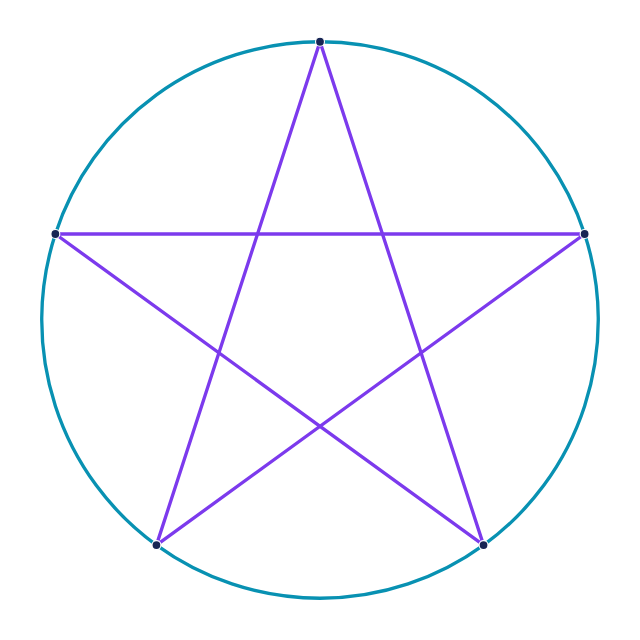

# SVG edges as actual coding constraints

Status: Python reference, viewer and standalone FPGA RTL are implemented,
verified in Questa, fitted and tested on the physical Agilex 3 board.
The first build uses the supplied pentagram graph and known endpoint timing;
general SVG uploads and unknown-clock recovery remain later extensions.

Start with [notebook11](../notebooks/11_svg_constellation.ipynb) or the
[standalone build/run guide](../fpga_hub/iq_bridge/svg_modem/README.md).

## Physical FPGA acceptance

[Hardware qualification](../fpga_hub/iq_bridge/svg_modem/VALIDATION.md) records
the source/image hashes, positive 50 MHz timing and reproducible commands.
Each noise setting ran 391 frames / 100,096 payload bits:

| FPGA uniform noise bound | Wrong nearest symbols / 102,442 | Decoded payload errors / 100,096 |
|---:|---:|---:|
| 0 | 0 | 0 |
| 6,000 | 19,017 | 0 |
| 10,000 | 47,644 | 19,697 |

All1173 frame counters and integer decoder metrics were independently checked.
Final-frame full waveform/sample/path readback also matches exactly. The example
viewer shows a measured seed7 frame: 47/262 wrong symbols and 0/256 payload
errors. [Notebook11](../notebooks/11_svg_constellation.ipynb) covers simulation,
Questa GUI recordings, build/program and explicit captures. The viewer replays
saved FPGA output; opening it never acquires hardware or starts RF.

## Accepted software and RTL evidence

- Exhaustive noiseless short messages, every final graph node, reverse-trellis
  checks and independent brute-force maximum-likelihood comparisons pass.
- Python AWGN: 100,000 payload bits at each Es/N0 of 0, 4 and 7 dB. Decoded
  payload errors were 17,826, 0 and 0 respectively. Zero observed errors do not
  establish perfect decoding: FEC errors can cluster within frames. Independent
  frame trials support a frame-error bound; a bitwise binomial bound additionally
  assumes independent bit errors and is not an unconditional BER guarantee.
- Bounded ideal-coordinate distance search through 20 symbols found a
  first-remerge event of length10 with squared distance11.381966. This is not a
  complete free-distance proof or a result for all possible starting memories.
- Actual RTL: every generated ROM sample, all4192 captured TX/RX samples,
  encoder bits, decoder traceback, metrics and counters match independent
  integer calculations. At bounded-uniform amplitude6000 and seed7, 47/262
  nearest-node symbol errors become 0/256 decoded payload errors.
- Noise amplitudes0, 10000 and30000 also pass exact checks, including actual
  decoder failures at high noise. Hardware noise is bounded uniform; the Python
  AWGN sweep is a separate experiment.

The internal loopback uses a known edge-end strobe. It tests waveform generation
and decoding without claiming symbol-clock acquisition. Ready/valid buffering
means capture sample indices are waveform positions, not continuous DAC timing.



[Editable SVG](../examples/svg_constellations/pentagram_circle.svg) ·
[Explicit graph](../examples/svg_constellations/pentagram_circle.graph.json)

## What the drawing means

| Drawing | Digital meaning |
|---|---|
| Five tips exactly on the circle | Five actual transmitted I/Q positions |
| Five straight pentagram segments | Allowed star transitions between tips |
| Five circle arcs | Allowed circle transitions between adjacent tips |
| Crossings inside the star | Crossings only; no extra nodes or connections |
| Direction/edge labels | Coded bits select a directed edge from the current node |

The ring is five exact circular arcs sharing endpoints with the star. Each tip
has radius1 before the uniform coordinate conversion. Importing it must preserve
these positions. A symbol is one discrete I/Q point at a symbol instant; it does
not specify the samples between symbol instants. In symbol-only mode an edge
selects the next endpoint, while pulse shaping determines the oversampled path.
If the transmitted waveform must visibly trace a circle arc, the transmitter
must explicitly generate a phase waveform (constant radius with a programmed
phase sweep). The arc cannot be inferred from endpoint symbols alone. Star
segments use an explicitly selected straight I/Q interpolation waveform. The
receiver therefore processes a timed oversampled waveform before making symbol
metrics; it must not treat every waveform sample as a new graph symbol.

## Why the edges alone are insufficient FEC

With five outer nodes, star segments reach the two nonadjacent tips and circle
arcs reach the two adjacent tips. Their union is the complete graph K5: every
node reaches all four other nodes. There are10 undirected edges and20 directed
transitions; self-transitions are forbidden.

Four choices let a constraint-only encoder consume two bits per transition.
However, many different valid paths differ in only one emitted symbol. The
no-self-loop constraint alone therefore does **not** guarantee correction of a
single-symbol error. Do not advertise a drawing as an error-correcting code
without a distance/BER result.

## Proposed useful FEC mode

Reuse the existing K7 rate-1/2 encoder, then let each coded pair select an actual
SVG edge. The receiver searches the combined encoder/graph trellis rather than
making independent nearest-point decisions.

```mermaid
flowchart LR
    B[Payload bits] --> K[FPGA K7 encoder]
    K --> M[FPGA coded-pair mapper]
    M --> E[FPGA graph edge / next-node selector]
    E --> W[FPGA waveform generator: explicit phase sweep on arcs]
    W --> N[FPGA internal noise injection]
    N --> R[FPGA RX timing and symbol sampling]
    R --> D[FPGA joint graph + K7 decoder]
    D --> C[FPGA error and frame counters]
    C --> H[Host displays final FPGA targets, waveform and counters]
```



All encode, mapping, edge selection, waveform generation, internal noise,
receive timing, joint decoding and error counting belong in FPGA RTL in the
target design. Host-side graph preparation and controls may configure the run;
the host display consumes final FPGA target/sample/counter buffers. Python
simulation is a reference and development aid, not a substitute for those FPGA
blocks. RF is a later gate for hardware with an explicit arbitrary-IQ waveform
playback path; the installed original ESP32 radios do not provide that qualified
path, and this internal modem plan does not transmit RF.

Number tips p0 through p4 clockwise in SVG coordinates, with p0 at the top.
Use the following deterministic proposed edge assignment:

| Coded pair | Move from pi | Drawn edge |
|---|---|---|
| 00 | p(i+1 mod5) | Circle, clockwise |
| 01 | p(i+2 mod5) | Star, clockwise |
| 10 | p(i−1 mod5) | Circle, counterclockwise |
| 11 | p(i−2 mod5) | Star, counterclockwise |

Both encoder outputs flip when its input bit flips for a fixed encoder state.
Complementary labels in this assignment lead to endpoints separated by144°.
That is a local branch-separation property, not a proof of whole-code coding gain.
Treat the assignment as a candidate to test and optimize, not a calibrated code.

Actual TX sequence:

1. Start at known graph node p0 and encoder memory0.
2. Encode one input bit using the existing171/133 octal polynomials/bit order.
3. Select the edge using that coded pair and current node.
4. Emit the destination node's quantized I/Q coordinate; update both states.
5. Append the existing six zero tail bits. These terminate the encoder memory,
   but need not return the graph node to p0.

This sends one payload bit per symbol before termination overhead. A256-bit
payload plus six tail bits produces262 transmitted symbols. Five symbols are
allowed in this **graph mode**, even though the separate memoryless mapper
initially supports only power-of-two alphabets. No padding or hidden sixth node
is added to the SVG.

## Decoder implementation

The hidden state is `(SVG node, convolutional encoder memory)`:5 ×64 = **320
states**, with two input-bit branches per state. It is not a five-state FEC
decoder and cannot use the current fixed64-state implementation unchanged.

For received symbol y, precompute squared distance to each of the five actual
I/Q points. Each legal branch uses the distance to its destination node. Reuse
these five metrics across the320-state add/compare/select update. Store survivors
and traceback to recover input bits and the chosen SVG path.

Initialize only `(p0,0)` with finite metric. At terminated frame end, choose the
best of the five states whose encoder memory is0. Preserve six-tail-bit handling
and exclude the tails from payload BER. Record start state, frame length, table
hash and edge-label hash with every result.

A262-step frame requires83,840 survivor decision bits if a single predecessor
selection bit per joint state suffices for the chosen implementation; verify the
reverse transition derivation in simulation. Use wide Euclidean metrics and
per-step normalization or proven accumulator bounds. The existing8-bit LLR,
32-bit path-metric assumptions must not be copied blindly into this decoder.

## Build order and acceptance

1. **Fixture:** validate SVG geometry, exact tip/circle contacts, all20 directed
   edges, labels, no self-loops, and the no-junction policy at crossings.
2. **Python reference:** implement graph-only encoding plus joint K7/graph
   encoding and Euclidean Viterbi. Exhaust short payloads with zero noise, including
   termination and traceback for all reachable final graph nodes.
3. **Code quality:** enumerate bounded diverge/remerge error events and search
   for zero-distance/catastrophic ambiguities. Measure free-distance evidence and
   retain its search bound. Reject ambiguous edge labeling or transitions.
4. **Noise tests:** compare memoryless decisions, graph-only sequence decoding,
   existing K7/QPSK and the joint graph code. Show actual throughput and both
   Es/N0 and rate-adjusted Eb/N0; slower transmission must not masquerade as free
   coding gain. Sweep at least100,000 payload bits per accepted operating point.
5. **RTL:** add graph/transition RAM, five-point distance unit, parameterized
   320-state ACS and survivor/traceback path. Use separate capability/version
   reporting and verified table uploads. Keep the existing QAM/K7 core available
   as a regression baseline.
6. **Hardware:** fit/timing, table and edge readback, no-noise round trips, then
   noisy replay and bit-exact comparison against independent integer reference.
   No ESP32 transmission or firmware flash is needed for this internal demo.
7. **GUI:** illuminate the transmitted SVG edges, show actual noisy samples,
   animate candidate/survivor paths and overlay the final recovered path. Show
   wrong decisions and failed frames; do not replace them with the intended path.

The FPGA will enforce the transition constraints and do sequence decoding. SVG
parsing, graph validation and offline code-design audits remain preparation on
the host. The final GUI must identify measured FPGA results separately from
Python simulation.

## Example generation

```sh
python scripts/make_pentagram_constellation.py
```

The generator emits SVG plus node/edge metadata and checks the unit-circle
contacts and graph degree. Geometry files do not declare the active device
status; qualification lives in the run records and linked guide. The fixed
graph RTL is available, runtime graph upload is not, and `rf_tested` is false.

This extends the [SVG constellation plan](SVG_CONSTELLATION_FPGA_PLAN.md).
The coding concept is joint trellis/constellation design; see the original
[Ungerboeck coded-modulation paper](https://research.ibm.com/publications/channel-coding-with-multilevelphase-signals).
No gain quoted in that work is assumed for this new pentagram code.

## Constellation over time

Open [the interactive time view](../examples/svg_constellations/constellation_time.html)
locally in a browser. It animates a five-edge star cycle followed by a five-edge
circle cycle, with the same five endpoint symbols in three waveform modes:

- Straight I/Q interpolation draws chords between tips.
- Explicit phase sweeps draw circle arcs at constant amplitude; star edges use
  straight interpolation. This draws the complete SVG over time.
- Symbol hold stays at the five tips.

Oversampled receiver IQ can reveal transition trajectories. Their shape depends
on transmit pulse shaping, channel filtering, timing, carrier offset and phase
recovery. An off-clock sample does not by itself create the intended SVG.
The animated path is an illustrative host simulation, not an implemented pulse
shaper, FEC decoder or measured RF result. Five-point symbol decisions and dense
waveform samples must remain separate in the eventual FPGA demonstration.
