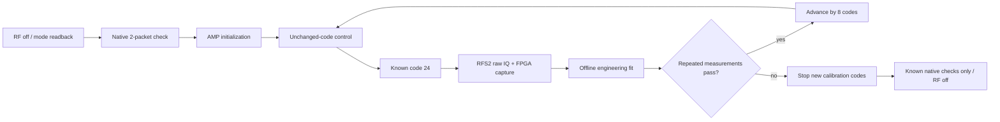
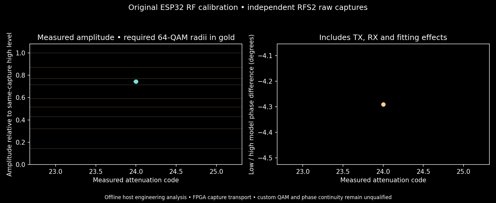

# Incremental amplitude calibration

The installed combined PMOD A image exposes attenuation training without another
flash. These experiments measure the original ESP32's scalar amplitude actuator
and end-to-end AM/PM effects before attempting a polar QAM transmitter.



Run beside the installed Quartus tools, with checkpoint11 and its capture app
loaded and the combined firmware installed:

```sh
python scripts/tx_lab_calibration.py --transmit --hours 3 \
  --spacing-seconds 90 --max-code 120 --repeats 3 \
  --output cyberether/run/tx-lab-calibration-NEW
```

The directory must be new. `status.json` records every command, raw capture path,
acceptance/rejection and source hash. `amplitude-calibration.png` shows measured
relative amplitudes with their capture spread, theoretical 64-QAM radii, and
end-to-end phase shifts. It is updated atomically as measurements arrive.

Each new code follows a fresh unchanged-code control. A candidate must have
multiple intact, unclipped, fixed-gain captures with actual transitions, sufficient
signal, stable high-level reference and bounded model residual. Missing sparse
coverage is retained and gets only a bounded number of additional attempts.
Candidate attempts use different host trigger delays within the short job to
avoid repeatedly landing in a firmware scheduling gap. These delays are not
RF timestamps, and captures are never spliced into a synthetic chronology.
Higher codes are attempted only after the preceding code passes. A discontinuous
transfer or insufficient repeats gates further calibration. Capture, register,
control or cleanup failures stop the whole batch; the runner attempts RF-off AMP
cleanup. It performs no firmware flash or FPGA programming.

Jobs request 30 ms and have at least three seconds of cooldown. Initialization
requests 50 ms and normally consumes its budget without opening a tone window.
Mode/native checks occur about every 20 minutes. TX stays off between jobs. These
software deadlines do not prove a physical RF cutoff.

**Interpretation:** the FPGA supplies capture RAM and transport. NumPy fitting is
an offline host engineering audit, explicitly separate from the final host-display
only modem. Fits include TX and RX behavior; no isolated transmitter AM/PM,
absolute power, phase continuity, calibrated polar schedule, arbitrary-IQ input,
EVM, custom 64-QAM frame or BER qualification is claimed. Gold reference radii
are geometry, not additional measured RF levels. Phase transmission remains
excluded until the telemetry qualification issue is resolved.


## First combined-image result



The corrected FPGA transport preflight receives both native packets with no
job-local transport errors. Two code24 captures measure amplitude ratios0.7419
and0.7459 (mean0.7439, about−2.57dB relative to the same-capture high level), with
mean model phase shift−4.29°. These establish one measured attenuation code,
not nine calibrated QAM radii. The continuing batch adds codes only through its
acceptance gates. Live read-only progress is at `http://<host>:8774/calibration`.

A separate corrected16MS/s QPSK raw capture acquires one frame in the offline host
audit, but fails CRC:16/44 coded errors and3/8 soft-decoded payload errors. The
uncorrected capture had a receive-rate command/metadata mismatch and is excluded.
No QPSK payload qualification or large-denominator BER claim follows from these
attempts. Native Wi-Fi packet reception remains a separate passing result.
