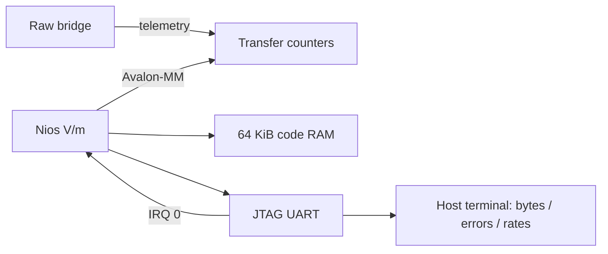
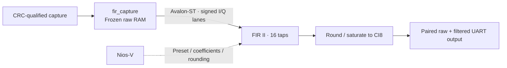
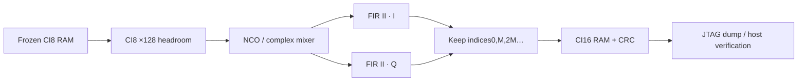
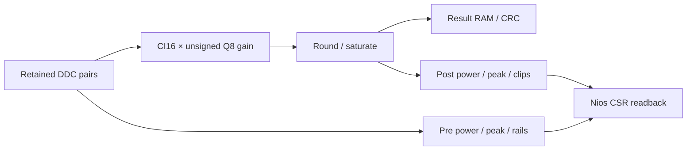

# VDS checkpoint block diagrams and connections

Prepare or build each checkpoint with the commands in the main README before opening its `.vds` file. The standalone gain simulation is `python scripts/simulate.py`. All checkpoint folders are under `fpga_hub/iq_bridge/`.

## 3. Checkpoint 1 — raw IQ bridge (6 blocks)

Open `../vds_demo_01_raw/iq_bridge_vds.qpf` for the independently rebuilt checkpoint. The wizard IQ starter has the same raw system.

Wire `capture_controller.host_link ↔ host_uart.host_link`, `radio_link ↔ radio_uarts.radio_link`, and `capture_memory ↔ capture_ram.capture_memory`. Fan out `clock50.out_clk` and `reset_bridge.out_reset` to all four RTL blocks. Clock the reset bridge. Set Clock Bridge to 50 MHz; preserve the starter's reset settings.

Export Clock Bridge input as **clk**, Reset Bridge input as **reset**, host UART as **host_serial**, and radio UART interfaces as **radio0**, **radio1**, **radio2**. Preserve `iq_bridge_vds_top` as the board top; its POR/reset-release logic drives the subsystem.

```text
ESP32 CI8 burst → UART parser → CRC accepted? → RAM → IQB1 UART frame → Python
                                                └→ rejected burst produces error
```

Generate the system, compile, and inspect pin and timing reports. There is no filtering or Nios in this checkpoint.


## 4. Checkpoint 2 — add Nios-V and transfer monitoring (11 blocks)

Open `../vds_demo_02_nios/iq_bridge_vds.qpf` to inspect the completed target. To extend a scratch copy of checkpoint 1, use checkpoint 2's RTL/IP definitions: the controller adds its telemetry interface and the board wrapper adds `monitor_reset_reset`.

Add:

| Instance | Catalog IP | Important parameters |
|---|---|---|
| cpu | Nios V/m (`intel_niosv_m`) | Avalon interfaces enabled; reset offset 0; RV32I firmware |
| cpu_ram | On-Chip Memory (`intel_onchip_memory`) | 65,536 bytes; initialized from `sw/monitor.hex` |
| jtag_uart | JTAG UART | Write buffer 4096; read buffer 64 |
| transfer_monitor | Atum IQ Bridge custom IP | Coherent event counters / rate windows |
| cpu_reset | Reset Bridge | Synchronous edges both; SYNC_RESET=1 |



Clock the five new blocks at 50 MHz. Reset CPU/RAM/JTAG from `cpu_reset`; reset monitor counters from the bridge reset and its bus side from CPU reset. Export CPU reset input as **monitor_reset**; the supplied board wrapper drives it from POR.

| Nios interface / target | Base address |
|---|---|
| data + instruction managers → cpu_ram.s1 | 0x00000000 |
| data + instruction managers → cpu.dm_agent | 0x00020000 |
| data manager → cpu.timer_sw_agent | 0x00030000 |
| data manager → jtag_uart.avalon_jtag_slave | 0x10010000 |
| data manager → transfer_monitor.csr | 0x10020000 |

Connect `jtag_uart.irq → cpu.platform_irq_rx`, IRQ 0. Connect controller telemetry to monitor telemetry.

Build `sw/monitor.hex` **before generating the system** using `bash scripts/build_firmware.sh`. This demo provides startup code and a linker script; it does not require you to create a new BSP during the talk. Nios configures and reports transfers; it does not perform the sample DSP.


## 5. Checkpoint 3 — FIR II and a frozen snapshot (13 blocks)

Use checkpoint 3's controller/top/custom-IP files when extending checkpoint 2. Add **fir_capture** from Atum IQ Bridge and vendor **FIR II** as **fir_ii**.



FIR II: Agilex 3, clock 50 MHz, two input channels (I and Q), signed 8-bit input, signed 16-bit Q15 coefficients, 16 taps, coefficient reload enabled/read-write, bus width 16, backpressure disabled, reset history enabled. Initial boxcar taps are sixteen values of 2048. The supplied second preset is the 16-tap Hamming low-pass.

| Connect | Purpose |
|---|---|
| controller.fir_capture ↔ fir_capture.capture | Commit valid raw captures |
| fir_capture.filter_input → fir_ii.avalon_streaming_sink | Samples into vendor FIR |
| fir_ii.avalon_streaming_source → fir_capture.filter_output | Full-precision results |
| controller.fir_uart ↔ fir_capture.uart | Paired UART delivery |
| cpu.data_manager → fir_capture.csr at 0x10030000 | Snapshot / run controls |
| cpu.data_manager → fir_ii.avalon_mm_slave at 0x10040000 | Coefficient reload |

Clock sample and coefficient ports. Use bridge reset for sample state, CPU reset for bus/coefficient state, as in the checkpoint's connection script.

**Local tool issue:** FIR II 19.3.8's coefficient-reset descriptor and generated VHDL polarity disagree in this setup. After each generation run `python3 scripts/patch_fir_reset.py` before compiling. The script patches only the generated wrapper and records its hash; regeneration overwrites that wrapper. The browser lab independently checks each received filtered result against the configured coefficients.


## 6. Checkpoint 4 — tune, filter, and decimate (16 blocks)

Use checkpoint 4's updated **fir_capture** RTL and component definition: it adds a shared snapshot-read conduit and arbitration. Replace/update the old wrapper in a scratch diagram, then reconnect its existing ports.

Add **ddc_engine**, **ddc_fir_i**, and **ddc_fir_q**:



- `fir_capture.ddc ↔ ddc_engine.source`: snapshot metadata, epoch, read address/data and ownership.
- `cpu.data_manager → ddc_engine.csr`, base **0x10050000**, span 128 bytes at this checkpoint.
- Separate `ddc_engine.i_input/q_input → respective FIR II sinks`; FIR outputs return to `i_output/q_output`.
- FIR II I/Q instances: one channel each; signed 16-bit input; signed 16-bit Q15 coefficients; 127 taps; clock 50 MHz; input rate 1 MS/s; no backpressure; history reset enabled. Use the coefficient list in `scripts/create_vds.tcl` / the prepared `.ip` files.
- Connect both FIR resets to **ddc_engine.fir_reset**, not directly to board reset, so each frozen run starts with zero history.

Positive tuning multiplies by exp(−jphase). A 32-bit phase accumulator selects a 1024-entry Q15 sine table. The mixer rounds/saturates to CI16. The filters return 39-bit results, rounded/saturated to CI16, and the decimator keeps every 1st/2nd/4th pair. The 127-tap filter has 126 startup samples and 63-sample group delay.


## 7. Checkpoint 5 — gain and FPGA power meters (17 blocks)

Use checkpoint 5's updated DDC component. The CSR address input grows from 5 to 6 bits; its span becomes 256 bytes at the same base. A stale instance still showing 5 bits/no `gain` conduit must be replaced from the refreshed component catalog before reconnecting it.

Add custom **gain_meter**, connect its clock/reset, and connect **ddc_engine.gain ↔ gain_meter.gain**. This conduit carries sample data/valid, latched settings, output data/valid and power counters.



Q8 examples: 128=0.5×,256=1×,512=2×,4096=16×. Bypass copies exactly while meters remain active. Each RUN clears meters and latches configuration; busy writes are ignored. FPGA accumulates I²+Q² in 64-bit sums and counts clipped complex pairs. Host computes the logarithm for display. These are uncalibrated digital dBFS, not RF dBm, and digital gain scales captured noise too.

Nios commands: `FIR <id> DDCGAIN <bypass 0|1> <gain_q8>` and `FIR <id> DDCLEVELS`. Existing register words 0–22 and commands remain available. New words 24–35 are documented in `../vds_gain/README.md`.
