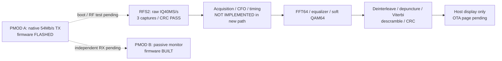

# Wi-Fi 64-QAM implementation — 2026-10-21

The two OTA plans are **in progress**. No native 64-QAM OTA reception or custom
64-QAM transmission has been qualified. Existing port8773 still shows FPGA
symbol replay, labeled **NO RF TX**. No replacement RF results are fabricated.



## Implemented and tested

| Item | Evidence | Remaining limit |
|---|---|---|
| Native TX firmware | Pinned SDK build; deterministic88-byte frames; UART command tests | Normal boot verified; 2/2 native TX callbacks at54Mb/s; independent RX pending |
| Independent monitor firmware | Same SDK builds; passive native reception and payload identity check | Not flashed; replaces PMOD B's SPI image |
| Bounded controller | Shared acquisition lock, explicit `--transmit`, readbacks, STOP/idle proof; fake-bridge tests | Not exercised against installed native firmware |
| Wideband transport | Three16380-sample CI8 captures, nominal40MS/s, CRCs pass; reported capture411us; no hub errors | Passive; sample clock and complete20MHz analog response not measured |
| Receiver primitives | Integer FFT64, two-LTF channel estimate, equalization, all64 QAM labels | Caller must supply acquired/CFO/pilot-corrected symbols |
| Wi-Fi DATA backend | s=3 deinterleave,3/4 depuncture, K7 soft Viterbi, SERVICE seed/descramble, FCS | 256-byte PSDU limit; not connected to live acquisition |
| Actual Nios V test | **5/5 pass on Agilex3**, fixture92-byte PSDU,4 DATA symbols, CRC107563580; corrupt FCS rejected | CPU software on device, not RTL acceleration or received RF |
| L-SIG header backend | All8 legacy rate fixtures pass; 54Mb/s wire code12,48Mb/s code8 | Offline C/RV32I compile only; acquisition remains missing |
| Custom-TX research | Original-chip attenuation field and separate forced-gain ABI identified;1024 bitfield cases pass | Separate attenuation-only firmware compiles; not installed or RF-qualified; no arbitrary-IQ playback proof |

Nios test ELF SHA:
`674d89ee92cfd3cf7f4334359b8ee46bad1388f84a2c72e44c118ebce5772467`.
Tested FPGA image is checkpoint06 SHA `4297a6c946a7bb1381523eccd53ee99864871fb5a66c83edef6c90eb8b2f5441`.
The original monitor ELF was restored and STATUS replied with no errors after that test.
PMOD A was subsequently flashed, verified and booted normally. Its first bounded
two-packet job reported accepted=2, done=2, rate54=2, failed/rejected/other=0.
STOP and STATUS confirmed busy=0, rf=0, stop_err=0. These are transmitter
callbacks, not independent reception or raw-IQ decoding. Programming bridges
temporarily replace the runtime SOF during installation of the other module.

The selftest uses42,804bytes of64KiB including BSS; workspace25,712bytes.
At50MHz its FFT tone test took453085 timer ticks (~9.06ms), channel/null test
423026 (~8.46ms), 64 repetitions of48-symbol demapping176552903 (~3.53s),
and one92-byte DATA backend20815151 (~416ms). These are slow CPU prototypes:
process finite captured bursts; they cannot sustain40MS/s. Move qualified stages
into streaming RTL/IP after acquisition and conventions are validated.

An initial hardware attempt used optional `mcycle`, timed out, and restored the
monitor. Replacing it with this system's memory-mapped `mtime` passed. The final
runner snapshots the exact ELF before download, avoiding a concurrent build race.

Local ignored evidence:

- `cyberether/run/wifi64-wideband-passive-1792630367872929318/`
- `cyberether/run/wifi64-nios-hardware-final/`
- `cyberether/run/original-iq-research-20261021/`

These paths hold captures/binaries and stay out of Git. No TX was requested during
these tests. PMOD A's existing v6 firmware reported idle with both tones disabled.

## Reproduce without RF

Run locally beside the installed tools, on host or inside the desktop container:

```sh
# SDK/toolchain provisioning follows docs/ESP32_FIRMWARE.md
ATUM_ESP_IDF=/path/to/pinned/esp-idf-sdr bash scripts/build_wifi64_tx.sh
ATUM_ESP_IDF=/path/to/pinned/esp-idf-sdr bash scripts/build_wifi64_monitor.sh
.venv-notebooks/bin/python -m unittest discover -s cyberether/tests -q
.venv-notebooks/bin/python scripts/analyze_original_polar_qam.py --self-test
.venv-notebooks/bin/python scripts/wifi64_nios_selftest.py
.venv-notebooks/bin/python scripts/wifi64_signal_nios_selftest.py
```

Explicit hardware test, only with checkpoint06 already loaded and devices free:

```sh
.venv-notebooks/bin/python scripts/check_wifi64_nios.py --hardware \
  --output cyberether/run/wifi64-nios-test-NEW
```

Add `--signal` to test the separately built L-SIG ELF (native4/4 pass;
hardware execution pending).

This temporarily replaces **CPU software**, restores the original monitor even
on failure, and does not change the SOF or issue radio commands. It tests offline
fixtures on actual hardware. It is not a waveform replay through the RF chain.

## Next gates

1. PMOD A installation and idle verification are complete, including a bounded
   two-packet native TX callback check. A MAC-matched4MiB physical rollback
   backup is saved privately. Independent receiver confirmation remains pending.
2. Install independent PMOD B monitor, restore FPGA runtime, SPI selectorOFF,
   BOOTOFF, verify UART identity. Native monitor replaces the current SPI receiver.
3. Confirm matching native54Mb/s packets in bounded jobs with final RF-off state.
4. Implement in-device40→20MS/s filtering, acquisition/CFO/timing, pilot correction
   and validated L-SIG. Integrate these primitives with actual capture RAM.
5. Qualify actual raw-IQ FCS/BER and build the separate source-tagged OTA GUI;
   then run100,000 unique known payload bits per RF condition with cooldowns.
6. Separately, build a bounded original-chip attenuation-only probe, qualify
   amplitude settling/AM-PM, then decide whether a polar64-QAM backend is viable.
   Direct arbitrary-IQ TX remains research-gated.

See [native plan](NATIVE_WIFI_64QAM_OTA_PLAN.md),
[custom plan](CUSTOM_IQ_64QAM_OTA_PLAN.md),
[telemetry](WIFI64_OTA_TELEMETRY.md),
[TX firmware](../firmware/wifi64_tx/README.md),
[monitor firmware](../firmware/wifi64_monitor/README.md), and
[original-chip research](ORIGINAL_IQ_TX_RESEARCH_20261021.md), and
[compile-only amplitude probe](../firmware/original_iq_tx_probe/README.md).
