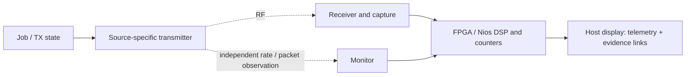

# Wi-Fi 64-QAM OTA telemetry contract

This contract applies to both [native Wi-Fi](NATIVE_WIFI_64QAM_OTA_PLAN.md) and
[custom-IQ](CUSTOM_IQ_64QAM_OTA_PLAN.md) experiments. Emit one run record and
one record per transmitted packet/frame and received capture. Preserve raw
capture bytes and their CRC; telemetry summarizes evidence and does not replace
it. FPGA and Nios produce live DSP results. The host controls jobs, transports
records and displays them; `hostdisplay` is never a receiver stage.

## Record fields

| Field | Meaning and required reporting rule |
|---|---|
| `job` | Run ID, packet/frame ID, sequence, requested count, start/end and deadline. IDs must join TX, monitor, capture and decoder records. |
| `source` | Required tag: `ota-native-wifi64`, `fpga-test-vector`, `saved-ota`, or a separately named custom-IQ backend. Include transmitter/receiver firmware and FPGA SOF identities (version or SHA). Never merge live RF with vectors or saved captures. |
| `rate` | Requested PHY/mode and independently observed `actualLSIG`; include channel width and channel. For native Wi-Fi, monitor-reported PHY rate is separate corroboration. Unknown or conflicting rate remains unknown. |
| `sampleclock` | Requested and measured/qualified RF sample rate, decimation and capture sample count. Identify source of clock evidence; UART receipt time is not RF sample time. |
| `captureCRC` | CRC algorithm/value and byte/sample length for the exact retained raw capture; validity flag. A corrupt or absent capture cannot support DSP BER. |
| `actualLSIG` | Decoded legacy RATE and LENGTH, parity/tail validity and decoder status. Keep separate from requested rate and monitor metadata. |
| `rateMonitor` | Independent monitor's observed rate, packet identity, RSSI if available, and match status. Missing observation is recorded, not inferred from TX configuration. |
| `EVMprepost` | EVM measurement point, reference, units and sample/symbol count; distinguish pre-equalizer from post-equalizer and report unavailable explicitly. EVM is not BER or SNR. |
| `BER` | `preFEC` and `postFEC` error counts **and denominators**, reference stream identity, and compared bit ranges. Pre-FEC denominator counts transmitted coded bits only; exclude punctured bits. Post-FEC denominator counts known payload bits. Include decodable frames even when FCS fails. |
| `PER` | Native packet delivery metric: observed valid matching packets / eligible transmitted packets, with denominator and observation window. Report separately from decoder BER. |
| `acqfails` | Count and reason categories for captures with no acquisition, bad L-SIG/header, unknown identity, or decode failure. Do not assign zero BER to these. |
| `truncation` | Count and reason for captures/frames cut short, plus expected and captured samples/bytes or payload length when known. |
| `drops` | TX failures, missing monitor observations, capture FIFO/transport overruns, duplicate or out-of-sequence IDs, and missing RX packets as separate counts. State each relevant denominator. |
| `TXstate` | `off`, `armed`, `active`, `stopping`, `idle`, `timeout` or `unknown`, with transition times, requested/completed/failed packet counts and stop/idle evidence. A completed command alone does not prove RF-off. |

For native mode, successful packet delivery at the ESP32 monitor estimates
packet-level PER; the native receiver generally reports only packets it decoded.
It cannot reveal bit errors in rejected packets and is not pre-FEC BER. Raw-IQ
BER requires a CRC-qualified capture, FPGA/Nios acquisition and decoding, a
known matching reference, and explicit coded-bit/payload denominators. Keep
unacquired, truncated and missing traffic in their own counters.

The current 256-bit modem is a symbol-input replay engine. It lacks Wi-Fi
puncturing/depuncturing and a direct soft-LLR input path, as well as the frame
capacity for full MAC packets. It cannot be labeled a native Wi-Fi decoder by
feeding it hard symbol decisions or by completing missing stages on the host;
the receiver design must add those capabilities and adequate frame/traceback
capacity.

## Validation checklist

- [ ] Confirm unique job/packet IDs join transmitter, independent monitor, capture and FPGA/Nios output; record source and image identities.
- [ ] Verify configured rate independently using valid L-SIG and, for native mode, matching monitor PHY metadata. Keep disagreements visible.
- [ ] Check sample-clock evidence, capture length and `captureCRC` before accepting DSP results; account for all truncations and capture gaps.
- [ ] Exercise acquisition, bad-header, unknown-ID, FCS-failure, duplicate, missing-packet and transport-overrun cases; ensure they do not become zero-error BER samples.
- [ ] Audit pre-FEC and post-FEC counts against the exact reference and bit ranges. Record denominator, puncturing treatment, and every excluded/unavailable interval.
- [ ] Report native PER and raw-IQ BER in separate fields/plots with their own denominators; do not use monitor packet success as BER evidence.
- [ ] Measure EVM at named pre/post points against a stated reference and count; keep it separate from RSSI, SNR and BER.
- [ ] Verify TX state transitions, bounded job completion, stop behavior and idle evidence; include failed or timed-out TX jobs in drops.
- [ ] Keep FPGA/Nios receiver stages and host display duties explicit. Host may plot measured output but must not supply runtime acquisition, equalization, demapping, FEC, CRC or BER.
