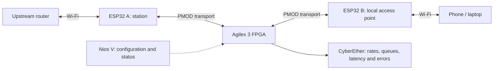

# Two-ESP32 Wi-Fi gateway through Agilex 3

Status: proposed design; not implemented or hardware-qualified.

## Goal

Connect a phone or laptop on a local Wi-Fi network to an upstream Wi-Fi network through two ESP32 radios and the Atum A3 Nano / Agilex 3 FPGA. This is a bidirectional gateway, not a channel-hopping scanner. Each radio stays on its associated/configured channel during normal operation.

The user's additional goal is FPGA processing of raw RX/TX IQ. That is a separate, much larger implementation than forwarding packets between two working Wi-Fi interfaces. Keep that distinction visible throughout the demo.



## Two explicit milestones

| Milestone | Data crossing PMOD | ESP32 responsibility | FPGA responsibility |
|---|---|---|---|
| G1: working packet gateway | Framed network packets | Wi-Fi PHY/MAC, association, link security; routing services initially in firmware | Packet transport, buffering, counters, scheduling and optional classification |
| G2: raw-IQ gateway research | Raw received samples and FPGA-generated transmit samples | RF tuning, capture/playback buffers and hardware control | Wi-Fi PHY, timing-critical MAC functions, packet recovery/generation and appropriate security processing |

G1 is a useful integration baseline. It does **not** meet the final raw-IQ/all-FPGA objective. G2 is a staged research track with hardware feasibility gates; do not describe it as a firmware toggle or as already supported.

## Hardware and current limits

- Candidate radios: two identical ESP32-C5 boards, such as XIAO ESP32-C5, for 2.4/5 GHz experiments. Start on supported 2.4 GHz configurations, then qualify 5 GHz station and SoftAP behavior with the chosen SDK/board.
- USB supplies power/programming; PMOD carries 3.3 V logic and common ground. Leave PMOD power disconnected for the proposed USB-powered setup.
- Use short adapter wiring, explicit board/FPGA pin maps and dedicated UART signals. Check board revision before wiring. No shared RF clock is exposed by these boards.
- Current project firmware and bitfiles target the installed original ESP32 suite. C5 firmware, packet forwarding and raw-IQ transmission are new work.
- The inspected arbitrary-IQ TX implementation supports ESP32-S3/S31, **not a verified C5 TX path**. Qualify C5 playback first, or select a different RF front end before committing to G2.
- Two separate radios permit independent channel choices. A single ESP32 in AP+STA mode shares a radio/channel; it is useful as a software baseline, not equivalent to the proposed two-radio path.

## G1 · Build a working packet gateway first

### 1. Establish Wi-Fi behavior independently

Use Espressif's Wi-Fi router/IoT Bridge examples as references. First prove an upstream connection, a local AP, DHCP/DNS behavior and routed Internet access in a supported baseline configuration.

For the two-radio build, define a concrete private packet-link network interface at each ESP32. Choose where routing/NAT runs after checking supported SDK network-interface hooks; avoid relying on undocumented raw Wi-Fi injection APIs. A practical initial target is routing/NAT on the upstream ESP32, local-client services on the downstream ESP32, and packet forwarding through the FPGA.

Use a distinct local SSID/subnet. Default to an IPv4 routed/NAT gateway. Transparent Ethernet bridging, IPv6 routing and arbitrary multicast discovery are separate requirements, not implied features. Do not nest an existing standalone router example without checking addressing and forwarding ownership.

Acceptance: phone joins the local AP, obtains an address, resolves DNS and reaches an upstream test server; return traffic follows the same FPGA path.

### 2. Define a bounded bidirectional packet transport

Start with independently framed UART links for bring-up. A proposed frame contains version/type, direction, sequence, payload length, payload and CRC. Carry link state and control messages separately from payload. Define maximum packet length, fragmentation/reassembly if needed, credits/backpressure, queue limits and reset/session behavior.

```text
ESP32 A RX packet → framed link → FPGA FIFO → framed link → ESP32 B TX packet
ESP32 A TX packet ← framed link ← FPGA FIFO ← framed link ← ESP32 B RX packet
```

At 2 Mbaud, 8N1 provides at most 200,000 transport bytes/s per direction per UART, before framing and software overhead: 1.6 Mbit/s of byte payload. Do not advertise Wi-Fi-rate throughput. A 1500-byte payload alone occupies 7.5 ms of a UART; store-and-forward over two UARTs adds further serialization delay.

After proving correctness, qualify a faster SPI-slave transport with DMA and ready/credit signaling. Determine supported C5 driver modes, pins, actual clock rate and sustained throughput experimentally. SPI clock is a transport clock, not RF phase synchronization.

### 3. Add FPGA packet blocks in VDS

| Block | Implementation | Evidence |
|---|---|---|
| Two radio link endpoints | UART RTL initially; SPI RTL later | Framing/CRC/sequence errors and throughput |
| RX/TX queues | FIFO/RAM with flow control | Occupancy, overflow and drop counters |
| Packet forwarding | RTL packet streams | Bidirectional payload identity |
| Traffic statistics | Length/type parser, counters and histograms | Packet/byte rates by direction and class |
| Optional scheduler | Per-direction queues and shaping | Configured versus measured rate/latency |
| Nios V control | Register map and JTAG UART | Link configuration, snapshots and logs |

Use explicit packet-stream SOP/EOP/valid/ready interfaces, separate clock domains where needed, complete SDC constraints and deterministic queue reset. Preserve the existing five lessons as separately buildable checkpoints.

### 4. Make the gateway visible

CyberEther shows a bidirectional path diagram, applied band/channel/SSID, link state, payload rates, queue occupancy, drops, CRC errors and round-trip latency. Show counters from the FPGA, not inferred activity animations. Credentials remain private and absent from logs/screenshots.

Demo: connect a phone to the local SSID, run a download, then enable an FPGA rate limit and watch throughput/queue changes. Prefer a controlled traffic test over assuming a video player produces steady traffic.

## G2 · Move the radio processing into FPGA

```mermaid
flowchart LR
    R[ESP32 RX IQ buffer] --> I[Framing / capture RAM]
    I --> S[Detection / timing / CFO correction]
    S --> D[Demodulation / equalization]
    D --> C[Channel decode / descramble / frame CRC]
    C --> M[MAC / association / link security]
    M --> P[Packet routing]
    P --> T[TX MAC / coding / modulation]
    T --> W[Waveform buffer / timed playback]
    W --> E[ESP32 RF TX]
```



Both network sides need receive and transmit capability. Replaying encrypted IQ from one network onto another is not packet routing: the links have distinct associations, addressing, keys, sequence state and acknowledgments. Link encryption must terminate appropriately; application encryption such as HTTPS can remain end to end.

### Feasibility gates before a live gateway

1. **Raw TX:** demonstrate a known waveform from the exact chosen chip, with independent RF measurement of center frequency, sample rate, occupied bandwidth and repeatability. C5 support is currently unverified.
2. **Capture coverage:** measure real capture gaps and buffer turnaround. Sparse snapshots can demonstrate packet reception but miss traffic and cannot establish a reliable gateway.
3. **Transport bandwidth:** CI8 at 16 MS/s is 32 MB/s per RX stream; at 20 MS/s it is 40 MB/s. TX has a similar requirement. The current UART's 0.2 MB/s theoretical byte ceiling cannot carry these continuously. A faster interface must expose a real sustainable radio-to-FPGA sample path; changing only the FPGA link is insufficient.
4. **Timed MAC behavior:** demonstrate deterministic RX completion, response scheduling, carrier sensing and TX start latency. Host-commanded or buffer-upload playback alone does not satisfy Wi-Fi acknowledgment deadlines.
5. **Incremental PHY:** pick one PHY/rate/bandwidth supported by the measured hardware. Validate known packets first, then real RF. Add subsequent modes only after exact reference/simulation checks.
6. **End-to-end Wi-Fi:** association, management/control frames, retransmissions, security and packet routing must work in both directions before calling this an FPGA Wi-Fi gateway.

If these gates cannot be met on ESP32 hardware, retain G1 as the working gateway and use a documented FPGA-facing transceiver for G2. Do not hide gaps by substituting ESP32-decoded packets for raw-IQ processing.

## Validation and deliverables

| Step | Test | Pass condition |
|---|---|---|
| Transport simulation | Random packet sizes, stalls, resets, corrupt frames | Exact payloads; bounded queues; counted/rejected errors |
| FPGA loopback | Synthetic bidirectional traffic without radios | Measured rates and counters agree with sent traffic |
| Wi-Fi integration | Phone/AP association, DHCP, DNS, TCP and UDP | Repeatable bidirectional traffic across both FPGA links |
| Fault recovery | Upstream loss, reboot either radio, link corruption | Recovery without stale sessions or silent payload corruption |
| Performance | Sustained traffic and queue saturation | Published throughput/latency/drop measurements; no unsupported rate claims |
| Raw-IQ experiments | Known vectors, RTL simulation and independent RF checks | Each G2 gate has recorded evidence before advancement |

Deliver a native VDS design, source and constraints, Nios BSP/app generation, board-specific firmware profiles, transport specification, reproducible build/program scripts, focused notebook and CyberEther page. The notebook includes Python theory/reference examples, real RTL/IP simulation and Questa GUI instructions, applied-setting evidence, progress feedback and example screenshots. Python is allowed as a validation reference; identify where any operational computation remains outside FPGA.

Develop tools where Quartus is installed, on host or container, with one acquisition owner. Do not program the board or reflash the installed ESP32s merely to write this plan. Record actual qualification in VALIDATION.md; this plan is not test evidence.

## References

- [Espressif ESP-IoT-Bridge](https://github.com/espressif/esp-iot-bridge): router examples and network-interface reference.
- [ESP32-C5 Wi-Fi API](https://docs.espressif.com/projects/esp-idf/en/latest/esp32c5/api-reference/network/esp_wifi.html): AP/STA modes and shared-channel constraints.
- [ESP-SDR](https://github.com/ESPARGOS/esp-sdr): raw-IQ capture support and snapshot/stream limitations.
- [ESP32 IQ TX](https://github.com/whstudio123/esp32-iq-tx): S3/S31 SRAM waveform playback; not established C5 support.
- [XIAO ESP32-C5](https://wiki.seeedstudio.com/xiao_esp32c5_getting_started/): board wiring and power references.
