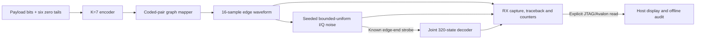

# Standalone SVG graph modem

This is an internal FPGA demo of the five-node pentagram/circle graph modem.
Payload bits select K=7, rate-1/2 convolutional encoder transitions; each coded
pair selects one of four directed graph edges, and the destination vertex is the
complex symbol. Six zero tail bits terminate each frame. Thus there is one
payload bit per emitted symbol before termination, with `payload_bits + 6`
symbols on the wire.

The symbol sequence and the oversampled waveform are separate signals. The
waveform block emits 16 CI16 I/Q samples for each edge, ending exactly at the
destination symbol. Linear mode interpolates each edge. Arc mode uses a
constant-amplitude shortest phase arc for adjacent circle edges; the pentagram star edges
remain linear. FPGA seeded bounded-uniform I/Q noise is added to every waveform
sample with signed CI16 saturation. At each edge's final sample, the joint
320-state node-and-encoder-memory decoder receives an ideal edge-end strobe.
This design does not recover timing from an unknown waveform. Samples are buffered
ready/valid transactions; the sample index describes the waveform, not a
continuous physical DAC clock.



The host writes controls and reads back FPGA-captured vectors, decoded bits,
traceback nodes and counters. Python may independently audit the saved data and
render the viewer; it does not replace the FPGA decoder during a hardware
capture. The page server is read-only and never starts a capture. This standalone
image replaces the active FPGA design while loaded. It does not use RF, ESP32
firmware, or radio controls.

## Avalon register map

The JTAG-to-Avalon master is connected at base address `0x00000000`. Offsets
below are 32-bit word offsets from that base. SystemConsole master commands use
byte addresses, so the host converts a word offset to `4 * offset`; reads use a
count of one and return after the wrapper's fixed one-cycle registered latency.

| Word offset | Register | Meaning |
| ---: | --- | --- |
| 0 | Design ID | `0x53564701` |
| 1 | Control/status | Write `1` to start when idle; read busy bit 0, done bit 1, error bit 2 |
| 2 | Payload count | Set 1–256 bits |
| 3 | Noise amplitude | Set bounded signed I/Q noise amplitude, 0–30000 CI16 units |
| 4 | Seed | Nonzero 32-bit payload/noise seed |
| 5 | Waveform mode | `0` linear, `1` arc |
| 6 | Capture index | Select symbol or waveform sample before reading capture data |
| 7–8 | TX/RX symbols | Packed `{Q[15:0], I[15:0]}` edge endpoints |
| 9–10 | Source/decoded bit | Payload bit at the selected symbol index |
| 11–12 | TX/decoded node | Three-bit node at the selected symbol index |
| 13–14 | TX/RX waveform | Packed `{Q[15:0], I[15:0]}` oversampled waveform |
| 15–16 | Error counters | Nearest-node symbol errors / joint-decoder payload bit errors |
| 17 | Cycle count | FPGA frame processing cycles |
| 18–19 | Vector lengths | Symbol count (`payload + 6`) / waveform sample count (`symbols × 16`) |
| 20–21 | Final path metric | Low 32 bits / high 16 bits of the accumulated integer metric |
| 22–23 | Capabilities | 320 decoder states / 16 samples per edge |

For each data read, write the vector index to word 6 first. Symbol buffers have
262 entries maximum; waveform buffers have 4192 entries maximum.

## Run the demo

Run commands from the repository root beside the installed Quartus/Questa tools.
Generating the ROM and running Questa are offline operations:

```sh
python scripts/make_svg_waveform_rom.py
python scripts/simulate_svg_modem.py --gui
```

The Questa run checks the synthesizable encoder, waveform ROM, noise/capture
wrapper, decoder and counters against independent integer expectations. To
generate and compile the standalone Agilex 3 project:

```sh
python scripts/build_svg_fpga.py
```

The generated Quartus project is
`fpga_hub/iq_bridge/svg_modem/run/build/svg_demo.qpf`. Build does not program the
board. Programming is a separate explicit action and replaces the active FPGA
image:

```sh
python scripts/program_svg_fpga.py
```

After the matching standalone image is loaded, request one bounded internal
frame. This action uses JTAG/Avalon only; it does not transmit or capture RF:

```sh
python scripts/svg_fpga_capture.py capture --noise 6000 \
  --mode arc --output cyberether/run/svg-constellation-result.json
python scripts/start_svg_lab.py serve --host 127.0.0.1 --port 8775
```

The viewer reads the saved result. It does not hold a serial connection; the
capture command releases its JTAG ownership when it exits. Stop other acquisition
owners before programming or capturing. When finished, restore the normal
runtime design and capture application explicitly:

```sh
python scripts/program_wifi64.py fpga
python scripts/program_wifi64.py capture-app
```

## Validation

Questa has passed clean, noisy and severe-noise wrapper cases at amplitudes 0,
6000, 10000 and 30000, including full capture readback. At amplitude 6000 it
reported 47/262 nearest-node symbol errors and 0/256 joint-decoder payload bit
errors. These are internal seeded bounded-uniform noise results, not AWGN SNR,
RF BER. The same amplitude6000 case is now verified on the physical board.
Simulation also checks the one-bit and
256-bit frame limits, stream backpressure, integer metrics, all 25 directed edge
waveforms in both modes, and 4192-sample TX/RX readback.

[Physical qualification](VALIDATION.md) records the matching SOF, positive50MHz
timing, three100,096-bit hardware sweeps, and independent audits of all1173
frame counters/metrics and final-frame full RAM outputs. The build manifest
records the build operation; programming and physical acceptance have separate
run records. Runtime upload of arbitrary SVG graphs and unknown-clock recovery
remain later extensions.
