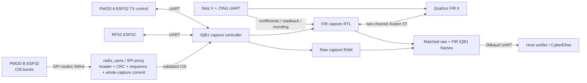

# Checkpoint07 — SPI IQ ingress and FPGA FIR II

Status: the first integrated image passed RTL/vendor-IP simulation and Quartus
but failed hardware acquisition. The ESP32 stayed healthy: the standalone SPI
meter immediately passed without resetting it. A delayed-READY regression now
reproduces the premature-CS fault in that first image; the revised DMA handshake
passes the regression. The revised build and delayed-READY simulations pass; hardware qualification
is pending. The separate SPIQ0001/0002 images have hardware
proof; that evidence does not qualify this integrated image.



Run beside the installed Quartus/Questa tools, with a working graphical DISPLAY
for native VDS generation. The helper checks the display and uses a private
`xvfb-run` display when none is accessible (install Xvfb/xauth if needed):

```sh
python scripts/spi_pipeline.py generate
python scripts/spi_pipeline.py simulate
python scripts/spi_pipeline.py build
# Explicit hardware action; first release any UART/JTAG owner:
python scripts/spi_pipeline.py program
python scripts/check_spi_fir.py --confirm-spi-image --output cyberether/run/spi-fir-synthetic
python scripts/check_spi_fir.py --confirm-spi-image --rf --output cyberether/run/spi-fir-rf
```

The project is `iq_bridge_vds.qpf`; generation/build also exports a complete QPF
package and ZIP under `results/`. `scripts/create_vds.tcl` and
`scripts/connect_vds.tcl` author the actual 13-cell native VDS diagram. The
`radio_uarts` RTL cell exposes connectable `radio_link`, `uart0`, `uart1`, and
`spi` interfaces. SPI master, validator and staging RAM are implemented inside
that cell; the FIR II and Nios V remain separate vendor IP cells.

The frozen combined PMOD B SPI firmware is reused without reflashing. Its SPI
selector must be ON and BOOT OFF. A remains UART, with its selector OFF. Pins
match the tested SPIQ0002 board image; no FPGA output is attached to BOOT/IO0.
RFS2 and A physical UART paths remain present. This image does not identify as
SPIQ0002: the host wire format is the original IQB1 envelope, with source 2's
`SPI?` response providing the integrated proxy identity `00030001`.

Source2 supports only 2447MHz, nominal 16 MS/s, 16380 CI8 samples, through
`CAP16 16380 6`. Unsupported proxy text controls return
`ERR unsupported_spi_control`. The IQB1 controller also enforces this profile:
source 2 rate/frequency reset to 16 MS/s and 2447 MHz, conflicting rate/frequency
commands return immediate kind 5/error 128 and increment command_errors without
changing the settings. A different source 2 arm sample count returns immediate
kind 5/error 32 and increments capture_errors; it does not arm or wait 5 seconds.
UART sources 0/1 retain their general metadata controls.
`SPI_MODE SYNTH` selects a deterministic firmware ramp; `SPI_MODE RF` selects
real receiver data. Requested mode is separate from observed packet flags.
A capture publishes no CI8 until all 32 chunks pass header/payload CRC, source,
version, sequence, offsets, lengths, final flag, padding and whole-capture
validation. RF requests first force a synthetic transaction and then RF,
providing a fresh mode boundary. Partial/stale drains may increment rejects.
SPI ingress remains sparse buffered capture, not continuous sample coverage.

`SPI?` returns 76 ASCII bytes including newline, with seven 32-bit hex fields after
version `00030001`: requested_synthetic, observed_flags, physical_sequence,
commits, rejects, ingress_cycles_low, ingress_cycles_high. Observed flags bit0
means valid and bit1 synthetic. The physical ESP32 sequence is distinct from the
IQB1 job. A complete final commit and forward sequence must be checked after each
capture. An ESP32 reboot needs a new FPGA session because sequence rollback is
rejected. The cycle count covers active SPI ingress at 50 MHz, not RF duration.

The unchanged FIR path supplies IQB1 kind 1 raw and kind 6 filtered frames with the
same source/job/ticks/origin CRC and the applied coefficient/rounding descriptor.
Actual RF exposure is unknown and encoded as 0. Receipt ticks do not synchronize
RF sampling. Host FFT/plotting/reference checks remain host computations;
filtering itself is FIR II in FPGA.

Checkpoint07 additionally accepts bounded radio text lines of 1–255 bytes, with
exact IQB1 payload length/CRC. A 256-byte line is dropped, increments text_drops,
and the next line can recover. Older checkpoint03 hardware still has its 127-byte
limit; updating the host decoder alone does not enlarge it.

Simulation uses the real SPI master and generated vendor FIR II, with no CPU
simulation or hardware access. It tests synthetic/RF selection, corrupt capture
rejection/retry, exact text/control gates, ready timeout, actual UART0/1 loopback
while SPI receives, same-capture IQB1 raw/FIR pairing, and independent Python
integer comparison for custom coefficients. Waveforms and fixture/proof files
are generated under `simulation/spi_pipeline/` and are not tracked.

For the Questa GUI after a successful simulation, change into
`simulation/spi_pipeline/` and run `vsim -do pipeline_gui.do`. It compiles the
same bench/IP, adds only the useful transport/FIR/control signals (no sample RAM
arrays), and runs the complete capture. To inspect the saved waveform without
rerunning, use `vsim -view pipeline.wlf -do view.do`. Zoom to the CS bursts,
`cap_commit`, FIR valid/result pairs, then the matched host frames. This is an
RTL plus actual vendor-IP simulation; the Nios CPU is not simulated.

The four-line status-queue build uses 27,988/45,800 ALMs (61%), 120/353 M20Ks
(34%) and 16/368 Quartus-reported DSP units (4%). The ALM increase is whole-line
status storage and mux/control logic, **not additional RF DSP processing or
throughput**. A RAM-backed byte queue is a future resource optimization; this
revision prioritizes bounded, atomic status delivery and qualification.
The 50 MHz setup slack is +6.296 ns and hold slack +0.035 ns; the generated
5 MHz SPI clock has +88.647 ns setup / +18.283 ns hold. Reported system-clock
Fmax is 72.97 MHz; the design runs at 50 MHz. The unconstrained paths report
contains zero unconstrained clocks, ports or path pairs. These are compile
results and timing budgets, not a higher-clock hardware qualification.

Compilation retains the baseline reset-release IP-count warning despite the
explicit configuration-reset endpoint feeding POR, vendor FIR constant and
memory-initialization width warnings, and I/O drive/slew defaults. The vendor SDM
internal control register also has a check_timing no_clock label. A Quartus
out-of-date information message names the regenerated FIR VHDL; all 164 local
input checksums in the synthesis report were independently audited against the
current files and match, including that VHDL. Evidence is under `run/`.

READY is a DMA reservation, not a radio-alive indicator. The ESP32's post-transfer
ISR can leave the previous HIGH level asserted for several microseconds after
CS rises. The original rapid proxy mistook this for a fresh DMA reservation.
The revised proxy latches READY LOW after packet start, then waits for HIGH
before every subsequent transaction; the initial packet may consume an already
armed HIGH. A missing LOW times out instead of clocking an unarmed slave.
Regression fixtures hold stale HIGH for 4–10 µs, then LOW for 4–6 µs, and assert that
CS cannot start early. The wave viewer includes READY and the low-seen latch.
The frozen failed image/source remains private under `run/failed-fce8-source/`;
parent-owned hardware evidence distinguishes it from the revision.
