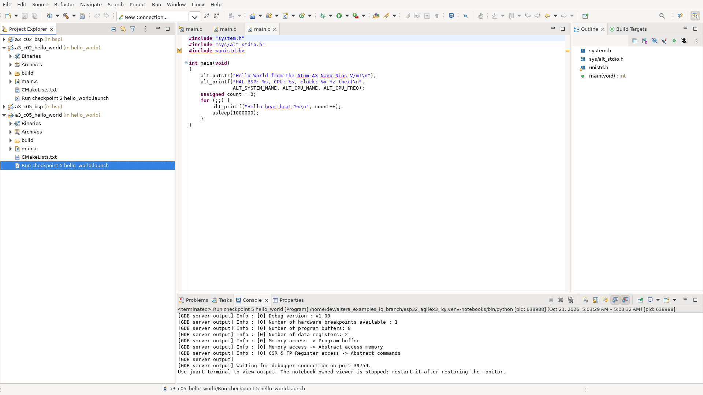

# Nios V software: BSP, Hello World and IQ monitor

The official software IDE is **Ashling RiscFree IDE for Altera FPGAs**, installed with this Quartus toolset. The BSP is generated by `niosv-bsp` directly from the **actual VDS system**, and each application CMake project is generated by `niosv-app`. [Official IDE import instructions](https://docs.altera.com/r/docs/730783/25.3.1/ashling-riscfree-integrated-development-environment-ide-for-altera-fpgas-user-guide/importing-nios-v-processor-project).

## Create and open

Run beside your Quartus/Nios V/RiscFree installation, from the example root:

```bash
# Generate the hardware system first if this is a fresh checkout:
.venv-notebooks/bin/python scripts/build.py 2 --generate-only

# Generate the HAL BSP, create both apps, build both ELFs, open the official IDE:
.venv-notebooks/bin/python scripts/nios_software.py 2 --open

# Or prepare all processor-equipped checkpoints:
.venv-notebooks/bin/python scripts/nios_software.py all
```

The notebook's `lesson.software()` cell performs the same software generation/build. Checkpoint 1 has no CPU. All commands run locally, whether that environment is a host desktop or a container desktop.

| Checkpoint | Hardware project | Generated software |
|---|---|---|
| 2 · Nios monitor | `fpga_hub/iq_bridge/vds_demo_02_nios` | `software/checkpoint_02/` |
| 3 · FIR | `fpga_hub/iq_bridge/vds_demo_03_fir` | `software/checkpoint_03/` |
| 4 · DDC | `fpga_hub/iq_bridge/vds_demo_04_ddc` | `software/checkpoint_04/` |
| 5 · Gain/meters | `fpga_hub/iq_bridge/vds_demo_05_gain` | `software/checkpoint_05/` |

Each generated directory contains:

```text
checkpoint_02/
├── bsp/                    # HAL, drivers, system.h, linker.x, CMakeLists.txt
│   └── settings.bsp        # Open with the VDS BSP Editor
├── hello_world/
│   ├── main.c              # Editable local copy of software/hello_world/main.c
│   ├── CMakeLists.txt      # Official niosv-app output
│   ├── Run checkpoint 2 hello_world.launch
│   └── build/hello_world.elf
├── iq_monitor/
│   ├── main.c              # Editable copy of this checkpoint's sw/main.c
│   ├── fir_control.h       # Where applicable, copied with the monitor source
│   └── build/iq_monitor.elf
└── BUILD_RESULT.json       # Hardware-description and ELF hashes
```

Local app source edits and BSP settings are preserved on repeat generation. `--refresh-sources` explicitly replaces app source/header copies with the repository examples. The generator enforces the **polled JTAG UART driver**: the monitor reads its command FIFO directly, so an interrupt-driven HAL UART driver would consume its commands. Other HAL defaults include 50 MHz CPU timing, the CPU internal timer, JTAG UART stdio and 64 KiB CPU RAM.

Generated BSP vendor files, builds and IDE workspace metadata remain local/ignored; the generator and example sources are checked in. Regenerate these projects on another machine rather than copying an absolute-path CMake build cache.



## Import, edit and build in RiscFree

1. In **File → Import Nios V CMake project**, select `software/checkpoint_02/bsp`. Use a unique name such as `a3_c02_bsp`.
2. Repeat for `software/checkpoint_02/hello_world` and optionally `iq_monitor`. Use `a3_c02_hello_world` / `a3_c02_iq_monitor`. Import each directory individually.
3. In the app's **Properties → Project References**, select its BSP project.
4. Expand the app, open its `main.c`, select the app and press **Ctrl+B** or **Project → Build Project**. Refresh with **F5** if you regenerated files externally.
5. The IDE puts its ELF under `build/Default/`; the CLI build puts it under `build/`. The generated `Run checkpoint … .launch` configuration uses the **IDE** ELF.

The launcher inherits the compiler/Nios tool paths and uses `software/workspace` as the IDE workspace. Override tools with `QUARTUS_ROOTDIR`, `ATUM_ALTERA_ROOT`, `ATUM_RISCV_GCC`, or `ATUM_RISCFREE` (the RiscFree executable). CMake is included in `install_local.sh --system`.

### BSP Editor

Open the matching hardware `.qpf` and VDS system, then choose **VDS → Tools → BSP Editor → Open** and select this checkpoint's `bsp/settings.bsp`. Inspect CPU `cpu`, JTAG UART stdio, timer, driver settings and linker memory mapping. Apply changes and generate the BSP before rebuilding the app. [Official VDS BSP Editor guide](https://docs.altera.com/r/docs/864927/current/visual-designer-studio-user-guide/creating-a-board-support-package-with-bsp-editor).

## Run on the board

Load the **matching checkpoint SOF** first. With a notebook, its existing `lesson.program()` cell does this. From a terminal, stop the notebook-owned viewer with `stop_demo()` before `scripts/run.py load --checkpoint 2`; that loader refuses an occupied acquisition UART. Stop unrelated acquisition owners yourself.

Then either:

- In RiscFree, build the app, choose **Run → External Tools → External Tools Configurations**, select the app's generated **Run checkpoint …** configuration and click **Run**. This uses the official `niosv-download` tool and sends its output to the IDE console. Select the `.launch` file and open External Tools Configurations if it is not listed yet.
- Run the CLI-built application:

```bash
.venv-notebooks/bin/python scripts/nios_download.py 2 hello_world
```

The helper checks the recorded active checkpoint, resolves the cable number by its exact `ATUM_JTAG_CABLE` name, stops this checkout's notebook-owned viewer, and downloads/runs **only the CPU ELF**. It does not replace the SOF or flash the ESP32s. An IDE app can also be selected explicitly with `--ide-build`.

Open another terminal for output:

```bash
export PATH=/opt/altera/quartus/bin:$PATH  # adapt to your installation
juart-terminal -q -c 'Atum A3 Nano [1-4.3-iface0]' -d 1 -i 0
```

Expected output:

```text
Hello World from the Atum A3 Nano Nios V/m!
HAL BSP: iq_bridge_system, CPU: cpu, clock: 2faf080 Hz (hex)
Hello heartbeat 0
Hello heartbeat 1
```

The counter is hexadecimal. Hello World replaces the monitor while it runs, so CyberEther's Nios-controlled FIR/DDC operations need the monitor restored. Close the JTAG terminal, then use either:

```bash
# Run the HAL/IDE version of the monitor:
.venv-notebooks/bin/python scripts/nios_download.py 2 iq_monitor
# Or restore exactly the compact monitor embedded in the original SOF:
.venv-notebooks/bin/python scripts/nios_download.py 2 boot_monitor
```

Restart the focused viewer with `lesson.start_demo(host=HOST)`, or RF Arcade with `Lesson(5).start_demo(host=HOST, demo_night=True)` after using checkpoint 5. Loading the original SOF also restores its original boot monitor. The existing FPGA build still embeds the compact `sw/monitor.hex`; BSP/application generation alone does not change that boot image.

For manual download, first run `openocd-cfg-gen --print /tmp/discover.cfg` to list the downloader's cable/device/CPU indices (the discovery command may exit nonzero after listing). On the tested Quartus 26.1.1 rig the Atum target is **cable 2 / device 0 / CPU 0**, while `juart-terminal` uses **device 1**. Avoid copying a Programmer device index blindly into the downloader.

## Validation

Four BSPs and eight Debug applications build with Quartus/Nios V 26.1.1 tools. The official RiscFree GUI imported checkpoint-2 and checkpoint-5 BSP/Hello World projects and built their ELFs. Its generated External Tools configuration downloaded the IDE-built checkpoint-5 Hello World successfully. On the physical Atum A3 Nano, checkpoint-5 Hello World printed its banner and timed heartbeats; the monitor ELF printed advancing IQMON counters. Hardware tests use the already-built checkpoint-5 FPGA image. See the repository [validation record](../VALIDATION.md).

## Modem checkpoint 06

After `python scripts/modem_fpga.py generate`, run `python scripts/nios_software.py 6` to generate/build its official HAL BSP, Hello World and modem-capable IQ monitor apps. Import the generated `software/checkpoint_06/bsp` and app directories in RiscFree as above. The original `all` shortcut still covers checkpoints 2–5; modem generation is explicit. Only after checkpoint06 is programmed, `python scripts/nios_download.py 6 hello_world` loads Hello World; restore its command monitor with `python scripts/nios_download.py 6 boot_monitor` before modem transactions. These software downloads are explicit hardware operations and are not part of the default notebook Run All.
